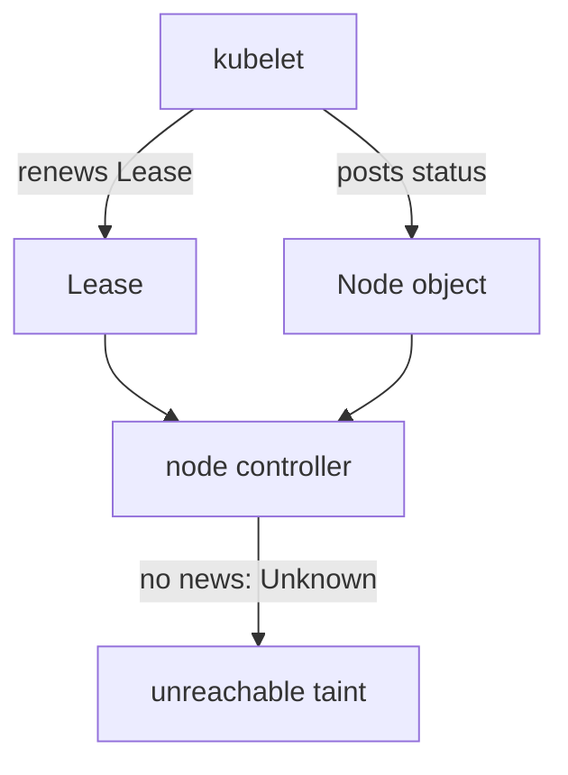

# Diagnosing Node Readiness And Host Dependencies

A node stops reporting readiness while some existing containers continue running. The reporting path and the container execution path can fail separately. A `NotReady` condition is therefore a starting symptom, not one universal diagnosis. This part follows the reporting path from the kubelet to the Node object and shows what each stage looks like when it fails.

## Learning objectives

- Distinguish unready, unschedulable and stale reporting.
- Trace kubelet and runtime dependencies.
- Interpret pressure, trust and connectivity evidence.

## Before you start

A Pod is the Kubernetes unit for running one or more containers, and a namespace groups namespaced objects. A kubeconfig identifies the cluster and credentials used by `kubectl`, the Kubernetes command-line tool. The playground for this module is a `kind` cluster with one control plane node and one worker node. In the playground, the kubelet on the worker node is stopped, so everything below can be observed. The commands in this part only read state, and they do not change the cluster.

## Responsible components and behavior

A Node resource records a machine's identity, capacity and observed conditions in Kubernetes. The kubelet is the node agent: it registers the node, starts containers through the container runtime and reports the node's status to the API server. The node controller, a loop inside `kube-controller-manager`, reads that status and reacts when it stops arriving. A node becoming unready can reflect several host, communication or subsystem failures, so the first question is which of these components stopped.

## Read conditions and timing

The Node object carries a list of conditions: `Ready`, `MemoryPressure`, `DiskPressure` and `PIDPressure`. Each condition has a status of `True`, `False` or `Unknown`, a reason, a message and a last heartbeat time. The kubelet writes these fields. `Ready=False` means that the kubelet reported a failing subsystem. `Ready=Unknown` means that the kubelet reported nothing for longer than the node monitor grace period, which is 50 seconds by default, so the node controller set the value itself.

That difference matters. A fresh report that says `False` points at the node's own subsystems, for example the runtime. A stale report that the controller turned into `Unknown` points at the reporting path: a stopped kubelet, lost credentials or a broken network path to the API server.

<!-- astrona:playground:renew -->

Select the playground kubeconfig and read the node list:

```sh
export KUBECONFIG="$(astrona kubeconfig ats-023-playground-010-01)"
kubectl get nodes -o wide
```

The worker node shows `NotReady` in the `STATUS` column. Print the conditions of the worker node to see which value the controller set:

```sh
kubectl describe node astro-ats-023-playground-010-01-worker
```

In the `Conditions` section, `Ready` has the status `Unknown`, and its message says that the kubelet stopped posting node status. The `Taints` line lists `node.kubernetes.io/unreachable` with the effect `NoExecute` and also `NoSchedule`. The node controller added those taints because the node stopped reporting.

## Leases and heartbeats

The kubelet reports in two ways. It updates the full node status when something changes and at a slow interval. It also renews a small Lease object in the `kube-node-lease` namespace every ten seconds by default. The Lease is cheap to write, so the control plane can tell that the kubelet is alive without receiving the whole status each time.

```sh
kubectl -n kube-node-lease get lease
```

Each node has one Lease with its own name. The `renewTime` field inside shows the last heartbeat. A node whose Lease stopped renewing is a node whose kubelet stopped, lost access to the API server or lost its credentials.



The diagram shows that the kubelet feeds two objects, and the node controller sets `Unknown` and the taint when both go quiet.

## Unschedulable is a different state

A node marked unschedulable is another distinct state. An administrator may deliberately cordon it for maintenance while its existing workloads and kubelet remain healthy. Its `STATUS` column then reads `Ready,SchedulingDisabled`. Treating `SchedulingDisabled` as a synonym for broken can lead to undoing a deliberate maintenance boundary.

Taints can follow node conditions or express an administrative placement rule. A toleration permits a Pod to be placed despite a matching taint but does not guarantee a healthy node and does not force placement. Compare the actual condition, the taint effect and the workload's eligibility before changing labels or tolerations.

## Separate kubelet, runtime and host

The kubelet process needs valid configuration, credentials and access to the API server. If it is stopped or repeatedly failing, the node status turns stale. Because the playground nodes are containers, you can ask the node's own service manager directly:

```sh
podman exec astro-ats-023-playground-010-01-worker systemctl is-active kubelet
```

The command prints `inactive` while the kubelet is stopped. This is evidence from the node itself, and it does not depend on the API server. The kubelet's log, read with `journalctl -u kubelet` in the same way, shows startup and authentication errors that the API side never records.

A healthy kubelet can still fail to talk to the container runtime. The runtime service, its socket and compatible control group settings matter. Restarting the kubelet alone does not repair a missing runtime endpoint or a runtime that cannot prepare containers. Disk space and filesystem health affect image pulls, log writing and local state. Free space on one filesystem does not prove that the filesystem used for images has enough room, so match the pressure to the actual storage path.

## Networking and trust

The node must reach the API server, and the API server must reach the node's kubelet port for logs and `exec`. A network partition can leave containers serving locally while management deteriorates. Distinguish application reachability from node control plane communication.

Certificate validity and trusted names can cause failures despite open ports. An expired client certificate is different from a refused connection, and host time contributes to certificate checks. Turning off trust checks hides the cause and replaces a recoverable fault with an unsafe identity assumption.

## Follow one failure through its layers

Suppose workloads stop being created on `outpost-node`. First decide whether the Node reports a fresh unready condition or has stopped reporting. Then check the kubelet, its runtime connection and the host resources. If the kubelet reports runtime preparation failures, investigate that path before editing an application Service. A repaired process may need a short time to refresh conditions, so connect the repair to current readiness and to a workload observation.

A good diagnosis names the failing responsibility and the evidence that separates it from the layers next to it. Preserve deliberate cordon and security settings unless they are the cause being corrected.

## Common pitfalls

> [!WARNING]
> Unschedulable, unready and stale reporting are different conditions. Do not treat `SchedulingDisabled` as a fault, and do not change workload routing to fix a stopped kubelet. `Ready=Unknown` says that reporting stopped, not why. Confirm the cause on the node itself before you change anything.
