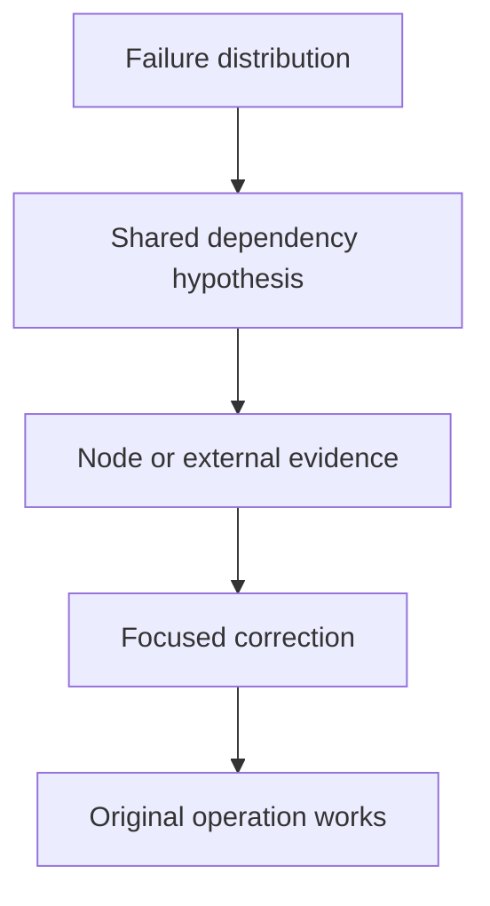

# Node Health And Shared Dependencies

Several unrelated Pods fail only on one worker. Their shared node is a stronger first hypothesis than the same bug in every application. Failure distribution helps you choose the scope of the investigation, and the node, its Pods and its events let you test the hypothesis.

## Learning objectives

- Distinguish unready, unschedulable and stale reporting.
- Trace kubelet and runtime dependencies.
- Interpret pressure, trust and connectivity evidence.

## Before you start

A Pod is the Kubernetes unit for running one or more containers, and a namespace groups namespaced objects. The playground for this module is a `kind` cluster with one control plane node and one worker node whose kubelet is stopped. The `starfleet` namespace has the `probe` Deployment with two replicas and the `shuttle` Pod. The `outpost` namespace has the `drifter` Pod. The commands below only read state.

## Responsible components and behavior

When several unrelated workloads fail on the same node, the pattern suggests a shared dependency and not identical application bugs. The kubelet reports conditions such as readiness and resource pressure, and the control plane uses them to decide how to treat workloads and scheduling on that node. The node's runtime, network path, system resources and its link to the control plane are all part of the picture.

A `NotReady` or `Unknown` condition can result from node or kubelet problems, but the condition alone does not identify the root cause. Existing containers may behave differently from new start attempts, so compare the timing and the kind of operation that failed.

## Using failure distribution to choose scope

If one application fails on every node, inspect its image, configuration and dependencies. If several unrelated applications fail only on one node, inspect that node's runtime, kubelet, network path and resource conditions. If failures cross nodes but share one storage backend, that backend is more relevant than any application's code. This is a hypothesis method, not a certainty: a shared release can affect several applications, and a network outage can affect only some destinations.

<!-- astrona:playground:renew -->

In the playground, list all Pods with the node that each one uses:

```sh
export KUBECONFIG="$(astrona kubeconfig ats-023-playground-010-01)"
kubectl get pods -A -o wide
```

Every Pod of the `starfleet` and `outpost` namespaces sits on the worker node. Their `STATUS` column may still say `Running`, because the node controller has not yet evicted them. The `READY` column and the age of the status tell you more. Filter the Pods of one node with a field selector:

```sh
kubectl get pods -A --field-selector spec.nodeName=astro-ats-023-playground-010-01-worker
```

The command lists exactly the Pods bound to the failing node. When the same node name appears for every failing workload, the node is the common factor. If the failing Pods were spread over several nodes, the node hypothesis would be wrong.

## Eviction and pressure

Memory, disk and process pressure can affect execution and lead to eviction. The kubelet evicts a Pod when a resource falls under its threshold, to protect the node. A controller may request a replacement, but the replacement needs an eligible node, so eviction does not remove the pressure. Eviction by the kubelet is different from eviction by the node controller. When a node stops reporting, the node controller waits for the toleration time of 300 seconds on the `unreachable` taint, and then deletes the Pods so that the controllers can create them elsewhere.

A Pod's memory limit kill is a third event. It is tied to one container boundary: the container exceeds its own limit and the kernel ends it with exit code 137 and the reason `OOMKilled`. The node itself stays healthy. Node-wide memory pressure, in contrast, shows `MemoryPressure=True` on the Node, and it can evict Pods that never exceeded their limits.

Read the pressure conditions and the resource numbers that the scheduler uses:

```sh
kubectl get node astro-ats-023-playground-010-01-worker -o jsonpath='{.status.conditions[*].type}'
kubectl describe node astro-ats-023-playground-010-01-worker
```

The first command prints the condition names. The `describe` output adds the `Capacity`, `Allocatable` and `Allocated resources` sections and the `Events` section at the end. Node events such as `NodeNotReady` come from the node controller and name the node as their object.

## Storage failure stages

A provisioned volume can fail to attach to a node, mount into a Pod or serve operations after it is mounted. These stages involve different components and different evidence. A bound claim proves a storage association, not that every later step has completed. A remote backend outage can affect otherwise `Ready` nodes, a topology mismatch can block access from one zone only, and a local volume depends on the one node that holds the data. Read the claim, the volume and the driver evidence next to the node health, because a `Ready` node does not prove that every external dependency works.

## Choose the smallest correction

Replacing one faulty node can help a node-specific runtime failure. Restarting every workload adds disruption and does not repair an external storage outage or a stopped kubelet. Broad restarts without a supported explanation can also destroy useful evidence. Group symptoms by operation, location and time, pick the one shared component that the group points to, correct it and verify from a representative consumer after the dependency recovers.



The diagram shows that the affected population narrows the scope, while evidence from the specific dependency establishes the cause.

## Worked example

Suppose `probe` has two replicas and `shuttle` and `drifter` run in two namespaces, all on the worker node. Users report that all three stop answering at the same time. The failures share the node, they cross namespaces and they started together. Those three facts point at the node and away from the three applications.

The next evidence is the node's `Ready` condition and its Lease. If both are stale, the kubelet or its link to the API server stopped, and the repair is on the node: start the kubelet, then wait for a fresh `Ready=True`. If the conditions are fresh and healthy but the Pods fail, look at the runtime, the network plugin and the storage path instead. The order matters. Node evidence is cheap to read and covers many workloads at once. Only after the node evidence is clean does it make sense to open one application and read its logs.

Record what you saw before you repair anything. Events expire, and the node's own log is the only place that keeps the first error.

## Common pitfalls

> [!WARNING]
> Node readiness is not a guarantee that every dependency works. A container memory limit kill, node pressure eviction and a storage outage are three different mechanisms. Do not restart all workloads to find out which one applies, because you lose the evidence.
