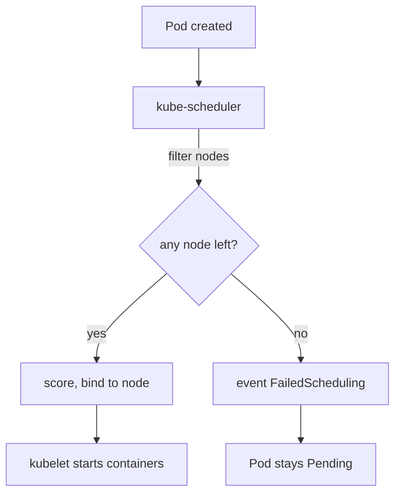

# How The Scheduler Decides

A new Pod has an empty `spec.nodeName` field. The scheduler watches the API server for such Pods and chooses a node for each one. If it finds none, the Pod stays `Pending` and the scheduler writes an event that explains why. Reading that event is the fastest way to find the cause, so this part starts with the mechanism behind it.

## Filtering and scoring

The scheduler works in two steps for every Pod. First it filters: it removes every node that cannot run the Pod. Then it scores the nodes that remain and picks the best one. If the filter step leaves no node, scoring never starts, and the Pod stays `Pending`.

The filter step checks several rules at once. The most common ones are these:

- Resource requests: the node must have enough unreserved CPU and memory for the sum of the container `requests` of the Pod.
- `nodeSelector`: every key and value in the selector must appear as a label on the node.
- Taints: the node must not carry a taint that the Pod does not tolerate.
- Node state: a node marked unschedulable (cordoned) is skipped.

The scheduler assigns a Pod by writing the node name into the Pod through a binding. After that, the kubelet on that node starts the containers. A Pod that never receives a node name has not reached any kubelet, so it has no container logs and no container status. All evidence is on the Pod itself and in its events.



The diagram shows that a Pod stays `Pending` when the filter step removes every node, and that the scheduler records the reason as an event.

## Requests and allocatable capacity

The scheduler does not look at how much CPU or memory a node uses at this moment. It adds up the `requests` of the Pods already placed on the node and compares the total with the node's allocatable capacity. Allocatable is the part of the node's capacity that remains after the kubelet reserves room for the operating system and for its own processes. The Node object shows both values under `status.capacity` and `status.allocatable`.

A Pod that requests more than the whole allocatable amount of every node can never be scheduled, even on an empty cluster. A Deployment with replicas that each request half a node fits only two replicas per node. The third replica stays `Pending` until capacity appears. Limits play no part here: the scheduler uses requests only.

<!-- astrona:playground:renew -->

In the playground, the `shuttle` Deployment in `starfleet` has Pods that stay `Pending`. List the Pods first:

```sh
kubectl -n starfleet get pods -o wide
```

The `STATUS` column shows `Pending` and the `NODE` column shows `<none>` for the Pods that the scheduler could not place. Describe one of them and read the `Events` section at the end of the output:

```sh
kubectl -n starfleet describe pod -l app=shuttle
```

The event has the reason `FailedScheduling` and comes from `default-scheduler`. Its message begins with a count of the nodes, in the form "0/2 nodes are available", and then lists how many nodes each rule removed. For `shuttle` one rule removed the worker node because of `Insufficient cpu`, and the control plane node was removed by its taint. Compare the request with what the worker offers:

```sh
kubectl -n starfleet get deployment shuttle -o jsonpath='{.spec.template.spec.containers[0].resources.requests}'
kubectl get node -l pool=survey -o jsonpath='{.items[0].status.allocatable}'
```

The first command prints the CPU and memory the Pod asks for. The second prints the allocatable values of the worker node. The request is far larger than the allocatable CPU, which explains the event. The fix is to lower the request to what the container needs, not to add nodes or remove the request.

## Node selectors

A `nodeSelector` is a map of labels in the Pod spec. The scheduler only considers nodes whose labels contain every pair in the map. A single wrong character in a value is enough to match no node at all. The `probe` Deployment in the playground asks for `pool: survey-east`, but the worker node has the label `pool=survey`.

```sh
kubectl get nodes --show-labels
kubectl -n starfleet get pods -l app=probe
kubectl -n starfleet get events --field-selector reason=FailedScheduling
```

The first command lists the labels of each node, so you can compare them with the selector. The second shows the `probe` Pods in `Pending`. The third lists only the scheduling failures in the namespace. For `probe` the message says that nodes "didn't match Pod's node affinity/selector".

The correct repair depends on which side is wrong. If the Pod has a typo, edit the Deployment. If the node is missing a label that the team relies on, add the label with `kubectl label node`. Do not remove the `nodeSelector` to make the Pod start, because the selector states where the workload must run.

## Sorting events and checking the repair

Events are short-lived objects, so read them soon after the failure. Sort them by time to see the newest first cause:

```sh
kubectl -n starfleet get events --sort-by=.metadata.creationTimestamp
```

The scheduler retries `Pending` Pods on its own. After you change a Deployment, the Deployment controller creates new Pods from the new template, and the scheduler evaluates them again. Run `kubectl -n starfleet get pods -o wide` and look for a node name in the `NODE` column. A `Running` status with the right node is the proof of the repair.

This part showed how filtering by requests and selectors produces `FailedScheduling`. The next question is what happens when a node refuses Pods on purpose, which is the job of taints.

## Common pitfalls

> [!WARNING]
> Do not read the Pod logs of a `Pending` Pod: it has no container, so the answer is in `kubectl describe pod` and in the events. Do not compare requests with current usage; the scheduler compares them with allocatable capacity. Do not delete a `nodeSelector` to hide a typo, because the selector states where the workload must run.
