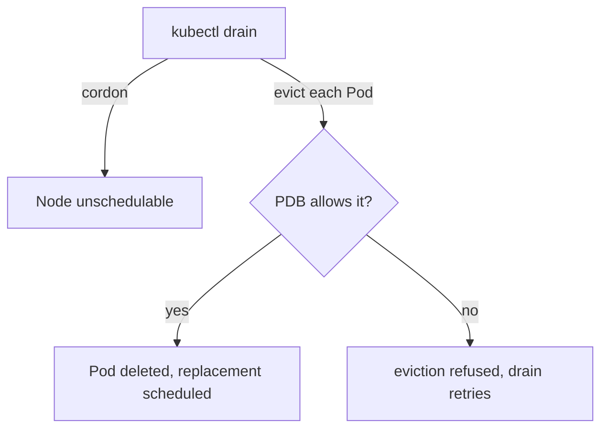

# Cordon, Drain And Disruption Budgets

An administrator must sometimes take a node out of service: to update the operating system, to replace hardware or to change the kubelet configuration. Kubernetes gives three tools for this: cordon, drain and uncordon. A drain can stop and wait forever when a PodDisruptionBudget protects the workload. Knowing which component enforces which rule lets you tell a deliberate block from a fault.

## Cordon, drain and uncordon

Cordon marks a node unschedulable. It sets `spec.unschedulable: true` on the Node, and the node controller adds the taint `node.kubernetes.io/unschedulable` with the effect `NoSchedule`. New Pods avoid the node, and the Pods that already run there keep running. The `kubectl get nodes` output shows `SchedulingDisabled` in the `STATUS` column.

Drain does more. It first cordons the node, then evicts each Pod on it. An eviction asks the API server to delete the Pod gracefully, and the owning controller (for example the ReplicaSet) creates a replacement that the scheduler places on another node. Drain skips Pods owned by a DaemonSet when you pass `--ignore-daemonsets`, because a DaemonSet would recreate them on the same node at once. Pods that use an `emptyDir` volume need `--delete-emptydir-data`, because their local data is lost. Uncordon removes the unschedulable mark so that new Pods can use the node again.

## Pod disruption budgets

A PodDisruptionBudget (PDB) limits how many Pods of one workload may be down because of a voluntary disruption, such as a drain. It has a label selector and either `minAvailable` or `maxUnavailable`. The API server checks the budget when `kubectl drain` sends an eviction request. If removing the Pod would break the budget, the API server answers with an error and the Pod stays. The drain command prints that it cannot evict the Pod because it would violate the disruption budget, and it retries until it succeeds or its timeout ends.

A PDB covers only voluntary disruptions. It does not stop a node crash, an out-of-memory kill or a deletion with `kubectl delete pod`. A budget with `minAvailable: 2` on a Deployment with two replicas allows zero disruptions, so every drain that touches those Pods is blocked.



The diagram shows that the drain command only asks, and the API server decides for each Pod whether the budget allows the eviction.

## Drain the worker and meet the budget

<!-- astrona:playground:renew -->

The playground has a `bridge` Deployment with two replicas and a PodDisruptionBudget. Check the budget:

```sh
kubectl -n starfleet get pdb
kubectl -n starfleet get pods -l app=bridge -o wide
```

The `ALLOWED DISRUPTIONS` column of the PDB shows `0`, because both replicas must stay available. Both Pods run on the worker. Try to drain the worker with a short timeout:

```sh
kubectl drain -l pool=survey --ignore-daemonsets --delete-emptydir-data --timeout=30s
```

The command first cordons the node and evicts the Pods that have no budget. When it reaches the `bridge` Pods, it reports that the eviction would violate the disruption budget and, after 30 seconds, ends with a timeout error. Look at the state it left:

```sh
kubectl get nodes
kubectl -n starfleet get pods -o wide
```

The worker shows `SchedulingDisabled` and is still `Ready`. The `bridge` Pods still run. Pods that were evicted from the worker are now `Pending`, because the only other node is the control plane, which carries a `NoSchedule` taint. This is an expected result in a one-worker cluster, not a bug.

## Resolve a blocked drain

You have three honest ways to continue. Scale the workload up so that the budget allows a disruption, change the budget to match the real requirement, or add capacity so that replacements can start before the old Pods leave. Do not delete the Pods by hand to bypass the budget, because that removes the protection the team asked for. Check the budget with `kubectl -n starfleet get pdb`, then end the maintenance:

```sh
kubectl uncordon -l pool=survey
kubectl get nodes
```

Uncordon removes `SchedulingDisabled`, and the scheduler starts placing the `Pending` Pods again. Pods that were evicted do not move back by themselves; the new Pods are placed wherever the scheduler finds room.

A cordon is an administrator's decision and not a fault. A node that is `Ready,SchedulingDisabled` is healthy. Check who cordoned it and why before you uncordon.

## Why the budget shows zero allowed disruptions

The PDB status holds the numbers that the API server uses for its decision. Four fields matter: `currentHealthy` is the count of Pods that are ready now, `desiredHealthy` is the count that the budget requires, `expectedPods` is the count of Pods that the selector matches and `disruptionsAllowed` is the difference the budget allows. Read them with:

```sh
kubectl -n starfleet get pdb bridge -o jsonpath='{.status}'
```

For `bridge`, `currentHealthy` and `desiredHealthy` are both 2, so `disruptionsAllowed` is 0. If the Pods were not ready, `currentHealthy` would be lower than `desiredHealthy`, and the same budget would also block the drain. A budget can therefore block a drain for two reasons: the budget is strict, or the workload is already unhealthy.

A second case is a PDB whose selector matches no Pod, because of a label typo. Such a budget protects nothing and blocks nothing. Compare the selector with the Pod labels when a budget does not behave as expected.

Eviction and deletion are different API requests. A `kubectl delete pod` request is a direct deletion that no budget can refuse. An eviction goes through the `pods/eviction` subresource, and only that path checks the budget. That is why a drain can be blocked while a manual delete of the same Pod succeeds, and why a manual delete is not a safe workaround.

This part closed the scheduling story: the scheduler filters nodes, taints and tolerations express rules and cordon and drain remove a node from service.

## Common pitfalls

> [!WARNING]
> A drain that hangs is usually a PodDisruptionBudget doing its job, not a hung node. Do not use `--force` or delete Pods by hand to get around a budget without the workload owner's agreement. A cordoned node stays cordoned after the maintenance until someone runs `kubectl uncordon`. Evicted Pods are not moved back when you uncordon.
