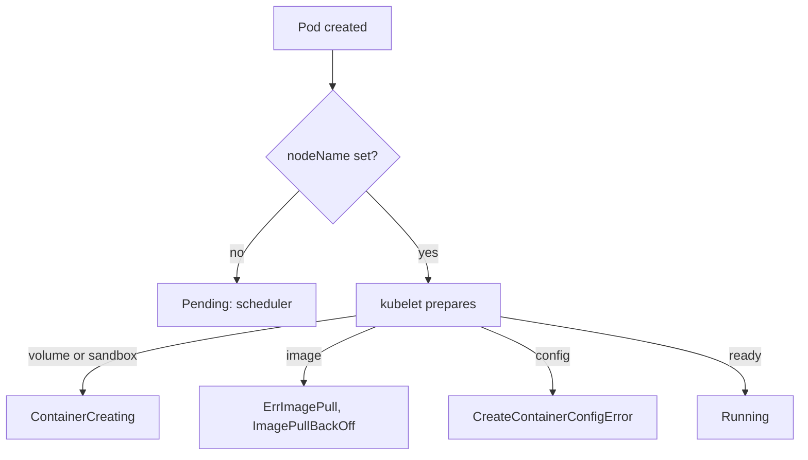

# Reading Pod State And Events

A failing Pod usually shows only one word in the `STATUS` column of `kubectl get pods`. That word is a summary that `kubectl` builds from several fields, so it is a hint, not a diagnosis. This part explains where the word comes from and shows the order in which to read the evidence: the Pod phase, the container states and the events.

## Phase and container state

A Pod has a `status.phase` field with five possible values: `Pending`, `Running`, `Succeeded`, `Failed` and `Unknown`. The phase is a coarse summary of the Pod's life. `Pending` means that the API server accepted the Pod but one or more containers are not running yet. `Running` means that the Pod is bound to a node and at least one container runs or is starting.

Each container has its own state in `status.containerStatuses`. The state is one of `Waiting`, `Running` or `Terminated`, and it carries a `reason`. `Waiting` with the reason `ImagePullBackOff` or `CreateContainerConfigError` is the cause behind many `Pending` or `Running` Pods that do not work. The state also has a `lastState` field that keeps the previous termination, for example `OOMKilled` with exit code 137.

The `STATUS` column of `kubectl get pods` shows the most specific word it can find: the container's waiting or terminated reason, or the phase if there is nothing more specific. Words like `ContainerCreating`, `CrashLoopBackOff` and `Evicted` come from that logic. They are not phases.

A Pod can be `Running` and still not work. The phase says only that a container runs. The `Ready` condition says whether the readiness probe, if there is one, passes. A Service sends traffic only to Pods that are `Ready`, so check the condition as well as the phase.

## Pending and ContainerCreating

Two states look similar and have different owners. A Pod that is `Pending` with no node name has not been scheduled: the scheduler is the component to ask, and the event reason is `FailedScheduling`. A Pod that shows `ContainerCreating` has a node, and the kubelet on that node is preparing the sandbox, pulling the image or mounting volumes. The next evidence is then an event from the kubelet, such as `FailedMount`.



The diagram shows that the node name splits the problem: before it is set the scheduler is responsible, after it is set the kubelet is.

## Read the evidence in order

<!-- astrona:playground:renew -->

Start with a list of all Pods in the playground, with the node name:

```sh
kubectl get pods -A -o wide
```

The `STATUS` column shows one healthy Pod and several words that are not `Running`. Look at the `NODE` column: every non-running Pod here has a node, so the scheduler did its work and the kubelet is the component that reports the problem. Pick the `shuttle` Pod and read its full description:

```sh
kubectl -n starfleet describe pod -l app=shuttle
```

Read the output from the bottom. The `Events` section lists the newest messages from `Scheduled`, `Pulled`, `Failed` and similar reasons, each with the component in the `From` column. Above it, the `Containers` section shows the state, the reason, the last state and the restart count for each container. The `Conditions` section shows `PodScheduled`, `Initialized`, `ContainersReady` and `Ready`, and tells you which stage is false.

You can read the same fields as structured data when you need an exact value:

```sh
kubectl -n starfleet get pod -l app=shuttle -o jsonpath='{.items[0].status.containerStatuses[0].state}'
```

The command prints the state object of the first container as JSON, including the `reason` and the `message`.

## The event stream

An event is a small API object that a controller or the kubelet creates to report something that happened to another object. Events have a type (`Normal` or `Warning`), a reason, a message and the object they describe. The API server keeps events for a short time, about one hour by default, so read them soon after the failure.

List the events of the namespace, sorted by time:

```sh
kubectl -n starfleet get events --sort-by=.metadata.creationTimestamp
```

Without `--sort-by`, the list has no useful order. With it, the newest events come last, so the end of the list shows what happened most recently. To narrow the list, filter by reason or by object:

```sh
kubectl -n starfleet get events --field-selector type=Warning
kubectl -n starfleet get events --field-selector involvedObject.name=probe
```

The first command shows only warnings. The second shows the events of the object with the given name. Repeated failures update the same event and increase its count, so one line can stand for many attempts.

## Logs only exist after a start

Container logs come from the container runtime on the node. A container that never started has no log, and `kubectl logs` returns an error that the container is waiting to start. For a container that started and then crashed, `kubectl logs --previous` prints the log of the earlier run. Use logs for application errors and events for platform errors. Choosing the wrong source is the most common reason a diagnosis stalls.

Now you can read the Pod status, the container state and the events. The next part uses them on the two failures that stop a container before it runs.

## Common pitfalls

> [!WARNING]
> The `STATUS` column is a summary, not a field you can rely on in a script. Do not run `kubectl logs` on a container that never started, because there is nothing to read. Events expire after about an hour, and an unsorted event list hides the newest message. Do not restart Pods before you have saved the events.
