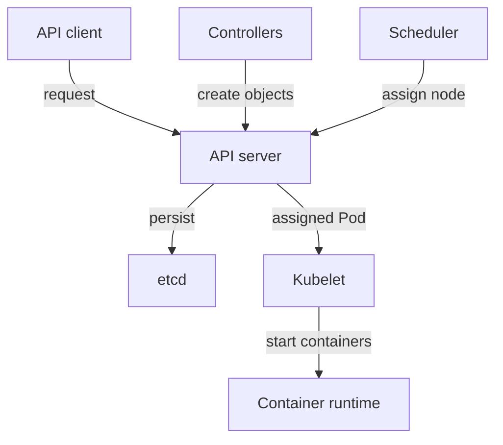
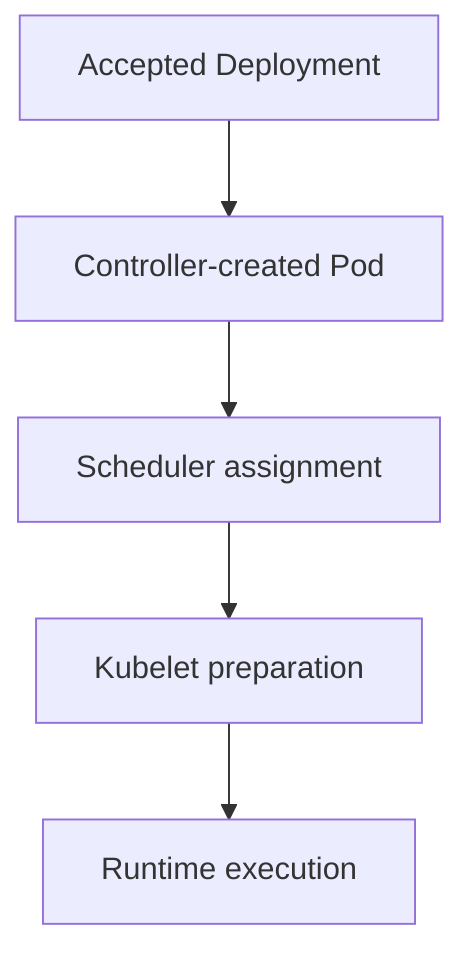

# Control Plane And Worker Responsibilities

A Deployment is accepted, but its new Pods never receive a node assignment. The request was stored, so the API server and etcd did their work. Something later in the chain did not. Naming each component and the exact job it does turns "the cluster is broken" into a question you can answer with one command.

## Learning objectives

- Identify API, controller, scheduler and datastore responsibilities.
- Trace the first failed workload transition.
- Use local static-Pod evidence when API access fails.

## Before you start

A Pod is the smallest deployable Kubernetes unit and runs one or more containers. A namespace groups namespaced objects. A cluster is the set of machines and components that work together. The playground for this module is a kind cluster: each cluster node is a container on your machine, with one control-plane node and one worker node. The example workloads are `probe` and `shuttle` in the namespace `starfleet`, and `drifter` in the namespace `outpost`.

## Responsible components and behavior

A team declares that the `probe` application needs two running copies. Kubernetes does not start two processes inside the application programming interface (API) server. It stores the request, creates workload objects, chooses nodes and asks node software to run containers. Each step belongs to one component.

The control plane manages the cluster. The API server (`kube-apiserver`) receives resource requests, checks them and exposes the cluster API. The etcd datastore persists cluster configuration and object state. The controller manager (`kube-controller-manager`) runs controllers. A controller is a loop that watches resources and acts when the observed state differs from the requested state. The scheduler (`kube-scheduler`) selects a node for a Pod that has none.

A worker node provides resources for workloads. Its kubelet is the agent that makes assigned Pods run and reports their status. The container runtime starts and stops containers on the node. Networking components implement communication between Pods and Services. A Service gives clients a stable address for a changing group of backends. Many clusters use `kube-proxy`, a DaemonSet (one Pod per node), to program Service forwarding rules on each node.



The API server sits between every component: etcd stores state, and the kubelet runs containers only for Pods the API server shows as assigned to its node.

## Seeing the components in the playground

The control-plane components in a kubeadm-style cluster run as Pods in the `kube-system` namespace. List them together with the node each one runs on:

<!-- astrona:playground:renew -->

```sh
export KUBECONFIG="$(astrona kubeconfig ats-023-playground-020-01)"
kubectl -n kube-system get pods -o wide
```

You should see one Pod each for the API server, etcd, the controller manager and the scheduler, all on the control-plane node, plus `kube-proxy` Pods on both nodes and the DNS Pods. The names of the control-plane Pods end with the node name. That suffix is a hint that these are not ordinary Pods, which later parts explain.

Now look at the example workloads and where they run:

```sh
kubectl -n starfleet get pods -o wide
```

The `probe` Pods and the `shuttle` Pod run on the worker node. The control-plane node carries a taint, so ordinary workloads do not land there. A taint is a node setting that keeps Pods away unless they tolerate it.

## Following a Deployment request

Assume a client submits a Deployment whose Pod template names an available image and asks for two replicas. The API server authenticates the client, checks authorization and applies admission checks. It stores the accepted Deployment in etcd. At this point no application process needs to exist; only the desired configuration is accepted.

The Deployment controller, which runs inside the controller manager, observes that object and creates a ReplicaSet. The ReplicaSet controller then creates the missing Pod objects through the API. These are separate controller actions, which is why several related objects appear from one declaration. Controllers use the API; they never write directly into etcd.

The scheduler notices each Pod whose `spec.nodeName` field is empty. It checks resource requests and placement rules, then writes the chosen node name into the Pod through the API. The kubelet on that node sees the assignment and prepares the Pod: it asks the runtime to pull the image, sets up the Pod network and mounts volumes.

The kubelet reports container and Pod status back through the API. Controllers use that status to decide whether more work is needed. A readiness probe can then mark a replica eligible for Service traffic. The sequence turns accepted intent into usable capacity through several steps that fail independently.

You can see the chain of ownership on a real object. Print the owner of one `probe` Pod and the node field:

```sh
kubectl -n starfleet get pods -l app=probe -o custom-columns=NAME:.metadata.name,OWNER:.metadata.ownerReferences[0].kind,NODE:.spec.nodeName
```

The owner column shows `ReplicaSet`, which proves the controller manager created the Pod. The node column is filled, which proves the scheduler assigned it. An empty node column on a Pod would point at the scheduler, and a missing Pod would point at the controllers.

## Three interruptions compared

If API access is unavailable, a new request cannot be accepted through the normal path. If the scheduler is unavailable, an accepted Pod waits without an assignment. If the controller manager is unavailable, a Deployment exists but no new ReplicaSet or Pods appear. If one node's runtime is unavailable, its assigned Pods fail to start while Pods on another node continue.

These are different failure boundaries, so the evidence should identify the last completed step. Existing containers keep running through a control-plane interruption, because the kubelet and runtime do not need the scheduler or the controllers to keep a running container alive. Continued execution is not evidence that new requests, replacement or scheduling work.

## Work through the decision

If controller child objects are absent, the investigation starts earlier than a node-startup failure. If Pods exist without assignments, compare scheduler operation with their placement requirements. If assignment exists but startup fails, inspect the node's preparation dependencies, such as the image, the network and volumes.



Each successful transition establishes one responsibility without proving that the next component can complete its work.

The reader now knows which component owns each transition and which field or object proves it. The open question is how to find a failed component when the usual API commands do not answer, which the next lesson takes up.

## Common pitfalls

> [!WARNING]
> The scheduler chooses a node; the kubelet and runtime execute containers. Do not assign both jobs to the API server or to etcd. A Pod that is still running is not proof that the control plane is healthy.
