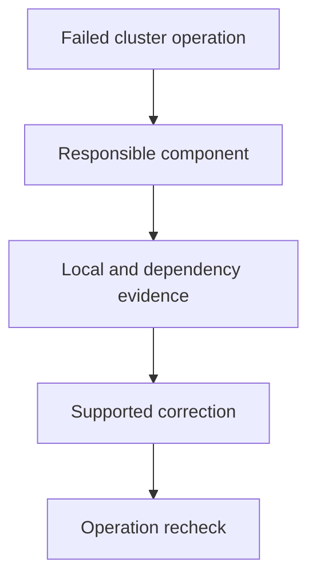

# Locating A Control-Plane Component Failure

The API listener answers, but an ordinary operation fails. Network reachability and useful operation are different health observations. This lesson shows how to find the component that stopped by asking which operation stopped, and how to read local evidence on the node when the API cannot help.

## Learning objectives

- Identify API, controller, scheduler and datastore responsibilities.
- Trace the first failed workload transition.
- Use local static-Pod evidence when API access fails.
- Distinguish component startup from useful dependent operations.

## Before you start

The playground has one control-plane node and one worker node. Each node is a container named after the environment, so the control-plane node is the container `astro-ats-023-playground-020-01-control-plane`. Commands run on a node with `podman exec` against that container only.

## Identify which operation stopped

Control-plane components maintain cluster state and coordinate work. A failure in one responsibility produces different symptoms from a failure in another, even when users describe both as a broken cluster. Start from the operation that did not happen.

If requests cannot reach the API server, examine the endpoint and the API server process. If requests reach it but datastore-backed operations fail, examine the API server's etcd connection and its credentials. A responding port does not prove that ordinary resource operations succeed.

If objects can be created but eligible Pods stay without a node, examine the scheduler and the placement rules. Some Pending Pods reflect valid reasons, such as too little capacity, so an unassigned Pod alone does not prove the scheduler failed. If a Deployment exists but its ReplicaSet or Pods are never created, examine the controller manager. A controller can be running while one reconciliation keeps failing, so status, events and logs separate that case from a full outage.

The API server offers health endpoints that name the failing check. Ask for the readiness report with the check names:

<!-- astrona:playground:renew -->

```sh
export KUBECONFIG="$(astrona kubeconfig ats-023-playground-020-01)"
kubectl get --raw='/readyz?verbose'
```

Each line starts with `[+]` for a passing check or `[-]` for a failing one, followed by the check name, such as `etcd`. The last line reports the overall result. A failing check is listed by name, which shows the API server's own dependencies at a glance.

## Static Pods and local evidence

In a kubeadm-style control plane, the kubelet runs the core components from manifest files on the node. A static Pod is a Pod that the kubelet starts from a local file instead of from the API. The kubelet reads the directory named by `staticPodPath` in its configuration, which is `/etc/kubernetes/manifests` in this cluster, and rescans it on a fixed interval.

For each static Pod the kubelet creates a mirror Pod in the API, so `kubectl` can show it. The mirror name is the Pod name plus the node name. Deleting the mirror Pod does not remove the static Pod, because the file is the source of truth. List the files on the control-plane node:

```sh
podman exec astro-ats-023-playground-020-01-control-plane ls /etc/kubernetes/manifests
```

You should see one file each for the API server, etcd, the controller manager and the scheduler.

The kubelet processes every file in that directory that does not start with a dot. A backup copy placed there can define a second Pod with the same name and change what runs. Keep backups in another directory.

## Reading the runtime when the API is unavailable

When the API server is down, `kubectl` fails, but the container runtime on the node still works. `crictl` is a command-line client for the container runtime. It lists containers, including ones that exited, and prints their logs. Run it inside the node container:

```sh
podman exec astro-ats-023-playground-020-01-control-plane crictl ps -a
```

The STATE column shows `Running` or `Exited`, and the ATTEMPT column counts restarts. A component whose attempt number grows is crashing and being restarted by the kubelet. Read the last lines of its log by container identifier:

```sh
podman exec astro-ats-023-playground-020-01-control-plane crictl logs --tail=20 <CONTAINER_ID>
```

Replace `<CONTAINER_ID>` with the first column of the `crictl ps -a` line for the failing component. A malformed flag, a missing file or an unreadable certificate usually prints one clear line at the top of the log, before the process exits.

## Dependencies and authority

Schedulers and controllers need API access and permission to use it. Credentials can exist but lack permission, and a reachable endpoint can reject an operation. Authentication, authorization and transport errors therefore need separate interpretation.

Etcd health depends on member connectivity, disk speed and quorum. Changing scheduler settings cannot repair a datastore that cannot commit updates. Certificates connect a component's identity to the endpoint it trusts. The names and the trust chain must match the connection, and an expired certificate breaks a configuration that worked yesterday. Treat a certificate error as a specific trust problem, not as a reason to raise a timeout.

## Compare failure scope

A single affected workload can have its own invalid request or dependency. Many unrelated workloads failing to progress can point at a shared API, datastore or controller problem. Scope is evidence, not a rule: a shared quota or a broad admission policy can also affect many workloads without any component crashing.



Diagnosis follows the failed responsibility and its dependencies, and it ends by repeating the operation that failed.

After restoring a component, check what it does, not only that its process exists. For the controller manager, change a Deployment and see a new ReplicaSet roll out. For the scheduler, create a Pod and see a node assigned. A running process that does not do its job is still a failure.

The reader can now choose a component from a symptom and read the node when the API is silent. The next step is to apply that to the controller manager in the guided exercise.

## Common pitfalls

> [!WARNING]
> A healthy process or open port does not prove the component's dependent operations work. Trace API acceptance, reconciliation, placement and preparation independently, and use `crictl` on the node when API inspection is unavailable. Never leave backup files in the static Pod directory.
