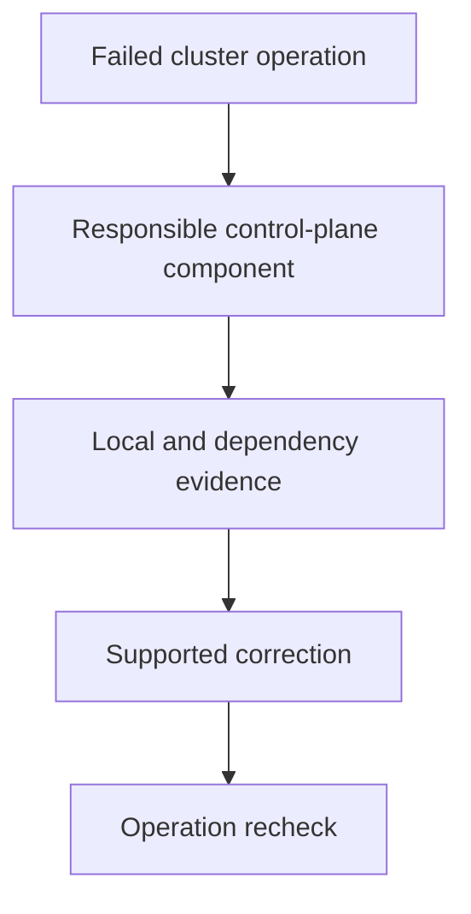

# Locating A Control-Plane Component Failure

The API listener answers, but ordinary resource operations fail because its datastore is unavailable. Network reachability and useful API operation are different health observations.

## Learning objectives

- Identify API, controller, scheduler and datastore responsibilities.
- Trace the first failed workload transition.
- Use local static-Pod evidence when API access fails.

## Before you start

This chapter is standalone reading material; no running cluster or installed tools are required. A Pod is the Kubernetes unit for running one or more containers, and a namespace groups namespaced objects. Treat the worked configurations as teaching examples rather than recorded observations from a provisioned environment.

## Responsible components and behavior

Control-plane components maintain cluster state and coordinate work. The API server handles supported requests, the scheduler chooses nodes for unscheduled Pods, controllers reconcile desired objects and etcd stores cluster state. A failure in one responsibility can produce different symptoms from a failure in another, even when users describe both as a broken cluster.

## Identify Which Operation Stopped

If API requests cannot reach a listener, examine the endpoint and API server process path. If requests reach it but datastore-backed operations fail, examine the API server's datastore dependency and relevant credentials. A responding network port is not proof that ordinary resource operations can succeed.

If objects can be created but eligible Pods remain without node assignment, scheduler state and placement constraints become relevant. Some Pending Pods instead reflect valid insufficient capacity or unmet affinity. The mere existence of unassigned Pods does not prove that the scheduler process failed.

If a Deployment object exists but its expected child ReplicaSet or Pods are not created, controller reconciliation and permissions deserve examination. A controller can be running while one reconciliation repeatedly fails. Status, events and controller records can distinguish that condition from a complete process outage.

## Static Pods And Local Evidence

In a common kubeadm control-plane arrangement, the kubelet manages core component static Pods from local manifests. Mirror Pods can make those workloads visible through the API, but their underlying lifecycle source remains local. Deleting a visible mirror object does not universally remove the local static-Pod definition.

When the API server is unavailable, API-dependent client inspection can fail. Host-level runtime and kubelet evidence then provide another view of component startup. A missing manifest mount, invalid flag or unreadable certificate can prevent startup before the usual cluster inspection path works.

Manifest changes can trigger the kubelet to reconcile the local component. A malformed change can remove management availability, so correction must be tied to the actual configuration contract. A backup file placed where the kubelet treats it as another manifest can also have unintended effects. Understand the watched location rather than scattering copies there.

## Dependencies And Authority

Schedulers and controllers need usable API access and relevant authorization. Credentials can exist but lack permission, and a reachable endpoint can reject an operation. Authentication, authorization and transport evidence therefore need separate interpretation.

Etcd health depends on member connectivity, storage performance and quorum. A datastore disk bottleneck can affect management even while ordinary application containers seem responsive. Changing scheduler policy cannot repair a datastore that cannot commit updates.

Certificates connect component identity to trusted endpoints. The names and trust chain must fit the configured connection, and expiration can make a previously working configuration fail. Treat a certificate error as a specific trust or identity contract to investigate, rather than assume a larger timeout resolves it.

## Compare Failure Scope

A single affected workload can have its own invalid request or dependency. Many unrelated controllers failing to progress can indicate a shared API or datastore problem. Scope is evidence, not an absolute rule: broad admission policies or a shared exhausted quota can also affect many workloads without a component crash.

For a new Deployment that produces no running Pods, trace accepted Deployment state, child-resource creation, node assignment and container preparation. The first demonstrated missing transition identifies the most relevant responsibility. This prevents confusing controller creation failure with later image retrieval failure.

After restoring a component, check the operations it performs, not only its process existence. API requests, new scheduling decisions and resumed reconciliation contribute different verification. A working control plane should advance the intended state under the remaining capacity and policy constraints.

## Work through the decision

Start with the operation that stopped: reaching the endpoint, persisting an object, creating controller children or assigning a node. Each points to a different component and dependency. A healthy TCP connection cannot establish datastore access or request authorization.

In a common kubeadm arrangement, local static-Pod manifests define core component execution through the kubelet. Mirror objects expose those Pods through the API without becoming the authoritative local lifecycle source. During API failure, local runtime and agent evidence can remain available. Preserve that distinction before deleting a visible object or assuming an API-only observation describes the complete host state.

Control-plane diagnosis follows the failed responsibility and its dependencies rather than treating every API symptom as one outage.

Control-plane diagnosis follows the failed responsibility and its dependencies rather than treating every API symptom as one outage.

## Common pitfalls

> [!WARNING]
> A healthy process or open port does not prove the component's dependent operations work. Trace API acceptance, reconciliation, placement and preparation independently, using local evidence when API inspection is unavailable.
