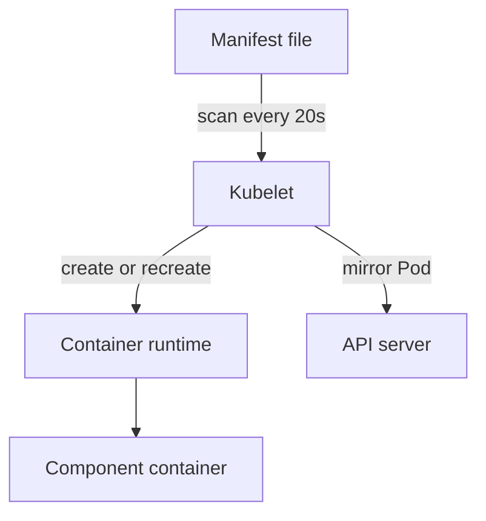

# Static Pod Manifests And The Kubelet

The API server and etcd are the two components that every `kubectl` command depends on, yet neither is managed through the API. They start from files on the control-plane node. When one of those files is wrong, `kubectl` stops working, and the only way back is to read and fix the file on the node. This lesson explains how that file-based startup works and how to inspect it safely.

## Learning objectives

- Explain how the kubelet starts static Pods from `/etc/kubernetes/manifests`.
- Find the manifest, the container and the log of a control-plane component on the node.
- Change a manifest in a way the kubelet applies safely.

## Before you start

The playground is a kind cluster. Each node is a container, so you reach a node with `podman exec` against its container name. The control-plane node is `astro-ats-023-playground-020-02-control-plane`. A kubelet is the agent on each node that starts Pods. A container runtime (containerd in kind) runs the containers, and `crictl` is its command-line client.

## Why control-plane components are static Pods

A normal Pod exists as an object in etcd, created through the API server. That cannot work for the API server itself, because nothing could start it. A static Pod solves this. It is a Pod that the kubelet starts from a manifest file on its own node, with no API server needed.

The kubelet reads the directory named by the `staticPodPath` field of its configuration file. In a kubeadm-style cluster, the configuration file is `/var/lib/kubelet/config.yaml` and the directory is `/etc/kubernetes/manifests`. Look at both on the control-plane node:

<!-- astrona:playground:renew -->

```sh
export KUBECONFIG="$(astrona kubeconfig ats-023-playground-020-02)"
NODE=astro-ats-023-playground-020-02-control-plane
podman exec $NODE grep staticPodPath /var/lib/kubelet/config.yaml
podman exec $NODE ls /etc/kubernetes/manifests
```

The first command prints the `staticPodPath` line. The second lists four files: `etcd.yaml`, `kube-apiserver.yaml`, `kube-controller-manager.yaml` and `kube-scheduler.yaml`.

## What the kubelet does with a manifest

The kubelet scans that directory on a fixed interval, 20 seconds by default (the `fileCheckFrequency` setting). It creates a Pod for each new file, recreates the Pod when the content of a file changes, and removes the Pod when the file disappears. It reads every file that does not start with a dot, whatever its extension.



The file is the source of truth; the API only shows a read-only copy of the Pod.

That copy is the mirror Pod. Its name is the Pod name plus the node name, such as `kube-apiserver-astro-ats-023-playground-020-02-control-plane`. Deleting the mirror Pod with `kubectl delete pod` does not stop the component, because the kubelet creates it again from the file. When the API server is down, there is no mirror Pod to see at all, and the node is the only place to look.

## Finding the container and its log

The runtime knows every container, including ones that crashed. List them on the node:

```sh
podman exec $NODE crictl ps
```

You should see running containers named `kube-apiserver`, `etcd`, `kube-controller-manager` and `kube-scheduler`. Add `-a` to include exited containers; a crashing component shows several lines with the same name and a growing ATTEMPT number. Print the end of one log with its container identifier from the first column:

```sh
podman exec $NODE crictl logs --tail=10 <CONTAINER_ID>
```

When a component crashes at start, the first lines of its log usually name the problem: an unknown flag, a missing certificate file or a connection that was refused. Read that line before you change anything.

## Changing a manifest safely

Because the kubelet reads every non-dot file in the directory, never keep a backup next to the manifests. A file named `kube-apiserver.yaml.bak` is read as another Pod definition. Keep the working copy and the backup in `/etc/kubernetes` and move the final file into place in one step.

A `mv` inside one file system replaces a file in one step, so the kubelet never sees half a file. A text editor that writes in place can be caught half way by a scan. This staging pattern copies the manifest out, edits the copy and moves it back:

```sh
podman exec $NODE cp /etc/kubernetes/manifests/kube-scheduler.yaml /etc/kubernetes/kube-scheduler.yaml.backup
podman exec $NODE cp /etc/kubernetes/manifests/kube-scheduler.yaml /etc/kubernetes/kube-scheduler.yaml.new
```

Edit `/etc/kubernetes/kube-scheduler.yaml.new` with `sed` or an editor on the node, then run `podman exec $NODE mv /etc/kubernetes/kube-scheduler.yaml.new /etc/kubernetes/manifests/kube-scheduler.yaml`. In this playground you only stage the copies; do not move a changed file back. Remove the copies when you are done:

```sh
podman exec $NODE rm /etc/kubernetes/kube-scheduler.yaml.backup /etc/kubernetes/kube-scheduler.yaml.new
```

The next change to a real manifest takes up to one scan interval to start, plus the time the component needs to become ready. Wait for that before you decide the fix failed.

## What a broken manifest looks like

Three failures happen at this layer. A YAML syntax error stops the kubelet from reading the file, so the Pod is not created or changed. A bad flag value starts the container, which then exits at once; the kubelet restarts it with a growing delay, and `crictl ps -a` shows several exited attempts. A wrong path or a missing file mounted into the container fails the same way, with a log line that names the path.

In all three cases `kubectl` may keep working or may stop, depending on which component broke. The kubelet log on the node, read with `journalctl -u kubelet`, shows manifest read errors. The container log shows startup errors.

The reader can now find a control-plane component on the node, read its log and replace its manifest safely. The next lesson looks inside the API server manifest, to see which flags decide whether `kubectl` works.

## Common pitfalls

> [!WARNING]
> Do not delete the mirror Pod to restart a component; the kubelet recreates it from the file. Do not leave `.bak` or `.orig` files in `/etc/kubernetes/manifests`. Do not edit a manifest in place with a tool that writes slowly, and do not conclude that a fix failed before one scan interval has passed.
