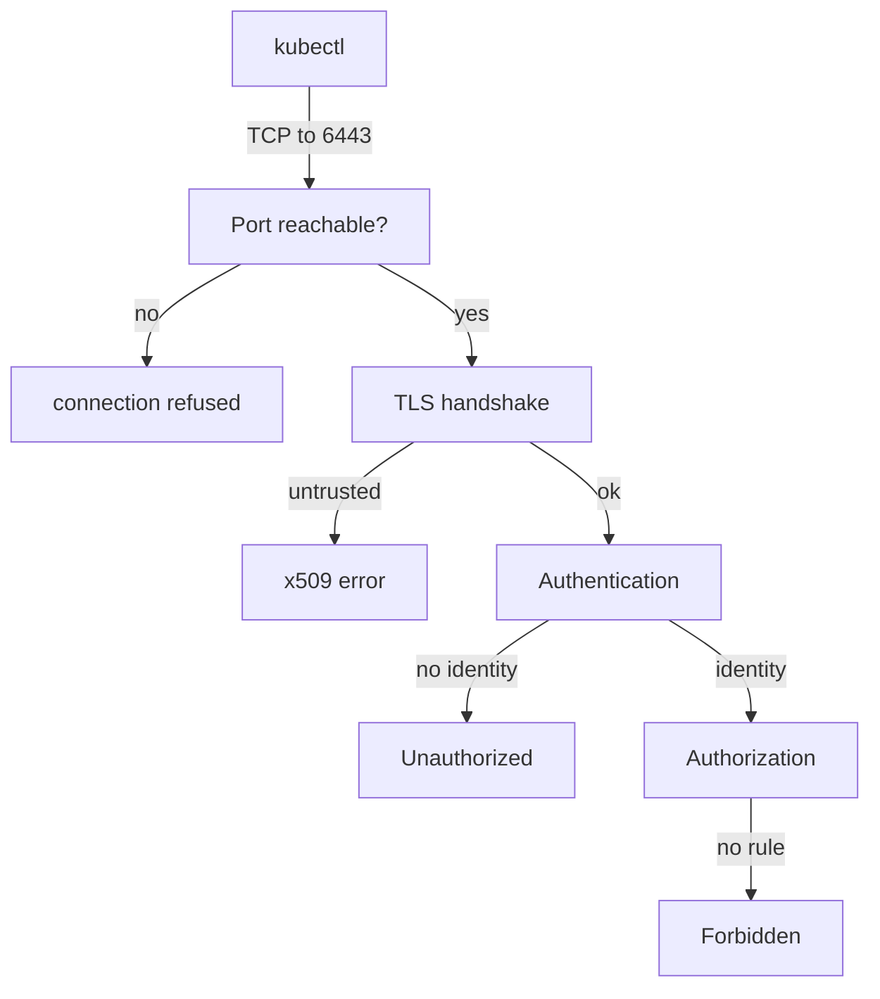

# API Server Flags And Error Types

A `kubectl` command fails with an error, and the text of that error already tells you which layer broke. "Connection refused", an x509 error, "Unauthorized" and "Forbidden" are four different problems with four different fixes. This lesson reads the API server manifest to see which flags control each layer, and then maps each error message to the flag or file behind it.

## Learning objectives

- Name the main `kube-apiserver` flags for its port, its certificates and its etcd connection.
- Tell a refused connection, a certificate error, an authentication error and an authorization error apart.
- Check the API server from the node when `kubectl` does not work.

## Before you start

The API server (`kube-apiserver`) is the component that serves the cluster API over HTTPS and stores objects in etcd. A kubeconfig file tells `kubectl` the server address, the certificate authority to trust and the client credentials. The commands run against the playground cluster `ats-023-playground-020-02`.

## The flags that matter

The API server runs as a static Pod, so its settings are command-line flags in `/etc/kubernetes/manifests/kube-apiserver.yaml`. Print the flag lines from the control-plane node:

<!-- astrona:playground:renew -->

```sh
export KUBECONFIG="$(astrona kubeconfig ats-023-playground-020-02)"
NODE=astro-ats-023-playground-020-02-control-plane
podman exec $NODE grep -E 'secure-port|etcd-|tls-|client-ca-file' /etc/kubernetes/manifests/kube-apiserver.yaml
```

The output has one flag per line. Four groups matter for troubleshooting:

- `--secure-port=6443` is the HTTPS port the API server listens on. Clients such as `kubectl` and the kubelet connect here.
- `--tls-cert-file` and `--tls-private-key-file` are the serving certificate and key. They prove the identity of the API server to its clients.
- `--client-ca-file` is the certificate authority (CA) that signs client certificates. The API server uses it to authenticate clients that present a certificate.
- `--etcd-servers`, `--etcd-cafile`, `--etcd-certfile` and `--etcd-keyfile` define the connection to etcd. The value of `--etcd-servers` is `https://127.0.0.1:2379`, the etcd client address. The three file flags are the CA that the API server trusts for etcd and its own client certificate and key for etcd.

A typo in any of these breaks a different layer. The next section shows how to tell which one from the error.

## Four errors, four layers



The request passes four gates in order, and each gate has its own error text.

A **connection refused** error means nothing listens on the address, for example `The connection to the server 127.0.0.1:6443 was refused`. No TLS and no credentials were involved. The API server is not running, or it listens on another port, or the address in the kubeconfig is wrong. Look at the container on the node, not at certificates.

An **x509** error, such as `x509: certificate signed by unknown authority`, means a TLS connection started but the client did not trust the server certificate. The server is running. The kubeconfig's `certificate-authority-data` does not match the CA that signed the serving certificate, or the certificate has expired or lacks the address in its subject alternative names.

An **Unauthorized** (HTTP status 401) response means the API server could not identify the caller. The client certificate is not signed by the `--client-ca-file` CA, or a token is invalid. A **Forbidden** (HTTP status 403) response means the caller is known, but no RBAC rule allows the verb. The message names the user, the verb, the resource and the namespace. Only Forbidden is fixed with a Role or a RoleBinding.

## Proving each layer by hand

Check the health endpoints from outside the cluster with `kubectl`, and from inside the node with `curl`. The `-k` flag skips certificate checks, which isolates the port from the trust question:

```sh
podman exec $NODE curl -sk https://127.0.0.1:6443/livez
podman exec $NODE curl -sk 'https://127.0.0.1:6443/readyz?verbose'
```

On a healthy API server, `/livez` answers `ok` without any credentials, because the default policy allows unauthenticated access to the health endpoints. An empty answer or a refused connection from `curl` proves the problem is the process or the port. If `curl -k` works and `kubectl` fails with an x509 error, the process is healthy and the trust settings in the kubeconfig are wrong.

Check the authorization layer with a question the API server answers for a given identity:

```sh
kubectl auth can-i list secrets -n starfleet --as=system:serviceaccount:starfleet:scout
```

The answer is `no` when no rule allows it. A `Forbidden` error from a real request and a `no` from this command mean the same thing, and the fix is a rule, not a certificate.

## When the API server starts but cannot reach etcd

One failure does not fit the table. The API server process runs and listens on 6443, but its `--etcd-servers` value points at an address where etcd does not answer. The port is open, so there is no refusal. The process then reports that etcd is not ready. The `/readyz?verbose` output lists the `etcd` check as failing, and the `/livez` check fails too, so the kubelet restarts the container again and again.

For the client this looks like intermittent errors: some requests time out, and others get a refused connection while the container restarts. The container log on the node contains lines about failing to connect to the etcd address. The fix is in the manifest flag, not in the certificates, and it needs node access because the API cannot be trusted while it restarts.

```sh
podman exec $NODE crictl ps -a --name kube-apiserver
```

A healthy API server shows one running container with a low ATTEMPT number. A repeating restart shows several exited attempts with a growing number.

The reader can now read an error message and pick the layer: port, trust, identity or permission. The remaining gap is etcd itself, which the next lesson checks directly with `etcdctl`.

## Common pitfalls

> [!WARNING]
> Do not fix "Forbidden" by changing certificates, and do not fix "x509" by adding RBAC rules. Do not use `curl -k` as proof that the kubeconfig works; it only proves the port and the process. While the API server restarts, wait for `/readyz` instead of assuming that the last edit made things worse.
