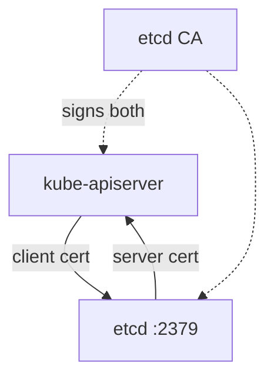

# etcd Health And Certificates

The API server keeps no state of its own. Every object it accepts is written to etcd, so a Deployment, a Secret and a Lease all live there. When etcd is unreachable or unhealthy, the API server cannot store or read anything, and the whole cluster stops accepting changes. This lesson shows how etcd listens, how its certificates are used, and how to prove that it is healthy with `etcdctl`.

## Learning objectives

- Name the etcd client and peer ports and the flags that set them.
- Explain which certificates protect the connection between the API server and etcd.
- Run `etcdctl endpoint health` with the correct certificate flags.

## Before you start

etcd is a distributed key-value database. Kubernetes stores all cluster state in it. A client of etcd, such as the API server, sends read and write requests over HTTPS. `etcdctl` is the command-line client for etcd. The playground is the cluster `ats-023-playground-020-02` with a single etcd member.

## How etcd is started and what it listens on

etcd also runs as a static Pod, from `/etc/kubernetes/manifests/etcd.yaml`. Print its address and certificate flags:

<!-- astrona:playground:renew -->

```sh
export KUBECONFIG="$(astrona kubeconfig ats-023-playground-020-02)"
NODE=astro-ats-023-playground-020-02-control-plane
podman exec $NODE grep -E 'listen-|advertise-|cert-file|key-file|trusted-ca|client-cert-auth' /etc/kubernetes/manifests/etcd.yaml
```

Two ports appear. Port 2379 is the client port: `--listen-client-urls` lists the addresses where etcd accepts client requests, and the API server connects there. Port 2380 is the peer port: `--listen-peer-urls` is used for traffic between etcd members. A single-member cluster has no peers, but the flag is still present. The `--advertise-client-urls` value is the address that etcd tells clients to use.

In kubeadm, etcd listens for clients on `127.0.0.1` and on the node address, so the API server on the same node reaches it through the loopback address `https://127.0.0.1:2379`.

## The certificates on the etcd connection

etcd uses mutual TLS (mTLS) on its client port. In mutual TLS both sides present a certificate. The server proves its identity to the client, and the client proves its identity to the server.

The flags `--cert-file` and `--key-file` are the etcd serving certificate and key. The flag `--trusted-ca-file` is the CA used to check client certificates, and `--client-cert-auth=true` makes etcd require a client certificate. On the API server side, `--etcd-cafile` names the CA that the API server trusts for etcd, and `--etcd-certfile` with `--etcd-keyfile` is the client certificate that the API server presents.



Both certificates must chain to the etcd CA, which is stored under `/etc/kubernetes/pki/etcd` on the node.

A mismatch shows up as a TLS error in the etcd log or in the API server log. A wrong address shows up as a connection error. The two look alike in `kubectl`, so read the log of the container that reports the problem.

## Proving etcd is healthy

The etcd container image contains `etcdctl`. Run it inside the etcd container, using the certificates that kubeadm creates for health checks. While the API is healthy, use `kubectl exec` with the mirror Pod name:

```sh
kubectl -n kube-system exec etcd-$NODE -- etcdctl endpoint health --endpoints=https://127.0.0.1:2379 --cacert=/etc/kubernetes/pki/etcd/ca.crt --cert=/etc/kubernetes/pki/etcd/healthcheck-client.crt --key=/etc/kubernetes/pki/etcd/healthcheck-client.key
```

A healthy endpoint prints its address, `is healthy`, and the time the check took. All four flags matter. Without `--cacert`, `--cert` and `--key`, etcd refuses the request because client certificates are required.

When the API server is down, `kubectl exec` cannot work, because it needs the API. Go through the runtime on the node instead:

```sh
podman exec $NODE crictl ps --name etcd -q
```

The `-q` flag prints only container identifiers. Run the same `etcdctl` command with `podman exec $NODE crictl exec <CONTAINER_ID> etcdctl endpoint health ...` and the same flags. If etcd is healthy here while the API server is failing, the problem is the connection between them, usually the `--etcd-servers` address or a certificate path in the API server manifest.

## Failure cases worth knowing

Three etcd failures appear in practice. First, the etcd container exits at start because a flag is wrong or a certificate file is missing; `crictl ps -a` shows exited attempts and the log names the file. Second, the certificates expired; the log of both etcd and the API server then reports a TLS handshake error, and the check `kubeadm certs check-expiration` on the node lists the expiry dates. Third, the API server points at the wrong address; etcd is healthy and its log shows no incoming request from the API server at all.

The third case is the cheapest to confuse with the others. The evidence that separates them is simple: if `etcdctl` on the node reports healthy and the etcd log is quiet, the fault is on the client side of the connection.

## Reading the result

A healthy etcd with a failing API server points at the API server manifest. An unhealthy etcd points at etcd: a crashed container, a corrupt data directory or a certificate that expired. etcd also reports the leader and database size with `etcdctl endpoint status --write-out=table`, which shows whether the member has a leader.

```sh
kubectl get --raw='/readyz/etcd'
```

This asks the API server for its own view of etcd and answers `ok` when the connection works. Compare the two views: the `etcdctl` result proves etcd, and the `/readyz/etcd` result proves the path from the API server to etcd.

The reader can now test etcd directly, with its own certificates, and compare that with the API server's view. What is left is to practise a repair when the broken flag is in the API server manifest and `kubectl` does not answer.

## Common pitfalls

> [!WARNING]
> Do not run `etcdctl` without the certificate flags and conclude that etcd is down; a refused request is a certificate problem, not an outage. Do not edit the etcd manifest to fix an API server symptom before you have shown etcd unhealthy. Never delete etcd data to fix a connection error, because that deletes the cluster state.
