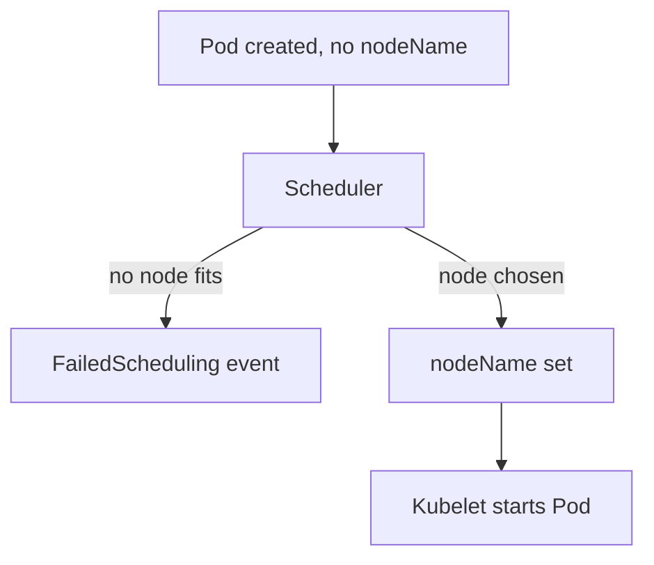

# Scheduler Role And Pending Pods

A new Pod stays in the status Pending. Two very different situations produce that same word. In one, the scheduler looked at the Pod and found no node that fits. In the other, the scheduler never looked at the Pod at all. The difference is visible in one place, the events of the Pod, and this lesson shows how to read it.

## Learning objectives

- Explain what the scheduler writes into a Pod and when it acts.
- Tell a Pod that cannot be placed from a Pod that was never considered.
- Reproduce a stopped scheduler in the playground and read the evidence.

## Before you start

The scheduler (`kube-scheduler`) is the control-plane component that assigns each new Pod to a node. A Pod's events are short messages from components, shown at the end of `kubectl describe pod`. The playground is a two-node kind cluster; the control-plane node is the container `astro-ats-023-playground-020-03-control-plane`, and `NODE` below holds that name.

## What the scheduler does

When the API server stores a new Pod, the field `spec.nodeName` is empty. The scheduler watches the API for Pods with an empty `nodeName`. For each one, it filters out nodes that cannot run the Pod, for example because of a taint, a node selector or too little free CPU or memory. It scores the nodes that remain and picks the best. Then it writes the chosen name into the Pod through a binding request to the API server.

The scheduler does not start containers. The kubelet on the chosen node sees the new assignment and starts the Pod. A Pod without a `nodeName` therefore sits in Pending, and the kubelet on every node ignores it.



The scheduler either explains in an event why no node fits, or it sets the node; either way, a working scheduler leaves a trace.

## Two kinds of Pending

When the scheduler runs but finds no suitable node, it records a `FailedScheduling` event on the Pod. The message names the reason, such as `Insufficient cpu` or a taint that no toleration matches. The event comes from the `default-scheduler`, which is the name of the scheduler profile in a normal cluster.

When the scheduler is not running, nothing writes any event. The Pod is Pending, its `nodeName` is empty, and `kubectl describe pod` shows no events at all. A Pending Pod with an empty events list points at the scheduler component, and a Pending Pod with a `FailedScheduling` event points at the Pod's requirements or at node capacity.

## Reproducing a stopped scheduler

Move the scheduler manifest out of the static Pod directory. The kubelet then removes the scheduler container, exactly as if the component had crashed. Run these commands, and keep the manifest in `/etc/kubernetes` for the moment:

<!-- astrona:playground:renew -->

```sh
export KUBECONFIG="$(astrona kubeconfig ats-023-playground-020-03)"
NODE=astro-ats-023-playground-020-03-control-plane
podman exec $NODE mv /etc/kubernetes/manifests/kube-scheduler.yaml /etc/kubernetes/kube-scheduler.yaml.parked
```

The kubelet rescans the directory every 20 seconds by default, so wait about half a minute. Then check that the mirror Pod of the scheduler is gone:

```sh
kubectl -n kube-system get pods -l component=kube-scheduler
```

The list is empty. Now create a Pod. Save this as `pod-scout.yaml`:

```yaml
apiVersion: v1
kind: Pod
metadata:
  name: scout
  namespace: starfleet
spec:
  containers:
  - name: scout
    image: docker.io/library/busybox:1.37.0
    command: ["sh", "-c", "sleep 3600"]
```

Apply it:

```sh
kubectl apply -f pod-scout.yaml
```

Then check the result:

```sh
kubectl -n starfleet get pod scout -o wide
kubectl -n starfleet describe pod scout
```

The status is Pending and the NODE column shows `<none>`. At the end of the describe output the Events section is empty. No `FailedScheduling` event exists because no scheduler looked at the Pod. Nothing is wrong with the Pod itself.

## Restoring the scheduler

Move the manifest back in one step. The kubelet starts the container again at its next scan:

```sh
podman exec $NODE mv /etc/kubernetes/kube-scheduler.yaml.parked /etc/kubernetes/manifests/kube-scheduler.yaml
kubectl -n starfleet get pod scout -o wide --watch
```

After the scheduler starts, it finds `scout` at once, assigns the worker node and the kubelet starts the container. The scheduler event `Scheduled` appears in the events of the Pod. Press Ctrl-C when the status is Running. The Pod was never wrong; it only had to wait for a component to do its job.

## What else keeps a Pod Pending

A scheduler that runs can still leave a Pod Pending for valid reasons. Requests for more CPU or memory than any node offers, a `nodeSelector` that matches no node, an affinity rule that cannot be met and a taint without a matching toleration all produce a `FailedScheduling` event. A Pod that asks for a PersistentVolumeClaim that is not bound also waits. In each case the event text names the cause, so read the event before you touch the control plane.

The reader can now separate a Pod that cannot be placed from a Pod nobody tried to place. The open question is what happens when the scheduler container starts but crashes or never becomes the active scheduler, which the next lesson covers.

## Common pitfalls

> [!WARNING]
> Do not restart the scheduler because a Pod is Pending with a `FailedScheduling` event; the scheduler is working and the event names the real cause. Do not forget to move the parked manifest back, or no new Pod gets a node.
