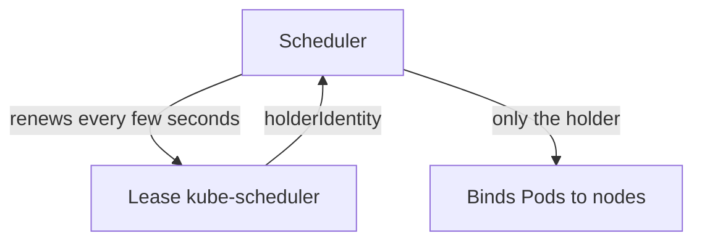

# Scheduler Static Pod And Leader Election

The scheduler is a static Pod, so a wrong flag or a missing file in its manifest keeps it from starting, and new Pods then wait without events. Leader election adds a second thing to check: even a running scheduler does nothing unless it holds the lease. This lesson reads the scheduler manifest, the scheduler log and the lease, and then repairs a broken scheduler.

## Learning objectives

- Name the scheduler flags that decide whether it starts and what it connects to.
- Read the scheduler log and the `kube-scheduler` Lease as evidence.
- Repair a scheduler manifest and prove that Pods are placed again.

## Before you start

A kubeconfig file holds the address and credentials that a client uses to reach the API server. The scheduler authenticates to the API server with the kubeconfig `/etc/kubernetes/scheduler.conf`. A Lease is a small Kubernetes object, in the API group `coordination.k8s.io`, that holds a name, a holder and a last-renewed time. Components use it to agree on one active instance. The commands run against the playground `ats-023-playground-020-03`.

## The scheduler manifest

The manifest is `/etc/kubernetes/manifests/kube-scheduler.yaml`. Print its flags:

<!-- astrona:playground:renew -->

```sh
export KUBECONFIG="$(astrona kubeconfig ats-023-playground-020-03)"
NODE=astro-ats-023-playground-020-03-control-plane
podman exec $NODE grep -E '^ +- --' /etc/kubernetes/manifests/kube-scheduler.yaml
```

Four flags matter. `--kubeconfig=/etc/kubernetes/scheduler.conf` is the credential file for the API connection. `--authentication-kubeconfig` and `--authorization-kubeconfig` point at the same file and let the scheduler ask the API server who calls its own secure port. `--leader-elect=true` turns on leader election. `--bind-address=127.0.0.1` keeps the health and metrics port 10259 on the loopback address.

The file `scheduler.conf` is mounted into the container from the node with a `hostPath` volume. If the flag names a path that is not mounted, the container cannot read it. The scheduler then exits during start with an error about the kubeconfig file. The kubelet restarts the container with a growing delay, and the mirror Pod status shows `CrashLoopBackOff` after a few attempts.

## Reading the evidence of a crash

Because the API server still works, the mirror Pod is visible. List it and read its previous log:

```sh
kubectl -n kube-system get pods -l component=kube-scheduler
kubectl -n kube-system logs -l component=kube-scheduler --previous --tail=10
```

On a crashing scheduler the first command shows a growing RESTARTS count. The second command prints the last lines of the container that exited. They name the file or flag the scheduler rejected. If the API were down as well, run `crictl ps -a --name kube-scheduler` and `crictl logs` through `podman exec` on the node instead.

## Leader election and the Lease

A cluster can run several scheduler instances for availability. Only one may assign Pods at a time, or two schedulers would choose different nodes for the same Pod. Leader election decides which one is active. The instances compete for one Lease object, and only the holder schedules. The holder renews the Lease every few seconds. If it stops renewing, another instance can take over after the lease duration, which is 15 seconds by default.

Read the Lease of the scheduler:

```sh
kubectl -n kube-system get lease kube-scheduler -o yaml
```

Look at three fields in `spec`. The field `holderIdentity` names the active instance, built from the node host name and a random identifier. The field `renewTime` is the last renewal. The field `leaseDurationSeconds` is how long the lease stays valid without a renewal. Run the command again after a few seconds: on a healthy scheduler, `renewTime` has moved forward.



The Lease shows which scheduler is active and whether it is alive.

Three cases follow. A `renewTime` that no longer changes means the holder stopped, and with a single scheduler nothing places Pods. A Lease that exists but is held by an old instance that has gone away recovers by itself after the lease duration. A missing Lease on a cluster that never ran the scheduler is normal. With `--leader-elect=false`, the scheduler does not use the Lease, so that flag also hides this evidence.

## Repairing a scheduler manifest

Suppose the `--kubeconfig` flag points at `/etc/kubernetes/scheduler-old.conf`, a file that does not exist. The repair has four steps. Read the log to find the bad path. Check which files exist on the node. Fix the flag in a copy of the manifest. Move the copy into place.

```sh
podman exec $NODE ls /etc/kubernetes
```

The listing shows `scheduler.conf` and not the path from the flag. Edit a copy and move it in one step, so the kubelet never reads half a file:

```sh
podman exec $NODE sh -c 'cp /etc/kubernetes/manifests/kube-scheduler.yaml /etc/kubernetes/kube-scheduler.yaml.fixed && sed -i "s#- --kubeconfig=.*#- --kubeconfig=/etc/kubernetes/scheduler.conf#" /etc/kubernetes/kube-scheduler.yaml.fixed && mv /etc/kubernetes/kube-scheduler.yaml.fixed /etc/kubernetes/manifests/kube-scheduler.yaml'
```

This command is the repair for that specific fault. In the healthy playground the flag already has the correct value, so running it changes nothing. Then prove the result with the work the scheduler does: the Pod is `Running` with a node assigned, and the Lease renews.

## Proving the fix

Process existence is not enough. Create a Pod and check that the scheduler binds it, then read the Lease twice:

```sh
kubectl -n starfleet get pods -o wide
kubectl -n kube-system get lease kube-scheduler -o jsonpath='{.spec.renewTime}{"\n"}'
```

The first command shows a node name for every Pod. The second prints a time. Run it again after a few seconds; a moved time proves the scheduler holds the lease. The reader can now diagnose a scheduler that does not start and one that does not lead. The next lesson moves from placement to Service forwarding and the other components in `kube-system`.

## Common pitfalls

> [!WARNING]
> Do not trust a running container as proof that scheduling works; check that new Pods get a node and that `renewTime` moves. Do not set `--leader-elect=false` to hide a lease problem. Do not edit the manifest in place or leave a backup inside `/etc/kubernetes/manifests`; copy it elsewhere, edit the copy and move it back.
