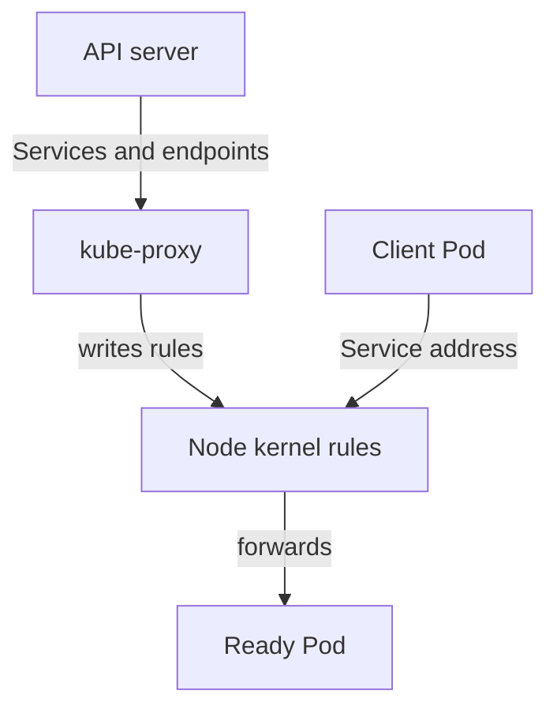

# kube-proxy And kube-system Add-Ons

A Pod can run and be Ready, yet clients still fail to reach it through its Service. The control-plane components are not involved in that path. The node-level components are: `kube-proxy` forwards Service traffic, the DNS server resolves Service names and the network plugin connects Pods. They run in the `kube-system` namespace as add-ons. This lesson shows what each does, where its configuration lives and how to check its health.

## Learning objectives

- Explain what `kube-proxy` does on each node and where its configuration comes from.
- Check a DaemonSet and its ConfigMap, and read the logs of an add-on Pod.
- Separate a Service forwarding failure from a Pod failure.

## Before you start

A Service is a stable virtual address for a group of Pods. A DaemonSet is a workload that runs one Pod on every node. A ConfigMap is an object that holds configuration as key-value data and can be mounted into Pods. An add-on is a cluster component that runs as an ordinary workload in `kube-system`. The playground has the Service `probe` in `starfleet` and the client Pod `shuttle`.

## What kube-proxy does

When a client connects to the address of a Service, no process listens on that address. `kube-proxy` on each node watches Services and EndpointSlices through the API server and writes forwarding rules into the kernel of its own node, using iptables or IPVS. The rules send traffic for the Service address to one of the ready Pod addresses. In the default mode these rules live in the node kernel, not in the `kube-proxy` process.

That has a consequence for failures. If `kube-proxy` stops, the existing rules keep working, so old Services still answer. New Services, new endpoints and changes are not written, so the rules drift from the cluster state. Stale rules, not a total outage, is the usual symptom.

The mode matters when you read the rules on a node. With iptables mode the rules appear as chains whose names start with `KUBE-`, and with IPVS mode they appear as virtual servers. The mode comes from the configuration, so the configuration is the first place to look when forwarding is wrong on one node and not on another.



The rules are rebuilt from the API by `kube-proxy` on every node.

## The DaemonSet and its ConfigMap

kubeadm, and therefore kind, runs `kube-proxy` as a DaemonSet named `kube-proxy` in `kube-system`. Check that it has one Pod for each node:

<!-- astrona:playground:renew -->

```sh
export KUBECONFIG="$(astrona kubeconfig ats-023-playground-020-03)"
kubectl -n kube-system get daemonset kube-proxy
```

The columns DESIRED, CURRENT, READY and UP-TO-DATE should all show 2, one for each node. A READY number lower than DESIRED means a Pod on some node is failing. Add `-o wide` to the Pod list to see which node:

```sh
kubectl -n kube-system get pods -l k8s-app=kube-proxy -o wide
```

The configuration is in the ConfigMap `kube-proxy`, mounted into each Pod. It has two keys. The key `config.conf` is the `kube-proxy` configuration with settings such as the proxy mode and the cluster CIDR, the address range of the Pods. The key `kubeconfig.conf` is the credential file for the API connection. Print the key names and the configuration:

```sh
kubectl -n kube-system get configmap kube-proxy -o jsonpath='{.data.config\.conf}'
```

A change to the ConfigMap does not reach running Pods. `kube-proxy` reads its configuration at start, so a changed ConfigMap needs a rollout restart of the DaemonSet. In the other direction, a DaemonSet that was changed with a wrong image tag or wrong argument leaves new Pods in `ImagePullBackOff` or `CrashLoopBackOff` while rules from earlier stay in place. `kubectl rollout undo daemonset/kube-proxy -n kube-system` returns to the previous revision.

## Reading an add-on failure

Use the same order for every add-on. First, check the workload: `kubectl -n kube-system get daemonset,deployment`. Second, check its Pods: the status and the node. Third, read the events and the log. For a Pod that restarts, add `--previous` to read the failed run:

```sh
kubectl -n kube-system describe pod -l k8s-app=kube-proxy
kubectl -n kube-system logs -l k8s-app=kube-proxy --tail=10
```

The events show image pull errors and probe failures. The log shows configuration errors, such as an unknown proxy mode or a kubeconfig that cannot be read.

DNS follows the same pattern. CoreDNS runs as the Deployment `coredns` in `kube-system`, and its Pods carry the label `k8s-app=kube-dns`. If CoreDNS is down, Pods can still reach each other by address, but name lookups such as `probe.starfleet.svc` fail. Check the Pods with `kubectl -n kube-system get pods -l k8s-app=kube-dns` and read their log. The network plugin also runs in `kube-system`; in kind it is a DaemonSet that must be Ready on every node for Pods to receive addresses.

## Separating Service failure from Pod failure

When a client cannot reach a Service, test in layers. First, check the Pod address directly: if the client reaches the Pod address, the Pod and the network plugin work. Second, check the Service name: if the address works but the name fails, look at DNS. Third, check the Service address: if the name resolves and the Service address fails while the Pod address works, look at the EndpointSlices and at `kube-proxy`.

```sh
kubectl -n starfleet exec shuttle -- wget -q -T 3 -O- http://probe/
```

Success proves the DNS name, the Service address and the forwarding rules in one step. A failure does not say which of the three failed, so repeat the request with the Pod address and the Service address.

The reader can now check each add-on in `kube-system`, read its configuration and tell forwarding problems from Pod problems. The next exercises combine these skills with the control-plane components.

## Common pitfalls

> [!WARNING]
> Do not edit the `kube-proxy` ConfigMap and expect the running Pods to change; restart the DaemonSet. Do not delete a DaemonSet Pod to fix a bad image, because the new Pod uses the same template. Do not assume that working old Services mean `kube-proxy` is healthy; new Services and endpoint changes need it.
