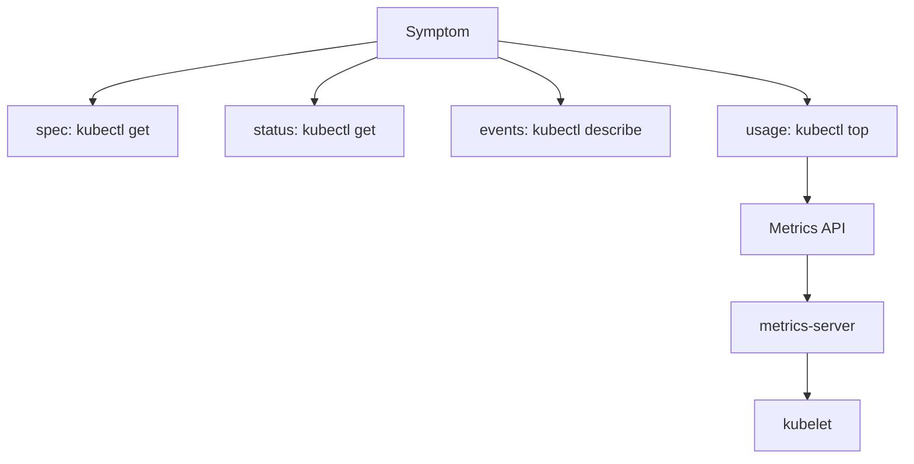

# Choosing Diagnostic Evidence With kubectl

The `probe` Deployment in `starfleet` asks for two replicas. Its status reports how many replicas are available. The metrics pipeline reports how much CPU and memory those replicas used a few seconds ago. These are three different observations, and a troubleshooting claim is only as precise as the observation behind it.

## Learning objectives

- Compare specification, status, events and metrics.
- Confirm observation context and permissions.
- Distinguish measured usage from allocation and enforcement.

## Before you start

A Pod is the Kubernetes unit that runs one or more containers. A namespace groups namespaced objects such as Pods and Deployments. The playground for this module is a kind cluster (Kubernetes running in container-engine containers on your machine) with the `probe` Deployment, the `shuttle` Pod in `starfleet` and the `drifter` Pod in `outpost`. It also runs metrics-server, the component that supplies usage numbers.

## Which component answers which question

`kubectl` is the Kubernetes command-line client. It sends every request to the API server, the component that stores and serves cluster objects. The kubeconfig file tells `kubectl` which cluster, which identity and which default namespace to use. The current context is the entry in that file that is selected right now.

The same client reads very different data. `kubectl get` returns objects that controllers and the kubelet (the node agent) have written to the API server. `kubectl describe` adds the events related to an object. `kubectl top` does not read the stored objects at all. It asks the Metrics API, which metrics-server serves from numbers it collected from each kubelet.

Start every investigation by proving where you are. The first command below prints the context and the second lists the two example namespaces. If the context name is not the playground, stop and fix that first, because correct output from the wrong cluster is still the wrong evidence.

<!-- astrona:playground:renew -->

```sh
kubectl config current-context
kubectl get namespace starfleet outpost
```

A `Forbidden` response means the API server authenticated you but its authorization step denied the verb on that resource. It does not mean the object is missing. A `NotFound` response means the name does not exist in the namespace you asked about, which is often the wrong namespace.

## Specification, status and events

A Deployment has a `spec`, which holds the desired state, and a `status`, which holds what the controller last observed. The `probe` Deployment has `spec.replicas: 2`. Its `status.availableReplicas` is the number of Pods that are ready. When the two numbers differ, the cluster is still converging or something prevents convergence.

```sh
kubectl -n starfleet get deployment probe -o jsonpath='{.spec.replicas}{" "}{.status.availableReplicas}{"\n"}'
kubectl -n starfleet describe deployment probe
```

The first command uses JSONPath, a query notation that selects fields from the JSON response. An empty result can mean the field is unset, for example `availableReplicas` is omitted while it is zero, or that the path is wrong. The second command prints conditions and an `Events` section at the end. Events are short records written by controllers and the kubelet. They expire after about an hour by default, so a missing event does not prove that nothing happened.

## Measured usage is a separate signal

The `kubectl top` command prints CPU in millicores (thousandths of a CPU) and memory as the working set, which is the memory the kernel cannot easily reclaim. The values come from metrics-server. The command with `--containers` splits a Pod into its containers, which matters when a sidecar is the real consumer.

```sh
kubectl -n starfleet top pods --containers
kubectl -n starfleet get pod -l app=probe -o jsonpath='{range .items[*]}{.metadata.name}{" "}{.spec.containers[0].resources}{"\n"}{end}'
```

The second command prints the declared requests and limits of each Pod. Put the two outputs side by side. The usage column is a measurement. The request is a number the scheduler uses to pick a node. The limit is a number the kubelet and the container runtime enforce. A low measured value does not make a large request cheap, and a small request does not mean the process stays small.



The first three branches read objects stored in the API server, and the fourth branch is the only one that reaches the kubelet through metrics-server.

## Narrow the output on purpose

Unfiltered output hides the one line you need. Two options keep the output small. A namespace flag (`-n starfleet`) limits a query to one namespace, and a label selector (`-l app=probe`) limits it to Pods that carry that label. A selector only matches labels. It does not prove that a Deployment owns those Pods, because ownership is recorded in `metadata.ownerReferences`.

The `shuttle` Pod in `starfleet` and the `drifter` Pod in `outpost` are different objects even if their names were the same. Always name the namespace when you compare a result with a task statement.

A third habit is to read the whole object once with `-o yaml` before you extract single fields. The full representation shows `spec`, `status` and `metadata` together, so you notice fields you did not think to query, such as an `ownerReferences` entry or a `deletionTimestamp`.

## Choose the next layer

Pick the next command from the state you see. A Pod in `Pending` has not been scheduled, so scheduling events matter and logs do not exist yet. A Pod in `CrashLoopBackOff` has started and stopped, so the last termination reason and `kubectl logs --previous` matter. A Pod that is `Running` but unreachable points to readiness, Service endpoints and ports. A Pod whose usage climbs toward its limit points to the sizing evidence from `kubectl top`.

A timing rule applies to metrics. The numbers are an average over a short window and they lag reality by a scrape interval. A short peak that ended before the last scrape does not appear. Use `kubectl top` to confirm a trend and use termination state to confirm an event that already happened.

You now know which command reads which source, and you can tell a request, a limit and a measurement apart. The open question is what happens when the measurement source itself is broken, because then `kubectl top` fails while the application runs normally.

## Common pitfalls

> [!WARNING]
> Output from the wrong context is still the wrong evidence, so check the context first. A `Forbidden` error is not a missing object. `kubectl top` shows a short-window measurement, not the request and not the limit, and it cannot show a peak that ended before the last scrape.
