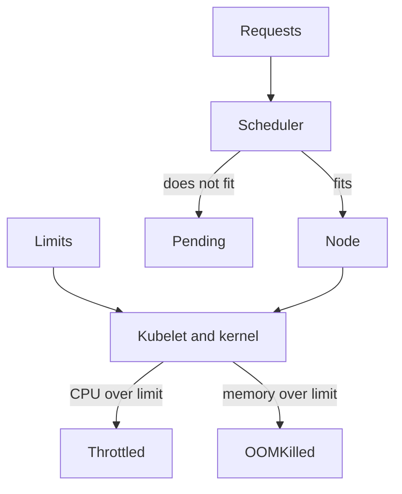

# Expressing Resource Needs For Every Container

A Pod can have a main container that requests little memory and a helper container that buffers a large amount of data. The scheduler and the kubelet both work with the complete Pod, not with the container the author remembers best. This chapter shows how requests and limits are written, which component uses each one, and how to read them from a running Pod.

## Learning objectives

- Distinguish measured usage from allocation and enforcement.
- Read the units for CPU and memory correctly.
- Account for every container when you reason about placement.

## Before you start

A resource request is the amount of CPU or memory a container asks for. A resource limit is the maximum the container may use. The `probe` Deployment in the playground sets `requests.cpu: 10m`, `requests.memory: 32Mi` and `limits.memory: 128Mi`. It sets no CPU limit. Keep those values in mind, because the commands below read them back.

## Units for CPU and memory

CPU is measured in CPU units. One unit is one core. A suffix `m` means millicores, so `10m` is one hundredth of a core and `500m` is half a core. Memory is measured in bytes. The suffixes `Mi` and `Gi` are binary (powers of 1024), and `M` and `G` are decimal (powers of 1000). `128Mi` is 134217728 bytes, while `128M` is 128000000 bytes. Mixing them changes the value by about five percent. A trailing `m` on a memory value means thousandths of a byte, which is almost always a mistake.

## Who uses the request and who uses the limit

The scheduler is the control plane component that picks a node for each new Pod. It adds up the requests of the Pod and compares the sum with what is left of each node's allocatable capacity. It does not look at live usage. A Pod whose request does not fit any node stays `Pending` with a `FailedScheduling` event, even if every node is nearly idle.

The kubelet and the container runtime enforce limits on the node. The kubelet translates a CPU request into a relative CPU weight, so under contention each container gets time in proportion to its request. A CPU limit becomes a hard cap that the Linux kernel enforces by pausing the container for part of each scheduling period. That pause is called throttling. A memory limit becomes a hard ceiling. When the container goes above it, the kernel kills a process in the container, and the container shows `OOMKilled`.

<!-- astrona:playground:renew -->

```sh
kubectl -n starfleet get pod -l app=probe -o jsonpath='{range .items[*]}{.metadata.name}{"\n"}{.spec.containers[0].resources}{"\n"}{end}'
kubectl describe node | grep -A8 "Allocated resources"
```

The first command prints the resources of each `probe` Pod as stored in the API server. The second command, run against a cluster with one node, prints the node's total requests and limits as a share of its capacity. The `Allocated resources` block counts requests and limits, not usage.

## Count every container

The scheduler sums the requests of all regular containers in a Pod. If the helper container requests `256Mi` and the main container requests `32Mi`, the Pod needs `288Mi`. Init containers run one after another before the regular containers, so the Pod's effective request is the larger of two numbers: the sum of the regular containers, or the largest single init container request. A restartable init container, which is an init container with `restartPolicy: Always` that keeps running as a sidecar, adds to the running total instead.

Defaults can change the real value. A LimitRange is a namespace object that sets default requests and limits for containers that omit them. A ResourceQuota caps the total requests and limits in a namespace. Both act when the Pod is created, so the stored Pod can differ from the Deployment template.

```sh
kubectl -n starfleet get pod -l app=probe -o yaml | grep -A12 "resources:"
```

Read the stored Pod, not only the template. If a LimitRange had filled in a default, only the stored Pod would show it.

## A worked example with numbers

Take a `scout` Pod with two regular containers. The `app` container requests `100m` CPU and `64Mi` memory. The `buffer` container requests `50m` CPU and `256Mi` memory. The Pod request is `150m` CPU and `320Mi` memory. A node with `300Mi` of allocatable memory left cannot take this Pod, even though the `app` container alone would fit.

Now add an init container that requests `500Mi` and runs for ten seconds. The effective memory request becomes `500Mi`, because the init container runs alone and its request is larger than the regular sum of `320Mi`. The scheduler uses the larger value. After the init container ends, the Pod still holds the scheduled slot, but the kubelet only enforces the limits of the running containers.

## Placement failure and runtime failure

These two failures look similar in `kubectl get pods` but they come from different components. A Pod that is `Pending` was never placed, and the cause is in the scheduler's `FailedScheduling` event. A Pod that is `Running` and then restarts was placed correctly and then enforced. Its cause is in `lastState.terminated.reason`, for example `OOMKilled` with exit code `137`, which is 128 plus signal 9.



Requests feed the placement decision, and limits feed runtime enforcement on the node that was chosen.

Raising only a request can make a Pod harder to place and leaves its memory ceiling unchanged. Raising only a limit lifts the ceiling and does not reserve any capacity, so the node can still run out of memory when several containers grow together.

## Changing a value

`kubectl set resources` edits the requests and limits of a Deployment's containers in one command. The change edits the Pod template, so the Deployment controller starts a rollout and replaces the Pods. The running Pods do not change in place.

```sh
kubectl -n starfleet set resources deployment/probe --requests=cpu=20m
kubectl -n starfleet rollout status deployment/probe
```

After the rollout, read the new Pods again with the first command of this chapter. The old Pods are gone, and the new ones carry the new request. Return the value to `10m` afterwards if you want the playground to match the text of the other chapters.

## Choosing values

Base a request on the steady usage you measure with `kubectl top`, plus the start-up peak. Base a memory limit on the highest usage you accept before the container should be killed. A CPU limit that is too tight slows the application without any error message. Many platform teams therefore set a CPU request and no CPU limit, and set a memory limit equal to or above the memory request.

You can now read the units, say which component uses each field and calculate the effective request of a Pod with several containers. The next question is how to prove a measurement with the metrics API directly.

## Common pitfalls

> [!WARNING]
> `M` and `Mi` are different sizes, and a request is not a measurement. Count every container, including init and sidecar containers. Compare the stored Pod with the Deployment template, because a LimitRange can add values. Raising a request does not raise the memory limit.
