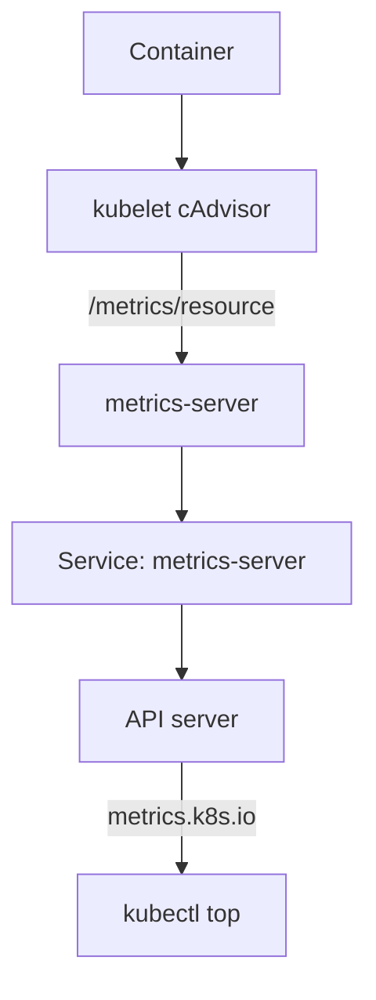

# How Usage Numbers Reach kubectl Top

The command `kubectl top pods` prints a CPU and memory figure for every Pod within a second. No component stores those figures in a database that `kubectl` reads directly. They travel through four components, and each one can fail on its own. Knowing the path turns a vague error into a short list of places to look.

## Learning objectives

- Name the components on the path from a container to `kubectl top`.
- Say where the numbers come from on the node.
- Locate the metrics-server objects in the cluster.

## Before you start

The playground runs metrics-server in the `kube-system` namespace. A Deployment is the controller that keeps a set of identical Pods running. A Service is a stable address in front of Pods. An APIService is an object that tells the API server to forward one API group to a Service. Each of the three plays a part below.

## The path in four steps

The numbers start on the node. The kubelet is the agent on each node that runs the Pods. It uses cAdvisor, a library built into the kubelet that reads container CPU and memory counters from the Linux kernel control groups. The kubelet publishes a summary of those counters on its HTTPS port 10250 at the path `/metrics/resource`.

The second component is metrics-server, a Deployment in `kube-system`. It contacts every kubelet on a fixed interval, reads `/metrics/resource`, and keeps only the latest sample for each node and Pod in memory. It stores nothing on disk and keeps no history.

The third component is the API server. The Metrics API is not built into it. The APIService named `v1beta1.metrics.k8s.io` registers the API group `metrics.k8s.io` and points it at the `metrics-server` Service in `kube-system`. The part of the API server that does this forwarding is called the aggregation layer. When a client asks for `/apis/metrics.k8s.io/v1beta1/nodes`, the API server authenticates and authorizes the request, then proxies it to metrics-server.

The fourth component is `kubectl top`. It sends ordinary requests to that API group and formats the response as a table.



The kubelet produces the numbers, metrics-server collects them, and the API server serves them through the aggregation layer.

## Look at each object

Start with the metrics-server Deployment and Pod. They run in `kube-system`. If the Pod is not ready, the Metrics API has no backend.

<!-- astrona:playground:renew -->

```sh
kubectl -n kube-system get deployment metrics-server
kubectl -n kube-system get pods -l k8s-app=metrics-server
```

The label `k8s-app=metrics-server` comes from the standard metrics-server manifest. If your installation uses another label, run `kubectl -n kube-system get pods` and pick the Pod by name.

Next read the Service and the APIService. The Service forwards port 443 to the container port. The APIService has a status with a condition named `Available`.

```sh
kubectl -n kube-system get service metrics-server
kubectl get apiservice v1beta1.metrics.k8s.io
```

The `AVAILABLE` column of the second command shows `True` when the API server can reach the Service and the backend answers its discovery request. The same column shows `False` and a reason when it cannot.

## What the kubelet actually returns

The kubelet endpoint serves only what metrics-server needs: CPU and memory for the node, for every Pod and for every container. It is a small resource-only interface. The older Summary API at `/stats/summary` carries more fields and is not used by current metrics-server for its normal work. Prometheus-style monitoring tools read a different, much larger set of metrics, so `kubectl top` and a monitoring dashboard can show different values for the same Pod.

CPU is reported as the rate of a cumulative counter, so the value covers a window. Memory is the working set, which is the memory in use minus memory the kernel can drop cheaply. The Pod value is the sum of its containers.

## Read the kubelet source yourself

The API server can proxy a request to a node's kubelet. The path `/api/v1/nodes/<node>/proxy/metrics/resource` returns exactly what metrics-server reads. The response is plain text in the Prometheus exposition format, one metric per line. The lines that matter are `node_cpu_usage_seconds_total`, `node_memory_working_set_bytes`, `container_cpu_usage_seconds_total` and `container_memory_working_set_bytes`. The CPU metrics are counters of CPU seconds, and metrics-server turns two counter readings into a rate.

```sh
node="$(kubectl get nodes -o jsonpath='{.items[0].metadata.name}')"
kubectl get --raw "/api/v1/nodes/$node/proxy/metrics/resource" | grep -m4 "^container_memory_working_set_bytes"
```

The command prints the first four container memory lines. Each line carries labels for the container, the Pod and the namespace. This is the data that survives or fails on the way to the terminal, and it exists even when metrics-server is broken. That makes it a useful test: if this request works and `kubectl top` does not, the kubelet side is healthy.

## Authentication on each hop

Every hop checks identity. metrics-server authenticates to the kubelet with its service account token, and the kubelet must have webhook authentication and authorization turned on so it can ask the API server whether that token may read node metrics. The API server authenticates the client of `kubectl top` as usual and then calls metrics-server with its own front-proxy credentials. A failure on any hop leaves the next one without data.

You can now trace a number along the path and find the objects that carry it. The open question is how to read the API itself and what depends on it besides `kubectl top`.

## Where each failure shows up

A failure on the node side shows up as scrape errors in the metrics-server logs. A failure in metrics-server shows up as a Pod that is not ready, or as an APIService with the condition `Available` set to `False`. A failure in the aggregation layer shows up as an error for the raw API path while the Pod is healthy. A client failure shows up only in one terminal. Keeping this map in mind decides which command to run first.

## Common pitfalls

> [!WARNING]
> metrics-server keeps only the latest sample and has no history, so it cannot answer what happened an hour ago. A Pod that is not ready in `kube-system` leaves the Metrics API without a backend. The numbers are not the same as a monitoring system's numbers, so do not compare them without knowing the source.
