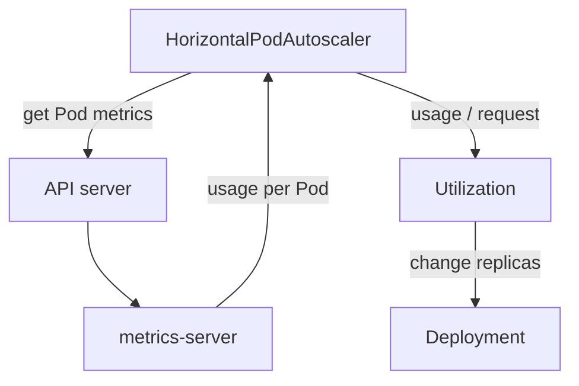

# Reading The Metrics API And Its Consumers

An API that is not built into the API server needs a registration object and a backend. This chapter reads both, shows the raw responses behind `kubectl top`, and explains the second consumer of the Metrics API: the HorizontalPodAutoscaler. It also explains how often the numbers change.

## Learning objectives

- Read the APIService `Available` condition and its reason.
- Query nodes and Pods with `kubectl get --raw`.
- Explain why the HorizontalPodAutoscaler needs metrics-server.
- Explain the sampling interval and the `window` field.

## Before you start

The playground has the `probe` Deployment in `starfleet` with two replicas. Each replica sets a CPU request, which matters for autoscaling. All commands below are read-only.

## The APIService object

The APIService `v1beta1.metrics.k8s.io` has a spec that names the API group (`metrics.k8s.io`), the version (`v1beta1`), the Service that serves it and a priority. It also says how the API server should check the backend certificate: with a `caBundle` or, in simple installations, with `insecureSkipTLSVerify: true`. Its status holds one condition of type `Available`.

<!-- astrona:playground:renew -->

```sh
kubectl get apiservice v1beta1.metrics.k8s.io -o jsonpath='{.status.conditions[?(@.type=="Available")].status}{" "}{.status.conditions[?(@.type=="Available")].reason}{"\n"}'
```

When the backend is healthy the status is `True` and the reason is `Passed`. The reason `MissingEndpoints` means the Service has no ready Pod behind it. The reason `FailedDiscoveryCheck` means the API server reached for the backend and the request failed or timed out. The `message` field of the condition carries the detail, so read it with `kubectl describe apiservice v1beta1.metrics.k8s.io` whenever the status is `False`.

## Raw requests

`kubectl top` is a client of the Metrics API. You can send the same requests with `kubectl get --raw`, which sends a GET to an API path and prints the unformatted response. Three paths cover the API: nodes, Pods in a namespace and one named Pod.

```sh
kubectl get --raw /apis/metrics.k8s.io/v1beta1/nodes
kubectl get --raw /apis/metrics.k8s.io/v1beta1/namespaces/starfleet/pods
```

The first response is a `NodeMetricsList`. Each item has `metadata.name`, a `timestamp`, a `window` and a `usage` object with `cpu` and `memory`. CPU is a quantity in nanocores, written with the suffix `n`. Memory is a quantity in kibibytes, written with the suffix `Ki`. The second response is a `PodMetricsList`, where each item has a `containers` array with one `usage` object per container.

`kubectl top` adds work on top of the raw response. It converts nanocores into millicores, memory into `Mi`, and divides node usage by allocatable capacity to print the percentages. If the raw request works and `kubectl top` fails, check the client version and the context. If both fail the same way, the problem is in the pipeline.

## What the error text tells you

A client error that mentions `Metrics API not available` means the discovery of `metrics.k8s.io` failed or returned no usable resources. A `ServiceUnavailable` error for the raw path means the API server could not reach the backend. A `Forbidden` error means your identity lacks access to the `metrics.k8s.io` group. A successful but empty list means the backend works and has not yet collected a sample for those objects, for example right after a restart.

## Which kinds the API offers

The API group has only two read-only kinds, `NodeMetrics` and `PodMetrics`. Nothing can be created or changed through it, and it has no `describe` output of its own. The command below lists the kinds and the check after it asks the authorizer whether your identity may read Pod metrics in `starfleet`.

```sh
kubectl api-resources --api-group=metrics.k8s.io
kubectl auth can-i get pods.metrics.k8s.io -n starfleet
```

The first command fails with an error when the APIService is unavailable, because discovery of the group fails. That is the same failure that `kubectl top` reports as `Metrics API not available`. The second command prints `yes` or `no`. A `no` for a non-administrator identity explains a `Forbidden` error from `kubectl top`, and the fix is a Role or ClusterRole that allows `get` and `list` on `pods` in the `metrics.k8s.io` group.

## Why the autoscaler depends on it

A HorizontalPodAutoscaler is a controller that changes a Deployment's replica count to keep an average metric near a target. For a CPU target it asks the Metrics API for the usage of each Pod, divides it by the Pod's CPU request to get a utilization percentage, and averages across the Pods. Two things follow. When metrics-server is down, the autoscaler cannot compute the value, shows `<unknown>` as the current metric and stops scaling, with a `FailedGetResourceMetric` event. When a Pod has no CPU request, the utilization has no denominator and the autoscaler cannot use that Pod.



The autoscaler uses the same Metrics API as `kubectl top`, so one broken pipeline stops both.

## The sampling interval

metrics-server scrapes each kubelet on a fixed period set by the flag `--metric-resolution`. Its default is 60 seconds, and an installation can change it, for example to 15 seconds. The `window` field in each item is the averaging window of the CPU rate. Because the value is a rate over that window and the scrape is periodic, the number can be up to one interval old.

After a restart of metrics-server the Metrics API answers with empty or missing items until the first scrape completes. Wait one interval before you decide the pipeline is still broken.

## What you can conclude

You can now read the APIService condition, ask for node and Pod metrics in raw form and explain the timing of the data. The remaining question is which failures stop the scrape from the node side and which flags repair them.

## Reading a sample correctly

A sample is a short average. Two reads a few seconds apart can return the same item, because metrics-server serves its latest stored scrape and does not measure on demand. Compare the `timestamp` of the two responses before you claim that a value changed.

## Common pitfalls

> [!WARNING]
> An empty list right after a restart is normal for one sampling interval. The `Available` condition can be `True` while a Pod has no metrics yet. The autoscaler needs a CPU request on every container it measures, so a missing request looks like a metrics failure.
