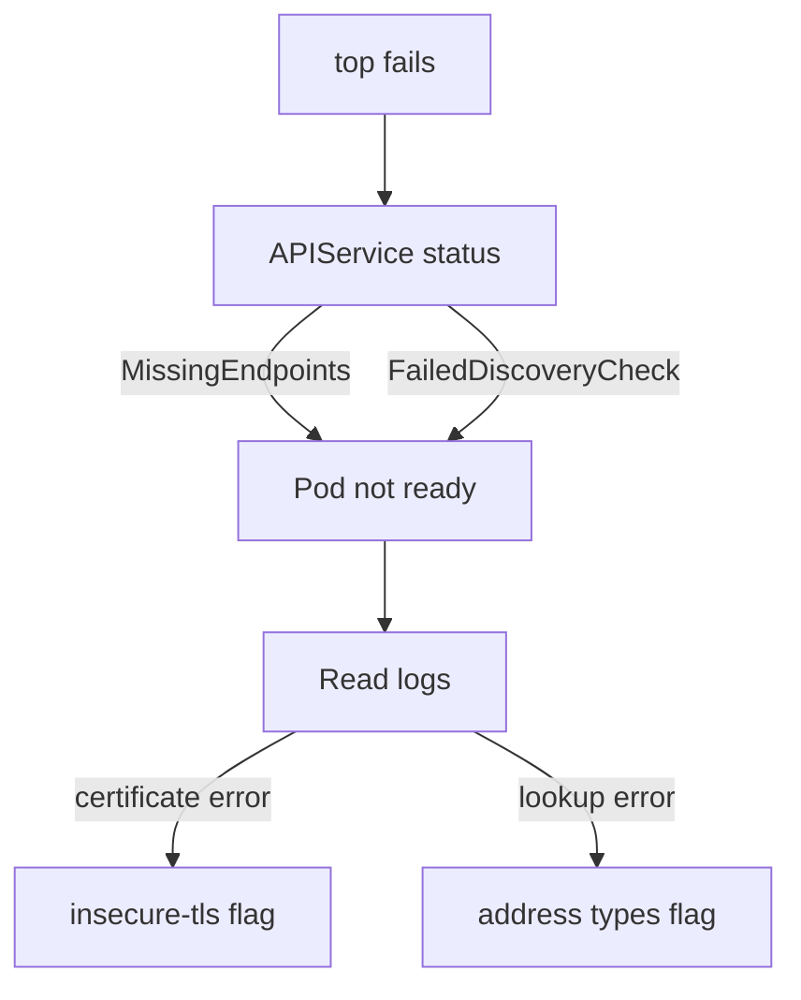

# Diagnosing And Repairing A Broken Metrics Server

The Metrics API stops answering, `kubectl top` prints an error, and the application keeps running. Most failures sit between metrics-server and the kubelets, and one pair of flags repairs the common ones. This chapter shows how to find the cause from the cluster and how to change the Deployment safely.

## Learning objectives

- Follow a short procedure from the symptom to the failing hop.
- Read the metrics-server logs for scrape errors.
- Explain what `--kubelet-insecure-tls` and `--kubelet-preferred-address-types` do and when they are acceptable.
- Change a container argument with a JSON patch and prove the repair.

## Before you start

The playground has a healthy metrics-server. You will read the commands and the flags there, but the playground is not broken, so do not expect an error from `kubectl top`. The graded task starts with a broken installation.

## A fixed order of checks

Work from the client toward the node and stop at the first failing step. The order prevents a long search.

1. Run `kubectl top nodes`. An error that mentions the Metrics API ends this step with a symptom.
2. Read the APIService status. `False` with `MissingEndpoints` means the Pod is not ready. `False` with `FailedDiscoveryCheck` means the Pod is ready or the Service routes badly.
3. Check the metrics-server Pod. If it is not `Ready`, read its events and logs.
4. If the Pod is ready and the APIService is `True` but the list is empty, read the logs for scrape errors.

<!-- astrona:playground:renew -->

```sh
kubectl top nodes
kubectl get apiservice v1beta1.metrics.k8s.io
kubectl -n kube-system get pods -l k8s-app=metrics-server
kubectl -n kube-system logs deployment/metrics-server --tail=20
```

On a healthy cluster the logs contain few lines. On a broken one they repeat the same scrape error for every node. The error names the node and the cause.

## Why a scrape fails

metrics-server opens an HTTPS connection to each kubelet, so two things must hold. It must reach the address, and it must trust the certificate the kubelet presents. The two flags below control those two things.

The flag `--kubelet-preferred-address-types` lists the node address types in the order metrics-server tries them. Node addresses can be `Hostname`, `InternalIP`, `ExternalIP`, `InternalDNS` and `ExternalDNS`. If the list starts with `Hostname` and cluster DNS cannot resolve node names, the scrape fails with a lookup error. Putting `InternalIP` first fixes that.

The flag `--kubelet-insecure-tls` makes metrics-server skip verification of the kubelet's serving certificate. By default metrics-server checks that the certificate was issued by the cluster certificate authority. A kubelet that generated its own self-signed serving certificate, which is the case in kind and many test clusters, fails that check with an error about an unknown certificate authority. The flag removes the check. The official documentation marks it as for testing only, because it makes a man-in-the-middle attack on the node connection possible. A production fix is to give kubelets certificates signed by the cluster authority.

## Read the flags

The arguments are in the container spec of the Deployment. Print them one per line, then confirm that the one you expect is present.

```sh
kubectl -n kube-system get deployment metrics-server -o jsonpath='{range .spec.template.spec.containers[0].args[*]}{@}{"\n"}{end}'
```

The playground installation includes `--kubelet-insecure-tls`. If a flag is missing in a broken installation, adding it is a one-line patch.

## Change one argument

A JSON patch (RFC 6902, a list of operations on paths inside the object) edits one place without touching the rest. The operation `add` with a path ending in `/-` appends to the end of an array. The command below appends `--kubelet-insecure-tls`.

```sh
kubectl -n kube-system patch deployment metrics-server --type=json -p='[{"op":"add","path":"/spec/template/spec/containers/0/args/-","value":"--kubelet-insecure-tls"}]'
kubectl -n kube-system rollout status deployment/metrics-server
```

Do not run this in the playground unless you remove the flag first, because the argument would then appear twice. The patch changes the Pod template, so the Deployment controller replaces the Pod. The new Pod starts with an empty sample store.

## Prove the repair

A repair is proven when the client works, not when the rollout finishes. Wait one sampling interval, then run `kubectl top nodes` and the raw node request. Both must return values. If the first scrape has not happened, `kubectl top` reports no metrics yet, so retry for up to a minute before you conclude anything.



The logs choose between the two flags, so read them before you edit anything.

You can now go from the symptom to the flag and prove the fix with the API. The next step is to practise it on a cluster that is broken on purpose.

## Common pitfalls

> [!WARNING]
> Do not add `--kubelet-insecure-tls` to a production cluster without accepting the risk. Do not delete and recreate the Deployment to fix an argument, because the patch is smaller and keeps its history. A rollout finishing is not proof that metrics work, so run `kubectl top nodes` after one sampling interval.
