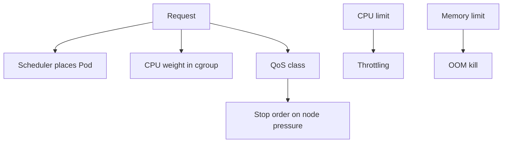

# QoS Classes And How Limits Are Enforced

Two containers on the same node can both exceed their settings, and only one is stopped. The kernel does not read Kubernetes objects. The kubelet translates requests and limits into settings the kernel understands, and the Quality of Service class decides who is stopped first. This chapter shows that translation for CPU and for memory.

## Learning objectives

- Assign a Quality of Service class from requests and limits.
- Explain CPU throttling and why no error message shows it.
- Explain why exceeding a memory limit kills the container.

## Before you start

A cgroup (control group) is a Linux kernel feature that limits and measures the resources of a group of processes. The kubelet creates one cgroup for each container and writes the limits into it. The playground has three workloads in `starfleet` with different settings: `scout` (requests lower than limits), `probe` (requests equal to limits) and `shuttle` (a CPU limit that is lower than what the process wants). The commands below read the class the API server stored.

## The three classes

The Quality of Service (QoS) class is a label Kubernetes calculates from the container settings of a Pod. It is stored in `status.qosClass`.

- `Guaranteed`: every container has a CPU limit and a memory limit, and each request equals its limit. If you set only limits, Kubernetes copies them into the requests.
- `Burstable`: at least one container has a request or a limit, and the Pod is not `Guaranteed`.
- `BestEffort`: no container has any CPU or memory request or limit.

The class does not change the placement. It matters under pressure. When a node runs out of memory, the kubelet and the kernel prefer to stop `BestEffort` Pods first, then `Burstable` Pods that exceed their requests, and `Guaranteed` Pods last.

<!-- astrona:playground:renew -->

```sh
kubectl -n starfleet get pods -o custom-columns=NAME:.metadata.name,QOS:.status.qosClass
kubectl -n starfleet get pod -l app=probe -o jsonpath='{.items[0].spec.containers[0].resources}{"\n"}'
```

The first command prints one class per Pod. The second prints the settings of one `probe` Pod, which has equal requests and limits for CPU and memory and therefore is `Guaranteed`. `scout` and `shuttle` have requests that differ from their limits, so both are `Burstable`.

No Pod in `starfleet` is `BestEffort`, although none of the sources asks for it. A LimitRange in the namespace fills in default requests and limits for any container that sets none, so the Pod is stored with values and becomes `Burstable`. The class is calculated from the stored Pod and not from your file.

## CPU: shares and throttling

CPU is a compressible resource. A container that wants more CPU than it has is slowed down and nothing is killed. The kubelet writes the CPU request as a weight in the cgroup. When the CPU is busy, the kernel gives each container time in proportion to those weights. An idle CPU gives the container as much as it asks for, so a request is a guarantee of a minimum share and not a cap.

A CPU limit is a cap. The kubelet writes it as a quota per scheduling period of 100 milliseconds. A limit of `200m` allows 20 milliseconds of CPU time in each period. When the container uses its quota early in a period, the kernel pauses it until the next period. That pause is throttling. The application is slower and its latency rises, but Kubernetes reports no event and no restart.

## Memory: no compressing

Memory is not compressible. The kernel cannot slow a process down to make it use less memory. The kubelet writes the memory limit into the cgroup. When the container tries to use more and the kernel cannot free enough memory in that cgroup, the kernel out-of-memory (OOM) killer ends a process in the container. If that process is the main process, the container stops with reason `OOMKilled`.

A memory request is not enforced by the cgroup. It is used by the scheduler for placement, and by the kubelet when it picks Pods to stop on a node that is short of memory. The kubelet also sets an OOM score adjustment from the class: a `Guaranteed` Pod gets a strongly negative value, a `BestEffort` Pod gets the highest value, and a `Burstable` Pod gets a value that depends on how much it requested. The kernel stops the process with the highest score first when the whole node is out of memory.



Requests drive placement, weights and the class, and limits drive throttling and kills.

## Find throttling

Because Kubernetes shows no event for throttling, you look for it indirectly. Compare `kubectl top` CPU with the CPU limit: a container whose usage sits at its limit is very likely throttled. Inside the container, the file `/sys/fs/cgroup/cpu.stat` on a cgroup version 2 node has the counters `nr_throttled` and `throttled_usec`. They only increase while the container is being paused.

```sh
kubectl -n starfleet top pods
kubectl -n starfleet exec deploy/shuttle -- cat /sys/fs/cgroup/cpu.stat
```

The `shuttle` Pod in the playground burns CPU against a limit of `100m`. The `nr_throttled` counter in the second command is greater than zero and keeps growing. The file exists only on nodes that use cgroup version 2, so on another node the command fails with a missing file.

You can now predict what the kernel does for each setting. The open question is how to prove an OOM kill happened, because the restarted container hides it.

## Worked reading of a limit

Take `shuttle` with a CPU request of `50m` and a CPU limit of `100m`. On an idle node it can use up to `100m` and no more, because the cap applies even when nothing else wants the CPU. On a busy node it is guaranteed at least its share of `50m` relative to the other containers. Its measured usage in `kubectl top` therefore approaches `100m` and stays there, and that flat line is the visible sign of a cap.

The same container with a memory limit of `64Mi` behaves differently. Nothing slows it down at `63Mi`. At `65Mi` the kernel kills it. CPU limits shape performance, and memory limits decide whether the process lives.

## Pod overhead and sidecars

The class belongs to the whole Pod. One container without a limit is enough to make the Pod `Burstable`, even when every other container has equal requests and limits. When you need a `Guaranteed` Pod, check every container, including sidecars and init containers.

## Common pitfalls

> [!WARNING]
> A CPU request is a minimum share, not a cap, and a CPU limit slows a container without any event or restart. A memory request does not stop a container from using more. Setting only limits makes the requests equal to them, which changes the class to `Guaranteed` only if both CPU and memory have them.
