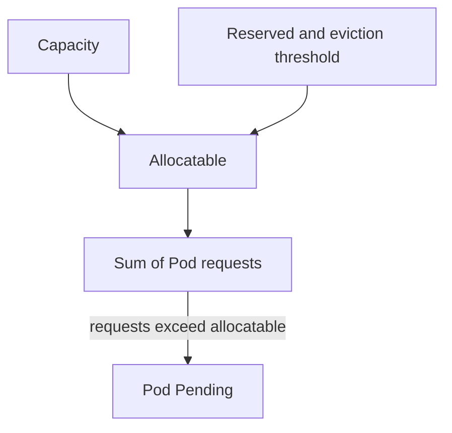

# Diagnosing OOMKilled And Node Capacity

A container with an out-of-memory kill restarts, runs for a few seconds and restarts again. Logs often show nothing, because the kernel ended the process without warning. This chapter shows where the evidence is stored, how to separate a too-low limit from a leak, and how to compare the requests on a node with what the node can allocate.

## Learning objectives

- Read `lastState.terminated` to prove an OOM kill.
- Explain exit code 137 and `CrashLoopBackOff`.
- Choose between raising the limit and fixing the application.
- Compare node capacity, allocatable and allocated requests.

## Before you start

The playground has the Deployment `scout` in `starfleet`. Its container allocates about 150 MiB of memory and has a memory limit of 96 MiB, so the kernel ends it again and again. A container restart is performed by the kubelet according to the Pod's `restartPolicy`, which is `Always` for Deployment Pods.

## The evidence in the Pod status

When the kernel ends the container process, the container runtime reports the exit to the kubelet. The kubelet writes the result into `status.containerStatuses`. The field `lastState.terminated` holds the previous run with `reason`, `exitCode` and timestamps. The reason is `OOMKilled` when the kernel's out-of-memory killer ended it. The exit code is `137`, which is 128 plus signal number 9 (SIGKILL).

<!-- astrona:playground:renew -->

```sh
kubectl -n starfleet get pods -l app=scout
kubectl -n starfleet get pod -l app=scout -o jsonpath='{.items[0].status.containerStatuses[0].lastState.terminated.reason}{" "}{.items[0].status.containerStatuses[0].lastState.terminated.exitCode}{"\n"}'
kubectl -n starfleet describe pod -l app=scout | grep -A6 "Last State"
```

The first command shows a rising `RESTARTS` count and the status `OOMKilled` or `CrashLoopBackOff`. The second prints the reason and the exit code of the previous run. The third prints the same record in the readable form of `describe`.

After a few restarts the kubelet waits longer between starts, doubling the delay up to five minutes. The status `CrashLoopBackOff` describes that waiting period. It is not a cause. Read `lastState` to find the cause.

## Exit 137 does not always mean OOM

Exit code 137 means that the process received SIGKILL. The OOM killer is one sender. Another is the kubelet, which sends SIGKILL when a container does not stop within the grace period after a delete or a failed liveness probe. The reason field separates them: `OOMKilled` is an out-of-memory kill, while `Error` with 137 comes from another sender. A Pod stopped for node-wide memory pressure has the status `Evicted` and reason `Evicted`, and the Pod message names the resource.

## Fix the right thing

Compare three numbers: the limit, the usage just before the kill, and what the application should need. Run `kubectl top pods --containers` while the container is alive. If usage is steady and only slightly above the limit, the limit is too low for a normal workload. If usage keeps rising until it is killed, the application has a leak and a higher limit only delays the kill.

When you raise a limit, raise the request too, so the scheduler reserves the memory the container now uses. Then check two policy limits: a LimitRange can cap the value per container, and a ResourceQuota can cap the total in the namespace. Either one can reject the new Pod.

```sh
kubectl -n starfleet set resources deployment/scout --requests=memory=128Mi --limits=memory=200Mi
kubectl -n starfleet rollout status deployment/scout --timeout=120s
```

## Node capacity and allocatable

The node reports two amounts. Capacity is the hardware total. Allocatable is what is left for Pods after the kubelet subtracts the memory and CPU reserved for the operating system and Kubernetes daemons (`system-reserved` and `kube-reserved`) and the hard eviction threshold. The scheduler uses allocatable.

```sh
kubectl describe node | grep -E "^Capacity|^Allocatable|cpu|memory" | head -20
kubectl describe node | grep -A12 "Allocated resources"
```

The second command prints the sums of requests and limits as a percentage of allocatable. A node can show 95 percent allocated memory while its real usage is low, and it will then refuse new Pods. In a kind cluster, capacity usually equals allocatable because nothing is reserved. Do not treat that as typical for a production node.



The scheduler compares the sum of requests with allocatable, not with usage.

You now know how to prove the kill, separate a low limit from a leak and read the node's accounting. Policy objects can still reject the fix, which the next chapter explains.

## Reading the restart count

The restart count in `kubectl get pods` increases by one for every container restart. A count that grows by one every few seconds at the start and then slows down shows the back-off delay at work. A count that stays at zero for hours and then jumps points to a memory use that grows with the amount of work, for example a cache without a size limit. Pair the count with the timestamps in `lastState.terminated.startedAt` and `finishedAt` to see how long each run lasted before the kill.

A run that always ends after the same number of seconds suggests an allocation at start-up that is larger than the limit. A run that lasts longer after each limit increase suggests growth over time.

## Checking the fix

A fix is proven when the Pod runs longer than the failing runs did and the restart count stops growing. Wait at least one full run of the workload, then read `lastState` again. If the previous state is still `OOMKilled` with a recent finish time, the new limit is still too low. If the Pod is new, `lastState` is empty, and the restart count is zero, the new Pod has not been killed yet.

## A note on node memory pressure

Two different mechanisms stop containers for memory. The kernel's cgroup limit ends a container that exceeds its own limit, and the cause is local to that container. The kubelet's eviction manager ends whole Pods when the node itself runs low on memory, and the cause is the node. Evicted Pods stay in the list with the status `Evicted` until they are deleted. The node condition `MemoryPressure` becomes `True` while the pressure lasts.

## Common pitfalls

> [!WARNING]
> `CrashLoopBackOff` is a delay between restarts and not a cause. Read `lastState.terminated.reason`. Do not read exit code 137 as proof of an OOM kill without the reason. A higher limit does not fix a leak, and a node with low usage can still be full of requests.
