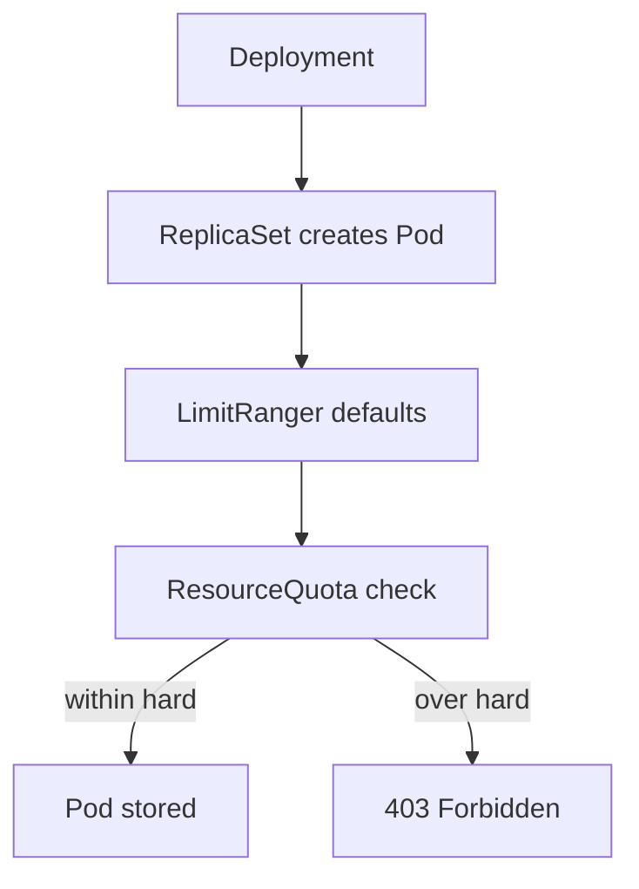

# ResourceQuota, LimitRange And Admission

The API server can refuse to create a Pod before any node sees it. Two namespace objects cause that: a ResourceQuota that caps the total a namespace may use, and a LimitRange that sets defaults and per-container bounds. This chapter shows the rejection messages and how to fix them without deleting the policy.

## Learning objectives

- Explain when quota and LimitRange act.
- Read `kubectl describe quota` and a rejection message.
- Explain how a LimitRange default can satisfy a quota.
- Fix a rejected workload with the smallest policy-compatible change.

## Before you start

Admission is the step in the API server where plugins check or change a request after authentication and authorization and before the object is stored. The `LimitRanger` plugin runs first and fills in defaults. The `ResourceQuota` plugin runs after it and rejects requests that exceed the namespace total. The playground has a ResourceQuota and a LimitRange in `starfleet`, and a quota without a LimitRange in `outpost`.

## Read a ResourceQuota

A ResourceQuota has a `hard` map of limits such as `requests.memory`, `limits.memory`, `requests.cpu` and `pods`. The quota controller keeps a `used` map with the current totals. The command `kubectl describe quota` prints both in one table.

<!-- astrona:playground:renew -->

```sh
kubectl -n starfleet describe quota
kubectl -n outpost describe quota
```

The `Used` column counts the Pods that exist and the `Hard` column is the cap. When a compute quota names `requests.memory` or `limits.memory`, every new Pod must state that value for each container, or a default must supply it. Otherwise the request fails.

## What a rejection looks like

Quota is checked when the Pod is created. A Deployment does not create Pods itself. The ReplicaSet controller does, and the API server answers it with an error. The error becomes an event on the ReplicaSet, and the Deployment shows fewer ready replicas than desired. No Pod exists, so `kubectl get pods` shows nothing for the missing replicas.

```sh
kubectl -n outpost get deployment drifter
kubectl -n outpost describe replicaset -l app=drifter | grep -A3 "FailedCreate"
```

For a quota total that is exceeded, the message reads `exceeded quota: <name>, requested: <resource>=<amount>, used: <resource>=<amount>, limited: <resource>=<amount>`. For a missing value it reads `failed quota: <name>: must specify limits.memory,requests.memory`. Both come with the HTTP status 403 Forbidden.

## LimitRange defaults and bounds

A LimitRange of type `Container` can set `default` (the limit for containers with none), `defaultRequest` (the request for containers with none), `min`, `max` and `maxLimitRequestRatio`. The defaults are written into the Pod when it is created, so the stored Pod shows them. This is why a Deployment that sets nothing can still be admitted under a quota: the LimitRanger plugin runs before the quota check.

A LimitRange also rejects Pods. A container with a limit above `max` fails with a message such as `maximum memory usage per Container is 256Mi, but limit is 512Mi`. A LimitRange does not change Pods that already exist. It applies only to Pods created after it.

```sh
kubectl -n starfleet get limitrange -o yaml
```

Read the `max` and the `default` values here before you choose a new limit, because the new limit must stay inside them.

## Fix without removing policy

Three fixes exist and each has a cost. Lowering the workload's requests and limits keeps the policy and may break the workload. Raising the quota keeps the workload and moves the cost to the namespace owner, so it needs approval in a real cluster. Adding a LimitRange default keeps both and fills missing values for everything in the namespace.



Defaults are applied before the quota check, so a LimitRange can make a Pod admissible.

A fix is proven by the ReplicaSet creating its Pods. Controllers retry with a growing delay, so a fix may take a short time to show. A rollout restart makes the retry immediate.

```sh
kubectl -n outpost rollout restart deployment/drifter
kubectl -n outpost get pods
```

You can now explain why a Pod never appeared, which component refused it and what each fix costs. Deleting the quota would also work and would remove the protection, so it is never the right answer to a quota failure.

## Which objects a quota counts

A compute quota counts `requests.cpu`, `requests.memory`, `limits.cpu` and `limits.memory` of Pods that are not finished. A Pod in the phase `Succeeded` or `Failed` no longer counts. Object-count quotas such as `pods` or `configmaps` count objects of that kind. The quota does not count usage that `kubectl top` measures. A namespace can therefore reach its cap with small, idle Pods.

During a rolling update the old and the new Pods exist at the same time. A Deployment that fits the quota at rest can fail to roll out because the surge Pods push the total over the cap. Read the `Used` column before and during a rollout.

## Common pitfalls

> [!WARNING]
> A quota rejection leaves no Pod, so `kubectl get pods` is empty; read the ReplicaSet events. A LimitRange does not change existing Pods. Do not delete a quota to make a workload start. Quota counts requests and limits, not usage, so a namespace can be full while usage is low.
