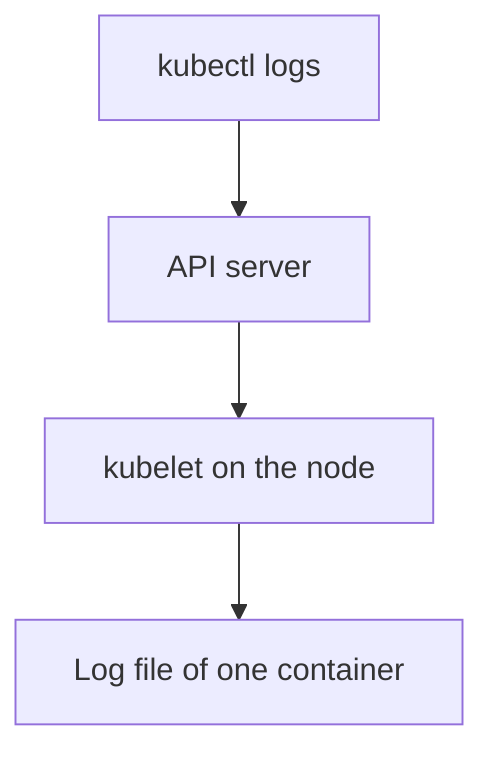

# Reading Logs Of Containers, Init Containers And Pod Sets

A Pod named `probe` can run an `api` container and a `worker` container. Only the `worker` has logged an error. If you read the wrong container, you see healthy lines and conclude that nothing is wrong. This chapter shows how `kubectl logs` chooses a stream and which flags let you select exactly the one you need.

## Learning objectives

- Select a container with `-c` and read every container with `--all-containers`.
- Select many Pods with `-l` and attribute each line with `--prefix`.
- Bound the output with `--since`, `--tail` and `--timestamps`.
- Find an init container failure from its status and its log.

## Before you start

A container is a running process with its own file system view, started from an image. A Pod can hold several containers. An init container is a container that runs and finishes before the main containers start. The playground for this module runs Pod `probe` with containers `api` and `worker`, Pod `shuttle` with an init container, and Deployment `scout` with two replicas.

## How kubectl chooses a container

The `kubectl logs` command sends a request to the API server for the `log` subresource of one Pod. The API server forwards the request to the kubelet, the node agent, which reads the log file that the container runtime wrote for one container. A request therefore always names one Pod and one container. If you do not name the container and the Pod has several, kubectl uses the container named in the annotation `kubectl.kubernetes.io/default-container` when it exists. Otherwise it takes the first container in the Pod spec and prints a notice on standard error that it used a default.

That default is a convenience, not a diagnosis. It can pick the healthy container. The first command below shows the notice, and the next two read each container by name.

<!-- astrona:playground:renew -->

```sh
kubectl -n starfleet logs probe
kubectl -n starfleet logs probe -c api --tail=3
kubectl -n starfleet logs probe -c worker
```

The first command reads the `api` container, because it is first in the spec, and shows only request lines. The third command shows the `worker` lines, including the line `worker: ERROR code=E-4417 backend unreachable`. The error code is evidence that the first command never showed.

## Read all containers at once

When you do not know which container failed, read them all. The `--all-containers` flag requests every container of the Pod, and `--prefix` writes the Pod and container name in front of each line:

```sh
kubectl -n starfleet logs probe --all-containers --prefix
```

Each line starts with a source such as `[pod/probe/worker]`. The flag also includes init containers when the Pod has them. Without `--prefix`, lines from different containers look the same and you cannot tell who wrote them.

## Read many Pods with a label selector

The flag `-l` takes a label selector and returns the logs of every Pod that matches. This is the tool for a Deployment with several replicas, where one Pod is not enough evidence:

```sh
kubectl -n starfleet logs -l app=scout --prefix --tail=3 --timestamps
```

With a selector, `--tail` defaults to 10 lines per Pod. When you follow the logs with `-f`, kubectl opens at most five log requests at the same time, set by `--max-log-requests`, and stops with an error when the selector matches more Pods than that limit, unless you raise it. The prefix tells you which replica wrote which line, and the timestamp lets you compare replicas.

## Bound the output

Three flags reduce the output to what matters. `--tail=N` returns the last N lines. `--since=5m` returns only lines from the last five minutes, and `--since-time` accepts a fixed time in RFC 3339 format. `--timestamps` adds the time that the runtime recorded to each line. Add `--limit-bytes` to stop after a number of bytes. Use them together: a bounded window around the time of the incident is easier to read than a full history, and it avoids reading a very large file.

## Follow a stream

The flag `-f` keeps the request open and prints new lines as the container writes them. Combine it with `--since` or `--tail` so that the first screen shows the recent past and then the live lines. Stop it with Control-C. Silence in a followed stream does not prove health: the container may log to a file, or you may have selected the wrong container.

## Init containers

Init containers run one after another before the main containers start, and each one must finish with exit code 0. If one fails, the kubelet restarts it according to the Pod restart policy and the main containers never start. The Pod status then starts with `Init:`, for example `Init:CrashLoopBackOff` or `Init:Error`, and the status shows the number of init containers that finished, for example `Init:0/1`.

The log of a failed init container is the primary evidence. Read it with `-c` and the init container name. Pod `shuttle` has a finished init container named `prepare`:

```sh
kubectl -n starfleet get pod shuttle
kubectl -n starfleet logs shuttle -c prepare
kubectl -n starfleet logs shuttle -c main
```

The Pod is `Running` because the init container finished. The log of `prepare` stays readable after it finished, and the log of `main` is separate. For a failing init container you add `--previous` when the container has restarted, exactly as for a normal container.



The request always ends at the log file of one container, which is why the container name matters.

You can now select one stream from a Pod with several containers, read a set of Pods with attribution, and find an init container failure. A container that writes its log to a file instead of standard output is still invisible to all of these commands.

## Common pitfalls

> [!WARNING]
> A command without `-c` (on a Pod with several containers) can read the healthy container and hide the error. An init container that keeps failing blocks the main containers, so `kubectl logs` for the main container reports that it is waiting to start. Read the init container by name. Following a selector that matches more than five Pods fails unless you raise `--max-log-requests`.
