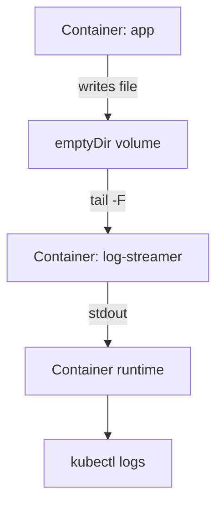

# Sidecar Containers That Stream Log Files

Some applications do not write their log to standard output. They append to a file such as `/var/log/app/events.log`. The container runtime only captures standard output and standard error, so `kubectl logs` shows nothing for that file. This chapter explains why, and shows the sidecar pattern that makes the file readable with the normal tools.

## Learning objectives

- Explain which output the container runtime captures and which it does not.
- Describe how a sidecar container reads a file from a shared `emptyDir` volume and prints it.
- Verify the pattern by reading the sidecar log and the file itself.
- Name the limits of the pattern.

## Before you start

A volume is a directory that Kubernetes mounts into containers. An `emptyDir` volume is created empty when the Pod starts on a node, can be mounted by several containers of the same Pod, and is deleted when the Pod is removed. A sidecar container is an additional container in the same Pod that supports the main one. The playground for this module runs Pod `bridge` in `starfleet` with this pattern.

## What the runtime captures

When the kubelet starts a container, the container runtime connects the standard output and standard error of the main process to a log file on the node. Everything the process writes to those two streams is stored there, and `kubectl logs` reads it back. A line written to a regular file inside the container goes to the container's own writable layer or to a volume. The runtime does not read it, so no log line appears.

The first check shows the difference. Container `app` in Pod `bridge` prints one line to standard output at the start and appends an event to a file every five seconds.

<!-- astrona:playground:renew -->

```sh
kubectl -n starfleet logs bridge -c app
kubectl -n starfleet exec bridge -c app -- tail -n 3 /var/log/app/events.log
```

The first command prints only the start line, because the events go to the file. The second command runs `tail` inside container `app` and prints the last three events. The data exists, but only a process inside the Pod can read it.

## The sidecar pattern

The fix needs no change to the application. Both containers mount the same `emptyDir` volume at `/var/log/app`. The `app` container writes the file. The `log-streamer` container runs `tail -n+1 -F /var/log/app/events.log`, which prints the whole file and then each new line to its own standard output. The runtime captures that output, so the file content becomes a normal container log.

The relevant parts of the Pod definition are the shared volume, the two mounts and the sidecar command. This is the same Pod that already runs in the playground, so you do not apply it again:

```yaml
spec:
  containers:
  - name: app
    volumeMounts:
    - name: applog
      mountPath: /var/log/app
  - name: log-streamer
    command: ["sh", "-c", "tail -n+1 -F /var/log/app/events.log"]
    volumeMounts:
    - name: applog
      mountPath: /var/log/app
      readOnly: true
  volumes:
  - name: applog
    emptyDir: {}
```

The mount in the sidecar is read-only, because it only reads. Now read the sidecar log:

```sh
kubectl -n starfleet logs bridge -c log-streamer --tail=5 --timestamps
```

The lines are the same events that are in the file, with the timestamps that the runtime added when the sidecar printed them. The timestamp shows when the sidecar printed the line, which can be later than when the application wrote it.



The sidecar turns a file into standard output, and the runtime and kubectl do the rest.

## Failure cases to recognise

Three faults look alike from the outside, and each has a different proof. If the sidecar log is empty, list the directory from the sidecar with `kubectl exec` to check that the file exists at the path you expect. If the file exists but is empty, the application writes elsewhere or has not logged yet. If the file does not exist, the volume is not mounted in one of the containers, or the paths differ.

Another case is a sidecar that starts before the application creates the file. A plain `tail -f` fails when the file is missing, while `tail -F` waits and retries until the file appears. The sidecar in the playground also runs `touch` on the file first, so the start order does not matter.

## Limits of the pattern

The sidecar doubles the number of containers and uses CPU and memory of its own. The file grows without a limit unless the application rotates it, and the sidecar prints every line again, so the data is stored twice on the node. The volume is deleted with the Pod, so a deleted Pod loses the file. A sidecar that exits ends its own log, and a sidecar with a wrong path prints nothing, which looks like a healthy silent application.

In a larger platform a logging agent often runs as a sidecar or on every node and ships the lines to a central store. The tail sidecar is the simple version of the same idea, and it is enough to make the file visible to the kubelet.

You can now explain why a file log is invisible to `kubectl logs` and how a sidecar makes it visible. When the log is still not enough, you need to look inside the running container.

## Common pitfalls

> [!WARNING]
> Both containers must mount the same volume at the path the application writes to. A sidecar that mounts the volume at another path, or tails a file name the application does not write, shows an empty log. Do not conclude that the application is quiet before you have listed the directory with `kubectl exec`.
