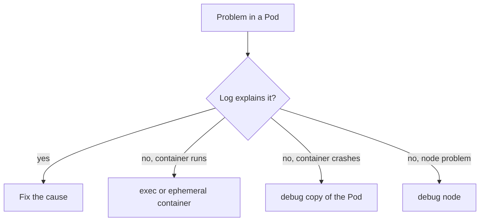

# Debugging With Exec And Ephemeral Containers

When the log does not explain a failure, you need to look inside: list a directory, read a file, check a process or run a network tool. Kubernetes offers three tools for this. `kubectl exec` runs a command in an existing container. `kubectl debug` adds a temporary container to a running Pod, or starts a modified copy of a Pod, or starts a debug Pod on a node. This chapter explains what each tool does and when it cannot help.

## Learning objectives

- Run a command or open a shell in a container with `kubectl exec`.
- Attach an ephemeral container with `kubectl debug --target`.
- Debug a copy of a Pod with `--copy-to`.
- Explain what `kubectl debug node/<name>` creates.

## Before you start

A process namespace is the view of the processes that a container can see. By default each container sees only its own processes. The playground for this module runs Pod `probe` with containers `api` and `worker` and Pod `bridge` with a shared volume.

## Run a command with exec

`kubectl exec` asks the API server to open a stream to the container through the kubelet and the runtime, and starts a new process inside the container. The `-c` flag selects the container. The `--` separates kubectl flags from the command.

<!-- astrona:playground:renew -->

```sh
kubectl -n starfleet exec probe -c api -- ps
kubectl -n starfleet exec -it bridge -c app -- sh
```

The first command prints the processes inside container `api`. You see only that container, because process namespaces are separate. The second command opens an interactive shell, where `-i` keeps standard input open and `-t` allocates a terminal. Type `ls /var/log/app` and then `exit`.

Exec has a hard limit: it needs a shell or the command in the image. A minimal image without a shell cannot run `sh`, and the command fails. The container must also be running. You cannot exec into a container that has crashed or has not started.

## Attach an ephemeral container

An ephemeral container is a temporary container that Kubernetes adds to a Pod that is already running. It has its own image, so you bring the tools. It is never restarted and cannot be removed, and it does not get ports or probes. The command `kubectl debug` creates it:

```sh
kubectl -n starfleet debug -it probe --image=busybox:1.37.0 --target=worker -- sh
```

The flag `--target=worker` makes the new container join the process namespace of container `worker`, when the container runtime supports it. Inside the shell, `ps` shows the processes of `worker`. You can read `/proc/<pid>/root` to see its files. Type `exit` to leave. The ephemeral container stays in the Pod status as terminated, and the Pod itself is not restarted.

## Debug a copy of the Pod

Sometimes you must change the Pod to debug it, for example to replace the command of a crashing container with a shell. Changing the original destroys the evidence. The flag `--copy-to` creates a new Pod from the original and applies your changes to the copy:

```sh
kubectl -n starfleet debug bridge -it --copy-to=bridge-debug --container=app -- sh
kubectl -n starfleet get pod bridge-debug
kubectl -n starfleet delete pod bridge-debug
```

The flag `--container=app` selects the container whose command is replaced with `sh`. The original `bridge` Pod keeps running unchanged. Add `--share-processes` to let all containers of the copy see each other's processes. Delete the copy when you finish, because it keeps running and uses resources.

## Which component does the work

For exec and for an ephemeral container, the API server authorises the request and the kubelet on the node carries it out through the container runtime. The permission to run exec is the `create` verb on the `pods/exec` subresource. Adding an ephemeral container needs permission on the `pods/ephemeralcontainers` subresource. A user who can read logs may still be denied exec, and cluster administrators often grant these separately because a shell can read secrets that are mounted into the container.

An ephemeral container shares the network namespace of the Pod, because all containers of a Pod share one network namespace. A `wget` from the debug container therefore reaches the same addresses as the application and shows the same network problems. It does not share the file system of the target container, which is why you read `/proc/<pid>/root` to reach it.

## Worked example: the quiet worker

Suppose the `worker` container of `probe` logs `backend unreachable`, and you want to know whether the Pod can reach anything at all. The image has no network tools besides the ones in busybox, and you must not restart it. Attach an ephemeral container with the `busybox:1.37.0` image, run `nslookup` or `wget` against the backend name, and compare the result with the same command from `shuttle`. If both fail, the name or the network is the problem. If only `probe` fails, look at its own configuration. The log gave the symptom, and the ephemeral container separated a Pod problem from a cluster problem.

## Debug a node

The command `kubectl debug node/<node-name> -it --image=busybox:1.37.0` creates a Pod that runs on that node with the root file system of the node mounted at `/host`. Inside it you can read files such as `/host/var/log/pods`. Use `chroot /host` to run the node's own tools. The Pod is not removed automatically, so delete it when you finish.



The tool you pick depends on whether the container runs, crashes, lacks a shell or sits on a faulty node.

You can now choose between exec, an ephemeral container, a copy and a node debug Pod. Each one also changes the cluster, so you clean up what you add. When the evidence is on the node itself, you need the node-level logs.

## Clean up and record what you changed

Every debug tool leaves something behind. Exec leaves nothing, apart from the shell history inside the container. An ephemeral container stays in the Pod status. A copy is a Pod you must delete. A node debug Pod must be deleted too. List the Pods in the namespace after a session and remove the ones that start with the name you gave to `--copy-to` or the generated name `node-debugger`. A cluster full of forgotten debug Pods hides the real workloads and can still receive traffic.

## Common pitfalls

> [!WARNING]
> Exec needs a running container with the tool you call. An ephemeral container cannot be deleted, so it stays in the Pod object until the Pod ends. A debug copy is a second Pod with the same labels, so a Service can send traffic to it. Delete copies and node debug Pods when you finish.
