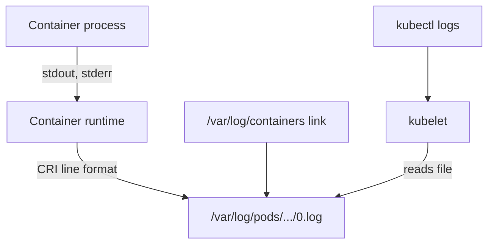

# Where Container Logs Live On The Node

When you run `kubectl logs`, the text comes from a file on a node. If you understand where that file is and how it is written, you can read the log when the API is not available, find the file of a Pod that you cannot query, and explain why old lines disappear. This chapter follows one line of output from the process to the file and then explains rotation.

## Learning objectives

- Describe the line format that the runtime writes to the log file.
- Find the log file of a container under `/var/log/pods` and the link under `/var/log/containers`.
- Name the kubelet settings `containerLogMaxSize` and `containerLogMaxFiles` and their defaults.
- Explain why `kubectl logs` returns only part of the history.

## Before you start

A node is a machine that runs Pods. The kubelet is the agent on a node that starts containers through the container runtime. The runtime, here containerd, is the software that creates and runs the containers. The playground runs a worker node as the container `astro-ats-023-playground-040-03-worker`. Commands run on it with `podman exec` (use `docker exec` when you use Docker).

## From standard output to a file

The process in a container writes to standard output and standard error. The container runtime reads both streams and writes each line to a log file on the node. It adds a time stamp, the name of the stream and a flag that says whether the line is complete. The format is the one that the Container Runtime Interface (CRI), the API between the kubelet and the runtime, defines:

```text
<time stamp> <stream> <flag> <message>
```

The stream is `stdout` or `stderr`. The flag is `F` for a full line and `P` for a partial line, which the runtime writes when a very long line is split. The time stamp is the time that the runtime recorded, which is what `kubectl logs --timestamps` prints.

The kubelet decides the directory. For each Pod it creates `/var/log/pods/<namespace>_<pod-name>_<pod-uid>/`, and inside it one directory per container with one file per restart: `0.log` for the first run, `1.log` for the next one, and so on. Pod `beacon-logger` in `starfleet` runs on the worker node in the playground, so its file is in that tree.

<!-- astrona:playground:renew -->

```sh
podman exec astro-ats-023-playground-040-03-worker sh -c 'ls -d /var/log/pods/starfleet_beacon-logger_*/logger/*'
podman exec astro-ats-023-playground-040-03-worker sh -c 'cat /var/log/pods/starfleet_beacon-logger_*/logger/0.log'
kubectl -n starfleet logs beacon-logger --timestamps
```

The first command lists the file `0.log`. The second shows two lines in the runtime format, one with `stdout` and one with `stderr`, and both with the flag `F`. The third command shows the same message text without the stream name and the flag. The API server asked the kubelet, and the kubelet read this file.

## The links under /var/log/containers

The directory `/var/log/containers` holds one symbolic link per container. A symbolic link is a small file that points to another path. The name is `<pod>_<namespace>_<container>-<container-id>.log`, and the link points to the file under `/var/log/pods`. Log shipping agents read this directory because the names carry the Pod, the namespace and the container.

```sh
podman exec astro-ats-023-playground-040-03-worker sh -c 'ls -l /var/log/containers | grep beacon-logger'
```

The output shows the name of the link and an arrow to a path under `/var/log/pods`. Both paths lead to the same content. When you search for a Pod by name, `/var/log/containers` is quicker, and when you need the Pod uid, use `/var/log/pods`.



The runtime writes the file, the kubelet reads it and `kubectl logs` reaches it through the kubelet.

## Rotation

A log file cannot grow without a limit. The kubelet rotates container logs with two settings in its configuration file, a KubeletConfiguration (the kubelet's configuration file format). `containerLogMaxSize` is the size at which a file is rotated, with the default `10Mi`. `containerLogMaxFiles` is the number of files kept for one container, with the default `5`. The kubelet sends these values to the runtime over CRI, and the runtime rotates the file.

On a kind node the kubelet file is `/var/lib/kubelet/config.yaml`. A field that is not in the file has its default value:

```sh
podman exec astro-ats-023-playground-040-03-worker sh -c 'grep -i containerLog /var/lib/kubelet/config.yaml || echo "not set: defaults apply"'
```

`kubectl logs` reads only the newest file of a container. A container that wrote 40 MiB with the default size has rotated several times, and the command returns at most the content of the current file. The older files stay on the node until the count exceeds `containerLogMaxFiles`. To read them you need node access.

## A worked reading of one line

Take the line `2026-01-01T10:00:00.123456789Z stdout F beacon: node log marker playground-77`. The first field is the time stamp in RFC 3339 format with nanoseconds, written by the runtime. The second field says that the process wrote it to standard output. The third field `F` says the line is complete. Everything after that is the message, exactly as the process wrote it. The time stamp is an example that shows the format, not output from your cluster.

This tells you what a log shipping agent has to do: split on the first three spaces, join partial lines that carry `P` until a line with `F` arrives, and keep the stream name if stdout and stderr must stay separate. It also tells you that a log file is evidence of what the process wrote, not of what the application meant.

## What disappears when

The log files of a Pod are removed when the Pod is deleted, and the kubelet removes the files of an evicted Pod with it. After a restart, the previous container's file is kept, because the kubelet keeps one terminated container by default. That is why `kubectl logs --previous` works for the last restart and no further back.

You can now follow a line from the process to its file, find the file by Pod name and explain why `kubectl logs` returns only a part of the history. The kubelet and the runtime also write their own logs, and those logs explain why a container never started.

## Common pitfalls

> [!WARNING]
> The names under `/var/log/containers` are links, so deleting or copying them does not copy the data. The directory name under `/var/log/pods` contains the Pod uid, which changes when a Pod is recreated, so use a wildcard or look it up. A missing file does not mean the container logged nothing: the Pod may have been deleted, or the container may never have started.
