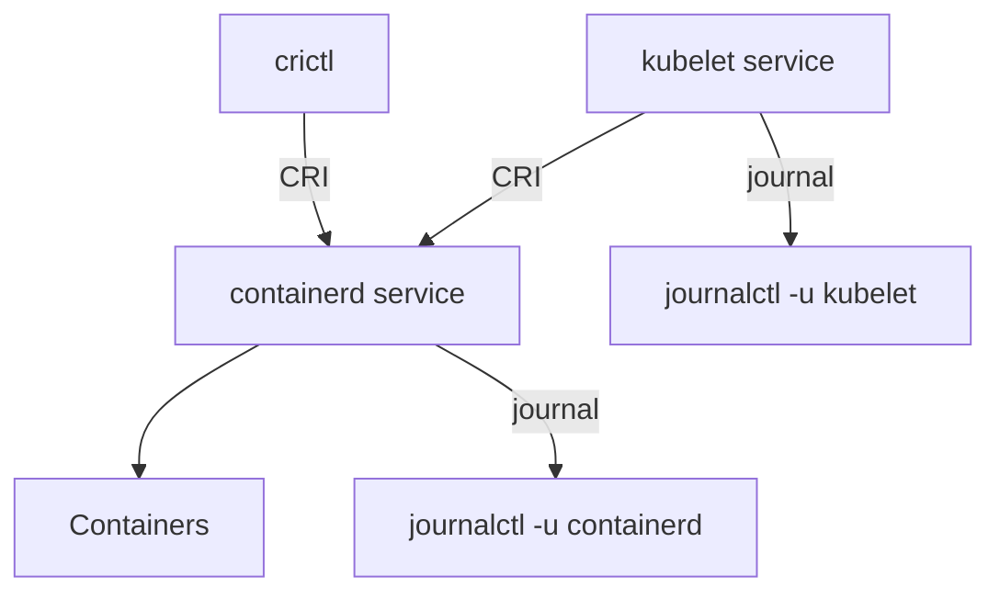

# Reading The Kubelet And Runtime With journalctl And crictl

Some failures never produce a container log. A Pod whose image cannot be pulled has no container, so it has no log file. The explanation is in the logs of the kubelet and the container runtime, which are services of the node and not Pods. This chapter shows where those logs are and how to ask the runtime directly what it knows.

## Learning objectives

- Read the kubelet and containerd logs with `journalctl -u`.
- Narrow a journal by time and by text.
- List containers and Pods on a node with `crictl ps` and `crictl pods`.
- Read a container log with `crictl logs`.

## Before you start

systemd is the service manager on most Linux nodes. The journal is its log store, and `journalctl` reads it. `crictl` is a command-line client for the Container Runtime Interface, so it talks to the runtime on the node and does not need the API server. The playground has Deployment `relay` in `outpost` with an image tag that does not exist, and a worker node that you reach with `podman exec`.

## The kubelet and containerd are services

On a kubeadm-style node, which kind nodes are, the kubelet and containerd run as systemd services named `kubelet` and `containerd`. Their output goes to the journal. The option `-u` selects a service, `--no-pager` prints without a pager, `--since` limits the start time and `-n` limits the number of lines.

<!-- astrona:playground:renew -->

```sh
podman exec astro-ats-023-playground-040-03-worker sh -c 'journalctl -u kubelet --no-pager --since "10 minutes ago" | grep "busybox:1.37.99" | tail -n 3'
```

The result is kubelet lines that contain the image reference `busybox:1.37.99` and a message that the pull failed, for example an error from the runtime that the image was not found. The exact wording depends on the version, so search for the image name and not for a fixed sentence. The kubelet is the component that asked the runtime to pull, and the lines record its reaction, which is the Pod event `ErrImagePull` and then `ImagePullBackOff`.

The same Pod problem is visible in the API as an event. The journal adds the exact image reference and the runtime's reason, and it stays readable when the API server is down:

```sh
kubectl -n outpost describe pod -l app=relay
podman exec astro-ats-023-playground-040-03-worker sh -c 'journalctl -u containerd --no-pager -n 5'
```

The first command shows the events for the Pod. The second shows the last five lines of the container runtime service, which often repeat the failed pull from the runtime's side. If nothing appears for a service, check the name with `systemctl status` and widen `--since`.

## Ask the runtime with crictl

`crictl` reads the runtime's own list of Pods and containers. On a kind node it is already set up to use the containerd socket. The runtime's view can differ from the API's view. A container that the API shows as running can be missing in the runtime, and a container that Kubernetes already forgot can still be in the runtime list.

```sh
podman exec astro-ats-023-playground-040-03-worker crictl pods
podman exec astro-ats-023-playground-040-03-worker crictl ps -a
```

The first command lists Pod sandboxes with their name, namespace and state. The second lists all containers, including exited ones, with an identifier, the image, the state, the name and the Pod. Use `--name` to filter by name, and use `ps` without `-a` to see only running containers. The `relay` Pod has a sandbox but no container, because the pull failed before a container existed.

Read a container log by its identifier. Take the identifier of the `logger` container from the list:

```sh
podman exec astro-ats-023-playground-040-03-worker sh -c 'crictl logs $(crictl ps --name logger -q)'
```

The output is the message text of the container, read directly from the runtime without the API server. `crictl logs` also accepts `--tail`, `--since` and `--timestamps` with meanings similar to the kubectl flags.



The kubelet and containerd write to the journal, and crictl reads from the runtime through the same interface that the kubelet uses.

## Worked example: a pull failure from three angles

The Pod of `relay` shows `ErrImagePull` and then `ImagePullBackOff`. The Pod status tells you the state. The events tell you that the kubelet failed to pull the image `busybox:1.37.99`. The kubelet journal confirms which image reference the kubelet used and adds the reason that the runtime returned. The runtime list shows a Pod sandbox with no container, which proves that no process ever started and explains why there is no application log.

Each angle rules something out. The empty container list rules out an application crash. The pull error in both journals rules out a wrong command. What remains is the image reference, which you correct in the Deployment. After the fix, the same commands show a running container and a container log.

## Time limits and text limits

A node journal holds the output of every service since the node started, so the first rule is to bound the time. `--since "10 minutes ago"` and `--until` take time expressions. The second rule is to bound the text with `grep` on a name you know, such as a Pod name, an image or a namespace. The third rule is to read the newest lines first with `-n` or `tail`. A bounded query is fast and its result fits on one screen, and an unbounded query can print many megabytes.

## Choosing the source

Use `kubectl logs` for what the application printed, `kubectl describe` for the events that Kubernetes recorded, `journalctl -u kubelet` for what the node agent did and why, `journalctl -u containerd` for what the runtime did, and `crictl` when the API is not available or you want the runtime's own list. Each source answers a different question, and a pull error is only fully explained when you read more than one.

You can now read the logs of node services and ask the runtime directly. The control plane components are containers too, and the same tools apply to them.

## Common pitfalls

> [!WARNING]
> `journalctl` without `-u` mixes every service, and without `--since` or `-n` it prints the whole history. Run it inside the node, not on your laptop. The wording of kubelet messages changes between versions, so search for an object name such as the image or the Pod, and do not rely on one exact sentence.
