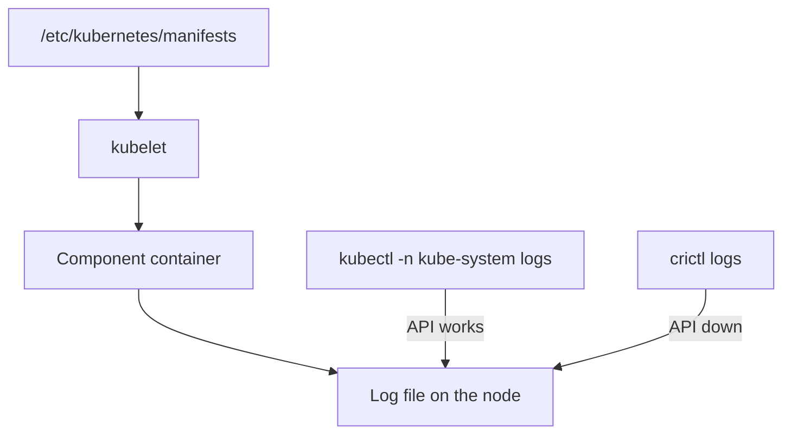

# Control Plane Component Logs

The API server, the scheduler, the controller manager and etcd decide what the cluster does. When a cluster behaves wrongly, their logs explain why. In a kubeadm-style cluster they run as static Pods on the control plane node, so you read them like Pod logs while the API server works. When the API server is down, you cannot ask it for logs, and you read the same containers through the runtime.

## Learning objectives

- Explain what a static Pod is and where its manifest lives.
- Read a control plane component log with `kubectl -n kube-system logs`.
- Read the same log with `crictl` when the API server is unavailable.
- Know which component logs answer which question.

## Before you start

A static Pod is a Pod that the kubelet starts from a manifest file on its own node, without the API server. The kubelet watches the manifest directory and recreates the container when the file changes. The kubelet then creates a read-only mirror Pod in the API so that you can see it. The playground control plane node is the container `astro-ats-023-playground-040-03-control-plane`.

## Static Pods and their manifests

On a kubeadm-style control plane, the manifests are in `/etc/kubernetes/manifests`: `kube-apiserver.yaml`, `kube-controller-manager.yaml`, `kube-scheduler.yaml` and `etcd.yaml`. The kubelet runs them, and the mirror Pods are in the `kube-system` namespace. The mirror Pod name ends with the node name, so on this node the API server Pod is `kube-apiserver-astro-ats-023-playground-040-03-control-plane`.

Because they are containers, they log to standard output and standard error like any other container, and the runtime stores the files under `/var/log/pods` on the control plane node.

## Read component logs through the API

While the API server works, `kubectl logs` is the quickest way. The namespace is `kube-system` and the container name is the component name, which is also the only container, so `-c` is not needed:

<!-- astrona:playground:renew -->

```sh
kubectl -n kube-system get pods
kubectl -n kube-system logs kube-scheduler-astro-ats-023-playground-040-03-control-plane --tail=10 --timestamps
kubectl -n kube-system logs kube-controller-manager-astro-ats-023-playground-040-03-control-plane --since=10m | tail -n 10
```

The first command lists the mirror Pods of the control plane and the cluster add-ons. The second and third read recent lines of the scheduler and the controller manager. The lines are in the structured format of the component, usually a severity letter, a time and a message, so you can pick out warnings and errors with `grep`.

Each component answers a different question. The scheduler log tells you why a Pod was or was not placed on a node. The controller manager log tells you why a Deployment, a node or a service account did not reach its desired state. The API server log shows request handling problems, such as authentication and admission failures. The etcd log shows storage problems, such as a slow disk or a lost quorum.

## Read component logs when the API is down

If the API server does not run, `kubectl` fails and you cannot read its mirror Pod. The kubelet and the runtime keep working, so you read the container with `crictl` on the control plane node. List the container, including an exited one, then read its log:

```sh
podman exec astro-ats-023-playground-040-03-control-plane crictl ps -a --name kube-apiserver
podman exec astro-ats-023-playground-040-03-control-plane sh -c 'crictl logs --tail=10 $(crictl ps -a --name kube-apiserver -q | head -n 1)'
```

The first command shows the API server container and its state, running or exited, and how many attempts exist. The second reads the last 10 lines of the newest one. A crash after a bad manifest edit shows the reason there, for example an unknown flag or a missing certificate file. If no container exists at all, read the kubelet journal on that node, because the kubelet logs why it could not start the static Pod.



Both ways end at the same file, and the second does not need the API server.

## What a component log looks like

The control plane components use the same log style as most Kubernetes programs: one line per event, starting with a letter for the severity (`I` for information, `W` for warning, `E` for error and `F` for fatal), then the date and time, a process identifier, the source file and line, and the message. A fatal line is the last line before the process exits, so it is the first line to read in an exited container. Warnings and errors are rare in a healthy cluster, so filtering on them with `grep` shortens the reading a lot.

The scheduler message for an unschedulable Pod names the Pod and counts the nodes that failed each filter, for example because of taints or too little memory. The API server logs a request-handling error with the verb and the path. etcd logs a slow request with the time it took. These details tell you which component to open next, and they are easier to read when you first fix the time window with `--since` or `--tail`.

## How the kubelet reports a static Pod

The kubelet is the only component that does not run as a Pod, so its own log is in the node journal. When a static Pod manifest has an error, such as invalid YAML or a wrong field, the kubelet logs the error and does not start the container. The mirror Pod then does not appear or shows an old state. This is why a missing control plane container leads you to `journalctl -u kubelet` on the node, and not to a container log.

## Worked example: reading the scheduler after a stuck Pod

A Pod stays `Pending`. The Pod events say `FailedScheduling`, which is the scheduler's decision. For more detail, read the scheduler log in `kube-system` around the time of the event, with `--since`. The log repeats the reason with node counts. If the log has no line about the Pod at all, the scheduler never saw it, and the next suspect is the API server or the scheduler's own health. The same method works for a controller manager that does not create the Pods of a Deployment: read its log, find the Deployment name, and read the error beside it.

## Multiple control plane nodes

A production cluster has several control plane nodes, and each one runs its own copy of every component. The mirror Pod names differ only by the node name, so the log you read belongs to one node. The scheduler and the controller manager elect one active instance with a lease, so the instance that made the decision may not be the one you opened.

List the mirror Pods first, read each instance, and compare the times. The playground has one control plane node, so every log you read there is complete.

## A safe diagnosis order

Start with the symptom. If `kubectl` answers, read the component that owns the symptom. If `kubectl` does not answer, run `crictl ps -a` on the control plane node and look for the API server and etcd containers. If they are exited, read their logs, then read `journalctl -u kubelet` for the static Pod start errors. Change a manifest only when the log names the cause, and keep a copy of the file you change, because the kubelet applies the edit at once.

You can now read the logs of every component of the control plane in the two situations that matter, with and without the API server. Together with the node and runtime logs, you can follow an output stream from the process to the cluster level.

## Common pitfalls

> [!WARNING]
> Mirror Pods cannot be changed through the API. Delete one and the kubelet recreates it from the file, and an edit of the manifest takes effect immediately. A log from before a restart is in an older container, so list with `-a` and pick the container you mean. Do not read control plane logs expecting application messages: they describe the cluster's decisions.
