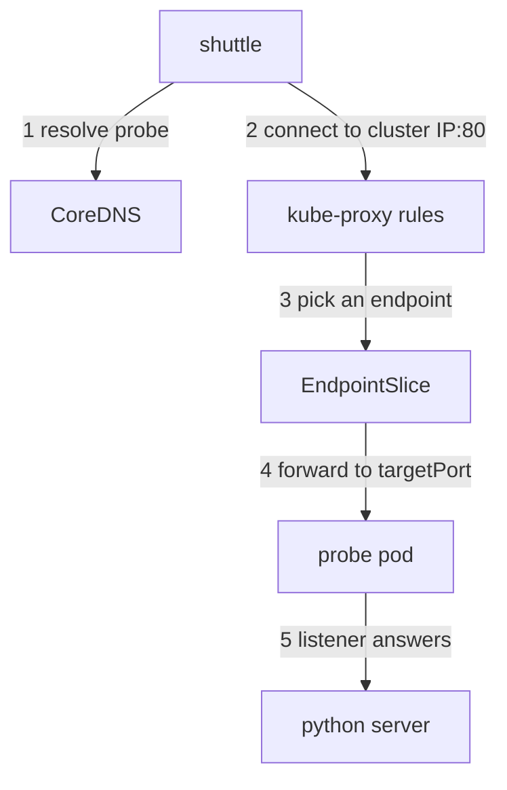

# Tracing A Service Request

A client resolves a Service name, opens a connection and still gets no answer. Name resolution is only the first of five stages that a request crosses inside the cluster. If you test the wrong stage, you change objects that were never broken. This part shows each stage, the component that owns it, and the one check that proves it.

## Learning objectives

- Name the five stages of an in-cluster request and the component that owns each one.
- Tell a Service selector fault from a readiness fault and from a port fault.
- Prove each stage from the client's own namespace.

## The five stages of one request

A Service is a stable virtual IP address and port that stands in front of a changing set of pods. When the `shuttle` pod runs `wget http://probe/`, five things happen in order, and a different component does each one.

1. Name resolution. The resolver in the `shuttle` container asks the cluster DNS server (CoreDNS) for `probe`. CoreDNS answers with the cluster IP of the Service.
2. Service lookup. The container sends a TCP connection to that cluster IP on the Service `port`. No process listens on a cluster IP. The kernel of the node rewrites the destination using rules that `kube-proxy` programmed.
3. Backend selection. The rules pick one address from the Service's endpoints. The EndpointSlice controller keeps that list: it adds a pod IP only when a pod matches the Service `selector` and is ready.
4. Forwarding. The packet goes to the chosen pod IP on the `targetPort` of the Service.
5. Application. A process inside the pod must listen on that port and answer.



The drawing shows that each arrow is a separate relationship that can break while the others stay correct.

## What each stage looks like when it fails

The failure message already narrows the search. A lookup error such as `bad address` or `NXDOMAIN` belongs to stage 1. A connection that waits until the timeout often means stage 3: the Service has no endpoints, so the rules have nothing to forward to, and on many clusters the packet is dropped. A fast `Connection refused` points to stage 4 or 5: a packet reached a pod IP, and nothing listened on that port. An HTTP error code means every stage up to the application worked.

These are clues, not proof. A NetworkPolicy that drops packets also gives a timeout. The rest of this part shows how to prove one stage at a time. A stage passes only when you see its evidence from the real client.

## Check the Service and its endpoints

The playground runs `probe` with two replicas in `starfleet`, and `shuttle` in the same namespace as a client. Start with the Service and the pods that it should select.

<!-- astrona:playground:renew -->

```sh
kubectl -n starfleet get service probe -o jsonpath='{.spec.selector}{"\n"}'
kubectl -n starfleet get pods -l app=probe --show-labels
```

The first command prints the selector of the Service. The second lists the pods that carry the label `app=probe` and shows every label on them. A Service selects pods only when every key and value of its selector appears in the pod labels. A selector with one extra key, such as `release`, matches no pod unless the pods carry that key too.

Now read what the EndpointSlice controller built from that comparison:

```sh
kubectl -n starfleet get endpointslices -l kubernetes.io/service-name=probe
```

Each EndpointSlice carries the label `kubernetes.io/service-name`, which names its Service. If the Service selector matches nothing, the slice exists but its `ENDPOINTS` column shows `<unset>`. If the selector matches pods that are not ready, the addresses are listed but marked not ready, and the Service does not forward to them.

## Selector, readiness and port faults compare like this

Three different faults all end in "no answer". The table lists what you see for each, so you can tell them apart without guessing.

| Fault | Pods | EndpointSlice | First fix to try |
| --- | --- | --- | --- |
| Selector matches no pod | Running and ready | No endpoints | Make the selector equal the pod labels |
| Pods not ready | Running, READY shows `0/1` | Endpoints marked not ready | Fix the readiness probe or the dependency it checks |
| Wrong `targetPort` | Running and ready | Endpoints on the wrong port | Point `targetPort` at the port the process listens on |

Relabelling a pod does not repair a failing readiness probe, and lowering a readiness threshold does not repair a selector. Change only the object that the evidence names.

## Test from the same place as the failing client

A test that runs on your laptop or in another namespace uses another resolver search path, another route and other policies. Run it from the client:

```sh
kubectl -n starfleet exec shuttle -- wget -q -T 3 -O- http://probe/
```

The flag `-T 3` stops the wait after 3 seconds, so a timeout does not block your terminal. If this command fails, repeat it with the Service's fully qualified name `probe.starfleet.svc.cluster.local` to prove stage 1 separately. Then test a pod IP directly to separate the Service from the pod. Take a pod IP from `kubectl -n starfleet get pods -l app=probe -o wide`. If the direct request on the container port works while the Service request fails, stages 3 and 4 are at fault. If it fails too, look at stage 5 or at network filtering.

## A worked trace

Take the case where `shuttle` in `outpost` uses the short name `probe`, but `probe` lives in `starfleet`. The pod's resolver adds the search suffix `outpost.svc.cluster.local` first, finds nothing, and the lookup fails. The fix is the name `probe.starfleet`, or the full name, not a change to any Service or pod. When the name is right, stage 1 passes, and you move on to the selector, readiness and port evidence in that order. After a fix, repeat the original request from the original client: the repaired relationship matters only if the intended operation now crosses all five stages.

You can now name the component behind each stage and read the evidence of the selector, readiness and port faults. The open question is the same for external traffic: a request that enters through an Ingress crosses extra stages before it reaches the Service.

## Common pitfalls

> [!WARNING]
> A successful DNS lookup proves only stage 1. A Running pod can be unready and absent from the endpoints. Test from the client's namespace, and never conclude that the pod network is broken from a failure that the endpoint list already explains.
