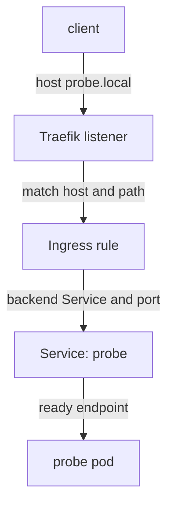

# Tracing An External Request To The Application

The frontend returns a routing error before the application logs a single request. The request reached a component in front of `probe`, but that does not prove it reached `probe`. An external request crosses more relationships than an in-cluster request, and each one has its own owner and its own evidence. This part separates them: hostname, listener, route match, backend Service and application.

## Learning objectives

- Name the extra stages an external request crosses and who owns each one.
- Say which component produced a response from its status code and body.
- Read an Ingress object and find a broken backend reference.

## Who answers what

An Ingress is an API object that holds routing rules: which host and path go to which Service. The object does nothing alone. An Ingress controller is a program that runs in the cluster, watches Ingress objects of its class, and configures a reverse proxy from them. In the labs of this module the controller is Traefik. The Ingress class, set in `spec.ingressClassName`, tells controllers which objects belong to them.

An external request therefore has these stages: the client resolves the host name; the client connects to the address of the controller; the client and the controller agree on a secure connection when the route uses Transport Layer Security (TLS); the controller matches the host and path to a rule; the controller forwards to a backend Service port; the Service sends the request to a ready endpoint; the application answers.



The drawing shows that the Ingress rule only names a Service. The Service, its endpoints and the pod are the same objects that an in-cluster request uses.

## Read the client observation first

A host name that does not resolve fails before any connection. No Ingress change can repair a missing DNS record for the host. A connection that times out means the client never reached a listener: check the address, any firewall, and the Service that publishes the controller. A certificate error belongs to TLS: the name in the certificate, the trust chain or the validity dates do not satisfy the client. Turning off verification hides this fault without fixing it.

If a response arrives, find out who sent it. A `404 Not Found` from the controller usually means no rule matched the host and path. The same status from the application means the route worked and the application has no such path. A `502 Bad Gateway` or `503 Service Unavailable` from a controller usually means that a rule matched but the controller could not use the backend: the Service does not exist, it has no ready endpoints, or the port is wrong. The response body and headers often name the sender.

## An Ingress object that names a missing Service

Here is an Ingress whose backend is a Service that does not exist. The playground has no Ingress controller, so the object shows what the API server accepts and what a reader can still see.

<!-- astrona:playground:renew -->

Save this as `ingress-probe.yaml`:

```yaml
apiVersion: networking.k8s.io/v1
kind: Ingress
metadata:
  name: probe
  namespace: starfleet
spec:
  ingressClassName: traefik
  rules:
    - host: probe.local
      http:
        paths:
          - path: /
            pathType: Prefix
            backend:
              service:
                name: missing-service
                port:
                  number: 80
```

Apply it:

```sh
kubectl apply -f ingress-probe.yaml
```

Then check the result:

```sh
kubectl -n starfleet get ingress probe
kubectl -n starfleet describe ingress probe
```

The API server accepted the object. Accepting an object only means that its fields are valid; it does not mean that traffic flows. The `describe` output lists the rule and, next to the backend `missing-service:80`, an error that the Service was not found. The `ADDRESS` column stays empty because no controller of class `traefik` runs here to publish an address. In a cluster with a running controller, the error would be the same and the controller would answer requests for `probe.local` with an error status.

## Class, host, path and path type

Four fields decide whether a request matches a rule. The controller only reads Ingress objects whose class it owns, so an object with another class name is ignored without any error. The `host` must equal the Host header of the request. A test that sends only an IP address uses a different Host value and may fall through to the controller's default backend, which returns 404.

The `pathType` changes the match. `Exact` matches only the same path, so `/reports` does not match `/reports/2024`. `Prefix` matches on path elements, so `/reports` matches `/reports` and `/reports/2024`. A rule with path `/` and type `Prefix` matches every path.

The backend names a Service and a port. The port is the Service `port` or the Service port name. It is not the container port. If the name is wrong, the failure is the one you just saw. If the name is right and the Service has no ready endpoints, the controller has a valid backend with nobody behind it.

## Repair the backend and check the chain

To repair this Ingress, change `missing-service` to `probe`, the Service that exists, and keep port 80. Then follow the Service evidence: selector, endpoints and `targetPort`. Run the request with the intended host and verification enabled. A request through the controller with `Host: probe.local` must reach `probe`, and a request with an unrelated host must still return the controller's 404. The second test proves that the fix did not turn the Ingress into a catch-all.

Two more causes are common after the route is correct. The application may listen only on `127.0.0.1`, which accepts requests from containers in its own pod but not from the controller, and a NetworkPolicy may block the controller's namespace from reaching the pod. Both give a gateway error with a healthy-looking route.

You can now follow an external request from the client to the Service and say which component produced the response. The next step is to practise the in-cluster half of the same chain on a live Service.

## Common pitfalls

> [!WARNING]
> A valid Ingress object is not a working route. The controller must own the class, the host and path must match the request, and the backend Service must exist with ready endpoints. Do not turn off TLS verification to make an error disappear.
