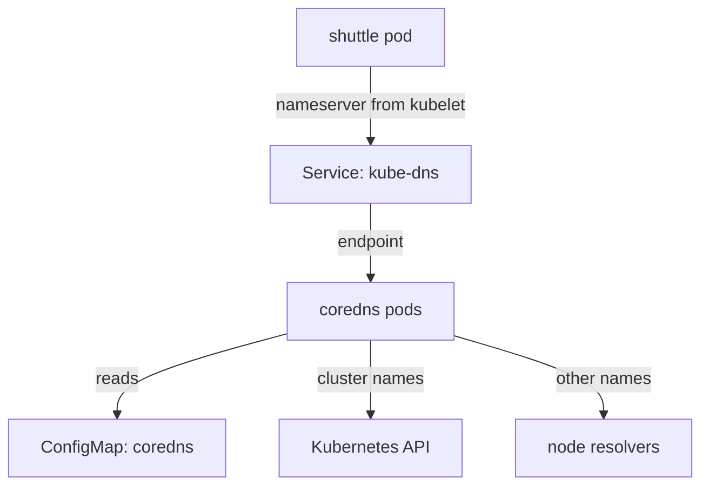

# CoreDNS And The Cluster DNS Service

A pod calls another Service by name, so some server in the cluster must answer name queries. In a kubeadm cluster, and in kind, that server is CoreDNS. Four objects make cluster DNS work: a Deployment, a Service, a ConfigMap and the kubelet setting that tells pods where to ask. If you know which object owns which part of the chain, a DNS failure becomes a short list of checks.

## Learning objectives

- Name the four pieces of cluster DNS and the namespace they live in.
- Explain how a pod learns the address of the DNS server.
- Read the Corefile and say what each default plugin does.

## The four pieces

CoreDNS is a DNS server written in Go. It reads one configuration file, the Corefile, and builds its behaviour from plugins listed there. In a cluster it runs as an ordinary Deployment named `coredns` in the `kube-system` namespace. A kubeadm cluster starts it with two replicas, and each pod carries the label `k8s-app=kube-dns`. The label keeps the old name from the time when the DNS server was called kube-dns.

The pods are reached through a Service named `kube-dns`, also in `kube-system`. It is an ordinary ClusterIP Service with port 53 for UDP and TCP. The name `kube-dns` stayed for backward compatibility, although the program behind it is CoreDNS. The Service address is the DNS server address that every pod uses.

The Corefile lives in a ConfigMap named `coredns` in `kube-system`, under the key `Corefile`. The Deployment mounts the ConfigMap into the pods, so a change to the ConfigMap changes what the pods read.

The last piece is the kubelet. The kubelet is the agent on each node that starts the pods. Its configuration holds the cluster DNS address, which is the cluster IP of the `kube-dns` Service. When the kubelet starts a pod with the default `dnsPolicy: ClusterFirst`, it writes that address into the pod's `/etc/resolv.conf` as the `nameserver`.



The drawing shows that a pod never talks to CoreDNS directly: it talks to the `kube-dns` Service, and the Service forwards to a CoreDNS pod, like for any other Service.

## Look at the running pieces

Start with the Deployment and its pods in the playground.

<!-- astrona:playground:renew -->

```sh
kubectl -n kube-system get deployment coredns
kubectl -n kube-system get pods -l k8s-app=kube-dns -o wide
```

The Deployment shows how many replicas are ready. The pod list shows where they run and their pod IPs. Now check the Service and the endpoints that the EndpointSlice controller built for it:

```sh
kubectl -n kube-system get service kube-dns
kubectl -n kube-system get endpointslices -l kubernetes.io/service-name=kube-dns
```

The Service has a cluster IP and ports `53/UDP` and `53/TCP`. The EndpointSlice lists the pod IPs of the ready CoreDNS pods. If the Deployment has no ready pods, this slice has no endpoints, and every DNS query that reaches the Service has nowhere to go. That is the first thing to check when all lookups time out.

## The address inside the pod

The pod learns the DNS server address from the kubelet, not from the Service object. Read it in the `shuttle` pod:

```sh
kubectl -n starfleet exec deploy/shuttle -- cat /etc/resolv.conf
```

The file has three kinds of lines. `nameserver` holds the cluster IP of the `kube-dns` Service, the same address that the previous command showed. `search` lists suffixes that are added to short names. `options ndots:5` controls when those suffixes are used. The Kubernetes documentation shows this file for a pod in namespace `test` with `search test.svc.cluster.local svc.cluster.local cluster.local`; on a cloud node more suffixes follow, and in kind the node's own suffixes can appear too.

A pod can choose another policy with `dnsPolicy`. `ClusterFirst` is the default. `Default` copies the node's resolver settings, so the pod cannot resolve Service names. `None` takes everything from the pod's `dnsConfig` field. Changing a workload to bypass cluster DNS hides a cluster problem for one pod and leaves it for all others.

## The Corefile

Read the Corefile that the Deployment uses:

```sh
kubectl -n kube-system get configmap coredns -o jsonpath='{.data.Corefile}'
```

Kubeadm installs a Corefile like this one. Your version can differ in small details:

```text
.:53 {
    errors
    health {
       lameduck 5s
    }
    ready
    kubernetes cluster.local in-addr.arpa ip6.arpa {
       pods insecure
       fallthrough in-addr.arpa ip6.arpa
       ttl 30
    }
    prometheus :9153
    forward . /etc/resolv.conf {
       max_concurrent 1000
    }
    cache 30
    loop
    reload
    loadbalance
}
```

`.:53` is the server block: it answers every zone on port 53. Each line inside is a plugin, and the order in the block does not decide the order of execution; CoreDNS has its own fixed plugin order. The ones to know are these.

- `errors` prints errors to the log.
- `health` and `ready` serve HTTP endpoints that the kubelet uses for the liveness and readiness probes of the CoreDNS pods.
- `kubernetes` answers names in the zone `cluster.local` and reverse lookups from the Kubernetes API. The zone name must match the cluster domain.
- `forward . /etc/resolv.conf` sends every other name to the resolvers listed in the node's `/etc/resolv.conf`.
- `cache 30` keeps answers for up to 30 seconds.
- `loop` stops CoreDNS if it detects a forwarding loop.
- `reload` re-reads the Corefile when the ConfigMap changes.

You can now find all four pieces of cluster DNS and say what each one owns. The open question is what a pod sends to that server: the next step is how a short name becomes a fully qualified name.

## Common pitfalls

> [!WARNING]
> The Service is called `kube-dns` and the pods are labelled `k8s-app=kube-dns`, but the program is CoreDNS. Look for the Deployment named `coredns`. Do not edit the `kube-dns` Service to fix a Corefile problem, and do not point a workload at another resolver to hide a cluster fault.
