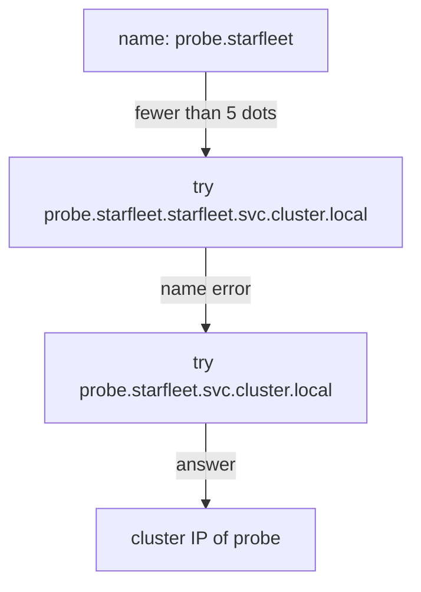

# Search Domains, ndots And Lookups

An application writes `probe` or `probe.starfleet` and the lookup works, but it never writes `probe.starfleet.svc.cluster.local`. The resolver in the container expands short names using the `search` line and the `ndots` option in `/etc/resolv.conf`. If you do not know the rules, you cannot tell a wrong name from a broken DNS server. This part shows the rules, the full name of a Service and the commands that test a lookup from a pod.

## Learning objectives

- Build the fully qualified domain name (FQDN) of a Service.
- Explain how search domains and `ndots:5` expand a name.
- Test a lookup with `nslookup` and tell a name error from a server failure.

## The full name of a Service

A fully qualified domain name (FQDN) names one host with no ambiguity. For a normal Service, CoreDNS answers this form:

`<service>.<namespace>.svc.<cluster-domain>`

The default cluster domain is `cluster.local`, so the `probe` Service in `starfleet` has the name `probe.starfleet.svc.cluster.local`. The record is an A record (an IPv4 address) that holds the cluster IP of the Service. For a headless Service, which has `clusterIP: None`, the same name returns the IP addresses of the selected pods instead.

A pod in `starfleet` can use shorter names because of the `search` line. For a pod in `starfleet` the line reads `search starfleet.svc.cluster.local svc.cluster.local cluster.local`, followed by any suffixes from the node. A resolver adds each suffix in order until one name exists. So `probe` becomes `probe.starfleet.svc.cluster.local` and succeeds. For `probe.starfleet`, the first suffix gives `probe.starfleet.starfleet.svc.cluster.local`, which does not exist. The second suffix gives `probe.starfleet.svc.cluster.local`, which does. This is why a pod in `outpost` reaches the Service with `probe.starfleet` but not with `probe`: the short name expands to `probe.outpost.svc.cluster.local`, and no such Service exists.

## What ndots:5 does

The `ndots` option sets how many dots a name needs before the resolver tries it as it is. With `options ndots:5`, a name with fewer than five dots is tried with the search suffixes first, and as an absolute name last. A name with five or more dots is tried as written first.

The name `probe.starfleet.svc.cluster.local` has four dots, so the resolver still tries the search suffixes first. Those attempts fail quickly, because CoreDNS answers name errors without delay, and then the literal name succeeds. An external name such as `example.com` has one dot, so the resolver first asks for `example.com.starfleet.svc.cluster.local`, `example.com.svc.cluster.local` and `example.com.cluster.local`, and only then for `example.com`. That extra work is the reason some teams lower `ndots` for pods that call mostly external names. A trailing dot, as in `probe.starfleet.svc.cluster.local.`, marks the name as absolute and skips the search list.



The drawing shows two attempts for one short name: the first gives a name error and the second gives the answer.

## Look up a name from a pod

Test from a pod that runs in the cluster, because only a pod uses the cluster's `/etc/resolv.conf`. The `shuttle` pod runs the `busybox` image. BusyBox has the `nslookup` tool but not `dig`. The `dig` tool belongs to the DNS utilities package, and you can use it from an image that contains it.

<!-- astrona:playground:renew -->

```sh
kubectl -n starfleet exec deploy/shuttle -- nslookup probe.starfleet.svc.cluster.local
```

The output names the DNS server that answered, which is the `kube-dns` cluster IP, and then the name with the address of the Service. Compare that address with the cluster IP of the Service:

```sh
kubectl -n starfleet get service probe -o jsonpath='{.spec.clusterIP}{"\n"}'
```

The two addresses are equal. Now test from the other namespace, with the namespace-qualified name:

```sh
kubectl -n outpost exec deploy/drifter -- nslookup probe.starfleet.svc.cluster.local
```

The answer is the same, because the Service address does not depend on the caller. A short name behaves differently, and a request tests the search path as the application sees it:

```sh
kubectl -n starfleet exec deploy/shuttle -- wget -q -T 3 -O- http://probe/
kubectl -n outpost exec deploy/drifter -- wget -q -T 3 -O- http://probe/
```

The first command works because `probe` expands to the Service in `starfleet`. The second fails in the resolver with a bad address error, because the same short name expands to `outpost`. Run the second command on its own, because it ends with a nonzero status. Replace `http://probe/` with `http://probe.starfleet/` in the second command and it works.

## Change ndots for one pod

A pod can override resolver options with the `dnsConfig` field without leaving cluster DNS. The `dnsPolicy` stays `ClusterFirst`, and the options in `dnsConfig` are merged into the generated `resolv.conf`. This is the supported way to lower `ndots` for a pod that mostly calls external names. Save this as `pod-ndots.yaml`:

```yaml
apiVersion: v1
kind: Pod
metadata:
  name: ndots-check
  namespace: starfleet
spec:
  dnsConfig:
    options:
      - name: ndots
        value: "1"
  containers:
    - name: client
      image: docker.io/library/busybox:1.37.0
      command: ["sh", "-c", "sleep 3600"]
```

Apply it:

```sh
kubectl apply -f pod-ndots.yaml
```

Then check the result:

```sh
kubectl -n starfleet exec ndots-check -- cat /etc/resolv.conf
```

The `nameserver` and `search` lines are the same as in `shuttle`, and the options line now reads `ndots:1`. With `ndots:1`, the name `probe.starfleet` has one dot, so the resolver tries it as written first. The cluster has no top-level domain `starfleet`, so that attempt gives a name error, and the resolver then goes through the search list and finds the Service. The short name `probe` has no dot and still expands as before. The lesson is that the resolver file, not the CoreDNS server, decides which names are tried and in what order.

## Name errors and server failures

A name error and a server failure look alike in an application log, but they mean different things. A name error (`NXDOMAIN` in DNS terms) is an answer: the server is alive and says that the name does not exist. Typical causes are a typo, a missing namespace part and a Service that does not exist. A timeout, or `connection timed out; no servers could be reached`, is no answer: the query never got a reply. Typical causes are no ready CoreDNS pod, a NetworkPolicy that blocks port 53, or a wrong `nameserver` line.

To separate the two, ask the DNS server directly. BusyBox `nslookup` takes the server as a second argument. Use the cluster IP from `kubectl -n kube-system get service kube-dns`, and run the lookup with that address after the name. If the direct query answers but the pod's default query does not, the pod's `resolv.conf` is wrong. If neither answers, the server side is broken, and the next place to look is the CoreDNS pods and logs.

You can now build the full name of any Service, predict how a short name expands, and tell a missing name from a missing server. The open question is what the server does with the queries it receives: that needs CoreDNS logs.

## Common pitfalls

> [!WARNING]
> A lookup from your own machine tests your machine's resolver, not the cluster's. Always test from a pod in the namespace that has the problem. A short name works only inside its own namespace, and a name error is not a broken DNS server.
