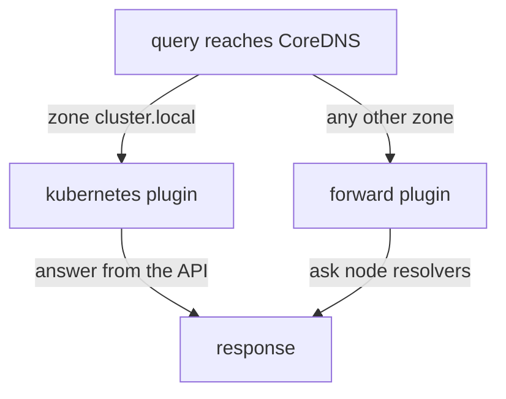

# CoreDNS Logs And Repairing The Corefile

When a lookup fails, the client only reports that it failed. The CoreDNS pods are the one place that shows what the server received and what it answered. This part reads their logs, turns on query logging with the `log` plugin, and works through the four ways a cluster DNS server usually fails: no pod, a bad Corefile, a wrong zone and an upstream that does not answer.

## Learning objectives

- Read CoreDNS logs and enable the `log` and `errors` plugins.
- Say what the `kubernetes` and `forward` plugins decide, and what happens when they are wrong.
- Repair a scaled-down CoreDNS and a broken Corefile, and prove it from a pod.

## Read the logs first

CoreDNS writes to standard output, so `kubectl logs` reads it. The label selects every CoreDNS pod at once.

<!-- astrona:playground:renew -->

```sh
kubectl -n kube-system logs -l k8s-app=kube-dns --tail=20
```

On a healthy cluster there is little to see at startup: CoreDNS prints its version and the configuration it loaded. A pod in `CrashLoopBackOff` prints the reason in its last lines, such as a Corefile that does not parse. If you cannot read the current container, add `--previous` to read the container that crashed. By default CoreDNS does not log queries. The `errors` plugin prints errors, such as an upstream that did not answer, and the `log` plugin prints one line for every query.

## Turn on query logging

The `log` plugin is a line in the server block of the Corefile. Edit the ConfigMap, add a line with `log` after `errors`, and save:

```sh
kubectl -n kube-system edit configmap coredns
```

The `reload` plugin notices the change, and the Kubernetes documentation says it can take a minute or two to reach the pods. Make queries while you wait, then read the logs again:

```sh
kubectl -n starfleet exec deploy/shuttle -- nslookup probe.starfleet.svc.cluster.local
kubectl -n kube-system logs -l k8s-app=kube-dns --tail=20
```

Each log line names the client address, the query type and name, the response code and the time taken. The response code `NOERROR` means an answer, and `NXDOMAIN` means that the name does not exist. Seeing the query in the log proves that the pod reached CoreDNS. Not seeing it proves the opposite: the problem lies between the client and the server, in the pod's `resolv.conf`, the `kube-dns` Service, or the network. Remove `log` when you are done, because on a busy cluster it produces a line for every lookup.

## Four failures and their evidence

The first failure is no running pod. If the Deployment has zero replicas, or every pod is unready, the `kube-dns` EndpointSlice is empty. Clients time out, and nothing appears in the logs, because there is no server. The repair is to restore the replicas, and to find out why they are not ready if replicas exist.

The second failure is a Corefile that CoreDNS cannot load. A pod that starts after the change crashes and prints a parse error. A mistake in a ConfigMap does not affect running pods until they restart or reload, so the damage often appears hours later, when a node drain restarts a pod. The repair is to correct the ConfigMap, and the crashed pod then starts with the new content.

The third failure is the wrong zone. The `kubernetes` plugin answers only for the zones on its line, which are normally `cluster.local in-addr.arpa ip6.arpa`. If the line names another zone, a query for `probe.starfleet.svc.cluster.local` does not match, and CoreDNS hands it to the next plugin. The `forward` plugin then asks the node's resolvers, which do not know the name, so the client gets a name error while CoreDNS is healthy. The log shows `NXDOMAIN` for names that should exist. The cluster domain in the Corefile must match the domain that the kubelet and the API server use.

The fourth failure is an upstream that does not answer. `forward . /etc/resolv.conf` sends everything that is not a cluster name to the node's resolvers. If those resolvers are unreachable, names like `example.com` time out while `probe.starfleet.svc.cluster.local` still works, because the `kubernetes` plugin answers it without help. The `errors` plugin prints the failed upstream lookups.



The drawing shows that a name takes one of two paths. A wrong zone on the `kubernetes` line sends cluster names down the second path.

## Scale CoreDNS down and up

Scaling the Deployment to zero reproduces the first failure on purpose. Do it in the playground and watch the evidence change:

```sh
kubectl -n kube-system scale deployment coredns --replicas=0
kubectl -n kube-system get endpointslices -l kubernetes.io/service-name=kube-dns
kubectl -n starfleet exec deploy/shuttle -- nslookup probe.starfleet.svc.cluster.local
```

The EndpointSlice has no endpoints, and the lookup fails after a wait. Run the lookup on its own, because it returns a nonzero status. Restore the replicas and check again:

```sh
kubectl -n kube-system scale deployment coredns --replicas=2
kubectl -n kube-system rollout status deployment/coredns
```

The new pods read the ConfigMap at start, so they run with whatever it holds at that moment. After the rollout, repeat the lookup from `shuttle` and expect the address of the `probe` Service.

## Repair in this order

Work from the outside in: check that CoreDNS pods exist and are ready, read the Corefile for the zone and the `forward` line, read the logs, and then test from a client. Keep the repair inside the DNS objects. Do not change the `kube-dns` Service, do not add `dnsConfig` to workloads, and do not replace the Corefile with a shorter one that drops `errors`, `forward` or `loop`: those lines keep the server safe and observable.

You can now find the owner of a DNS failure from the logs and the endpoints, and repair the two most common faults. The next step is the graded task: repair a CoreDNS that has both faults at once.

## Common pitfalls

> [!WARNING]
> Do not scale CoreDNS up before you read the Corefile: new pods start with the faulty configuration. Do not use `kubectl edit` to paste a shorter Corefile that drops the `kubernetes`, `forward` or `errors` plugins, and do not leave the `log` plugin on in a busy cluster.
