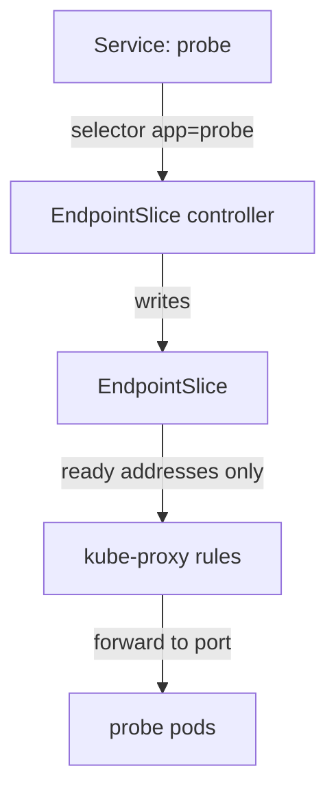

# EndpointSlices, Target Ports And Readiness

A Service has no pods of its own. It holds a selector and ports, and a controller turns them into a list of addresses. If that list is wrong, the Service is wrong, whatever the Service object looks like. This part reads the list, compares three port numbers that people mix up, and shows how one failing readiness probe removes a pod from it.

## Learning objectives

- Read an EndpointSlice and say which pods it lists and why.
- Tell `port`, `targetPort` and `containerPort` apart and find a mismatch.
- Show that a failing readiness probe removes a pod from the endpoints.

## What an EndpointSlice is

An EndpointSlice is an API object that lists the network endpoints behind a Service: pod IP addresses, the ports and the state of each endpoint. The EndpointSlice controller creates and updates the slices. For every Service that has a selector, it finds the pods that match the selector and writes their addresses into slices that carry the label `kubernetes.io/service-name` with the name of the Service. A large Service can have several slices.

The slice also records conditions for each endpoint. The `ready` condition is true only when the pod's readiness checks pass. The `kube-proxy` component on each node watches the slices and programs the forwarding rules from them. So the slice is the single source for what a Service forwards to. When a request to a Service fails, read its slice before anything else.



The drawing shows that the Service object itself never touches a pod: the controller and `kube-proxy` do.

## Read the slice

Look at the slice of the working `probe` Service in the playground, and print the address, the ready condition and the port of each endpoint.

<!-- astrona:playground:renew -->

```sh
kubectl -n starfleet get endpointslices -l kubernetes.io/service-name=probe
kubectl -n starfleet get endpointslices -l kubernetes.io/service-name=probe -o jsonpath='{range .items[*].endpoints[*]}{.addresses[0]} ready={.conditions.ready}{"\n"}{end}'
```

The first command lists the slice and its endpoints. The second prints one line for each endpoint: the pod IP and whether it is ready. Both `probe` pods are ready, so both appear with `ready=true`. A Service without matching pods has a slice with no endpoints.

## Three port numbers

A Service forwards a connection from one port to another, and a container listens on a third. These three names are the cause of many faults.

| Field | Where it lives | Meaning |
| --- | --- | --- |
| `port` | Service | The port clients use on the Service cluster IP |
| `targetPort` | Service | The port on the pod where the connection arrives |
| `containerPort` | Pod container | A declaration of the port the process listens on |

The `targetPort` can be a number or the name of a container port. In the playground the `probe` containers declare `containerPort: 8080` with the name `http`, and the Service uses `targetPort: http`. The Service resolves the name for each pod, so the Service keeps working if a pod changes the number. A `containerPort` is documentation and a name registry. It does not make the process listen: the process must bind that port itself.

The Service `probe-alt` has `targetPort: 9090`. The process listens on 8080, so a connection to port 9090 of the pod is refused. Compare the numbers:

```sh
kubectl -n starfleet get service probe-alt -o jsonpath='{.spec.ports[0].targetPort}{"\n"}'
kubectl -n starfleet get endpointslices -l kubernetes.io/service-name=probe-alt -o jsonpath='{.items[*].ports[*].port}{"\n"}'
kubectl -n starfleet exec deploy/shuttle -- wget -q -T 3 -O- http://probe-alt/
```

The Service shows 9090, and so does the slice. Both pods are ready, so the endpoints exist, and the slice looks healthy at a glance. The request is refused because nothing listens on port 9090. Run the last command on its own, because it ends with a nonzero status. A refusal that arrives fast is the mark of a port mismatch: a packet reached a pod and the pod's kernel rejected it. The repair is to set `targetPort` to `http` or to 8080, never to change the container.

## Readiness removes a pod from the slice

The readiness probe is a check that the kubelet runs against a container. The `probe` pods check the path `/ready` on the port `http` every 2 seconds. The server in the playground answers 503 on that path while the file `/tmp/not-ready` exists. Create the file in one pod and watch the endpoint change. Save the pod name in a variable first.

```sh
PROBE_POD="$(kubectl -n starfleet get pods -l app=probe -o jsonpath='{.items[0].metadata.name}')"
kubectl -n starfleet exec "$PROBE_POD" -- touch /tmp/not-ready
```

After a few seconds the kubelet marks the pod not ready. Read the pods and the slice:

```sh
kubectl -n starfleet get pods -l app=probe
kubectl -n starfleet get endpointslices -l kubernetes.io/service-name=probe -o jsonpath='{range .items[*].endpoints[*]}{.addresses[0]} ready={.conditions.ready}{"\n"}{end}'
```

One pod shows `0/1` in the `READY` column. Its endpoint now shows `ready=false`, and `kube-proxy` stops sending Service traffic to it, while the container keeps running and is not restarted. A readiness failure is not a liveness failure: the kubelet restarts a container only when a liveness probe fails. If every pod is unready, the Service has no ready endpoints and clients wait until they time out. Restore the pod before you continue:

```sh
kubectl -n starfleet exec "$PROBE_POD" -- rm /tmp/not-ready
```

You can now read a slice, find a port mismatch from three numbers, and prove that readiness controls the endpoints. The next question is how to test a Service from outside the normal client path.

## Common pitfalls

> [!WARNING]
> Endpoints that exist are not endpoints that work: check the port in the slice against the port the process listens on. A pod that runs is not a pod that is ready, and relabelling it does not fix a failing readiness probe. A `containerPort` does not open or change a port.
